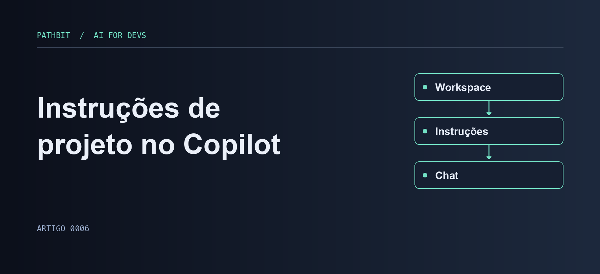

# Teach GitHub Copilot the conventions of your project

[Português (Brasil)](ARTICLE.md) · [English](ARTICLE.en.md) · [Español](ARTICLE.es.md)

An online store keeps money in integer cents. When asked for a free-shipping test, Copilot needs the unit, the pricing module, and the test runner. Store these decisions in the repository so the team can review them with the code.

## How it works

Put repository-wide rules in `.github/copilot-instructions.md`. The example points to `src/pricing.py`, uses integer cents, and documents the existing `unittest` command. Put test-specific rules in `.github/instructions/python-tests.instructions.md`, with `applyTo: 'tests/**/*.py'`. The chat prompt describes the current task. It can refer to a threshold without repeating durable conventions.

## Run the exercise

Open `examples` as the workspace root and attach `tests/test_pricing.py` to a fresh Copilot chat. Ask for the tests at and immediately below the free-shipping threshold. The patch should keep `src/pricing.py` intact. Run `python3 -m unittest discover -s tests -v` and check `10_000 → 0`, `9_999 → 750`, and the existing case at `5_000`.

## Check the result

Look for the instruction references or the customization diagnostics in your VS Code version. If the scoped file is missing, confirm the workspace and file context, then attach it manually to isolate a discovery problem. Keep the instructions short enough to review. The executed test provides evidence that the proposed change meets the contract.

[Quick start](../README.en.md) · [Official documentation](https://code.visualstudio.com/docs/agent-customization/custom-instructions)

Developed with ❤️ by [Pathbit](https://pathbit.co/)
