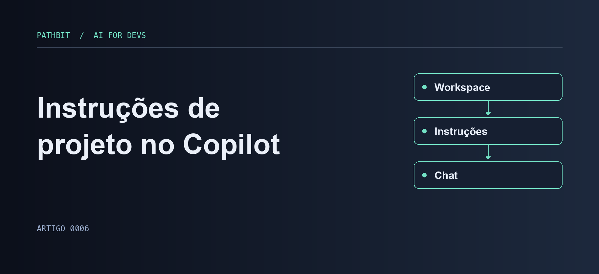

# Cómo enseñar a GitHub Copilot las convenciones de tu proyecto

[Português (Brasil)](ARTICLE.md) · [English](ARTICLE.en.md) · [Español](ARTICLE.es.md)

Una tienda guarda los importes en centavos enteros. Al pedir una prueba de envío gratuito, Copilot necesita conocer la unidad, el módulo de precios y el comando de pruebas. Guarda estas decisiones en el repositorio para que el equipo pueda revisarlas junto al código.

## Cómo funciona

Pon las reglas generales en `.github/copilot-instructions.md`. El ejemplo señala `src/pricing.py`, usa centavos enteros y documenta el comando de `unittest`. Guarda las reglas específicas en `.github/instructions/python-tests.instructions.md` con `applyTo: 'tests/**/*.py'`. El mensaje del chat describe la tarea actual y puede centrarse en el umbral.

## Ejecuta el ejercicio

Abre `examples` como raíz del espacio de trabajo y adjunta `tests/test_pricing.py` a un chat nuevo de Copilot. Pide pruebas para el umbral de envío gratuito y el valor inmediatamente anterior. El cambio debe conservar `src/pricing.py`. Ejecuta `python3 -m unittest discover -s tests -v` y comprueba `10_000 → 0`, `9_999 → 750` y el caso existente de `5_000`.

## Comprueba el resultado

Busca las referencias de instrucciones o los diagnósticos de personalización de tu versión de VS Code. Si falta el archivo específico, comprueba la raíz y los archivos en contexto y luego adjúntalo manualmente. Mantén instrucciones fáciles de revisar y usa las pruebas para comprobar la propuesta.

[Inicio rápido](../README.es.md) · [Documentación oficial](https://code.visualstudio.com/docs/agent-customization/custom-instructions)

Developed with ❤️ by [Pathbit](https://pathbit.co/)
