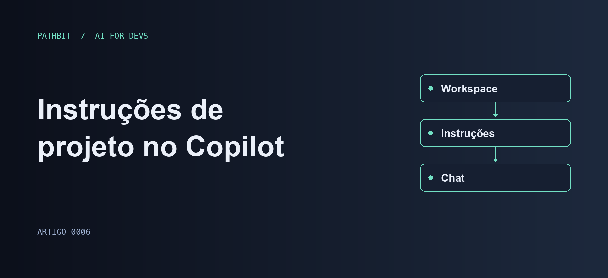

# Como ensinar as convenções do seu projeto ao GitHub Copilot



Uma loja registra cada preço em centavos inteiros. Quando alguém pede ao Copilot um teste para o frete grátis, o assistente precisa descobrir a unidade, onde vive a regra e qual biblioteca de testes a equipe usa. Repetir essas três informações em cada prompt funciona em uma sessão. Colocá-las no repositório permite que o time revise a orientação junto com o código.

## Três lugares para três tipos de informação

| Informação | Onde guardar | Exemplo do laboratório |
| --- | --- | --- |
| Convenção válida para todo o projeto | `.github/copilot-instructions.md` | Dinheiro em centavos e testes com `unittest` |
| Regra condicionada aos arquivos em contexto | `.github/instructions/python-tests.instructions.md` | Testar o ponto de corte e o valor logo abaixo |
| Entrega desta conversa | Prompt do chat | Adicionar casos para o frete grátis |

Abra a pasta `examples` como raiz do workspace. No exemplo, o arquivo de instruções geral indica `src/pricing.py` como fonte da regra e fornece o comando de teste que já existe. Registre no arquivo o que o agente teria dificuldade para inferir ou costuma errar. Quando a estrutura do projeto mudar, ajuste os caminhos no mesmo PR.

## Oriente apenas os testes Python

O arquivo de regras para testes começa com este front matter. [Arquivo completo](../examples/.github/instructions/python-tests.instructions.md).

```yaml
---
applyTo: 'tests/**/*.py'
---
```

O padrão é relativo ao workspace e se aplica a Python dentro de `tests/`. No chat local do VS Code, uma instrução com `applyTo` pode entrar no contexto quando um arquivo correspondente está em uso. Abra ou anexe `tests/test_pricing.py` ao prompt para tornar a comparação observável. A documentação do VS Code descreve também a inclusão manual de uma instrução e o diagnóstico de personalizações. [Instruções personalizadas no VS Code](https://code.visualstudio.com/docs/agent-customization/custom-instructions).

## Show-Me-The-Code

1. Siga o [guia rápido](../README.md) e confirme que o teste inicial passa.
2. Abra uma conversa no chat do Copilot com `tests/test_pricing.py` em contexto. Use o [prompt do laboratório](../examples/README.md) e revise a proposta antes de aplicar.
3. Execute `python3 -m unittest discover -s tests -v`. O caso no limiar, `10_000`, deve retornar `0`. O valor imediatamente abaixo, `9_999`, deve retornar `750`. O caso de `5_000` continua válido.

Compare com uma conversa nova em que você peça apenas «adicione testes para o frete grátis». Observe se a proposta explicita unidade, limiar e arquivo alterado. A comparação serve para depurar instruções, pois duas respostas do mesmo modelo podem variar. O teste é o critério de aceite.

## Quando a instrução parece ignorada

Confirme que o VS Code abriu `examples` como raiz, que o chat está no workspace do exemplo e que o arquivo de teste está em contexto. Inspecione as referências da resposta ou o diagnóstico de personalização da versão do VS Code em uso. Se a regra ainda não aparecer, anexe o arquivo de instruções manualmente para distinguir um problema de descoberta de uma orientação ambígua.

O [artigo sobre SDD](../../0005_sdd_do_vibe_coding_a_engenharia_deterministica/article/ARTICLE.md) coloca os critérios de aceite na especificação. A instrução do Copilot complementa esse trabalho com convenções reutilizáveis. Para mudanças com mais de um consumidor, veja como o [Plan Mode do Claude Code](../../0007_claude_code_plan_mode/article/ARTICLE.md) ajuda a decidir o que entra no patch.

---

Developed with ❤️ by [Pathbit](https://pathbit.co/)
