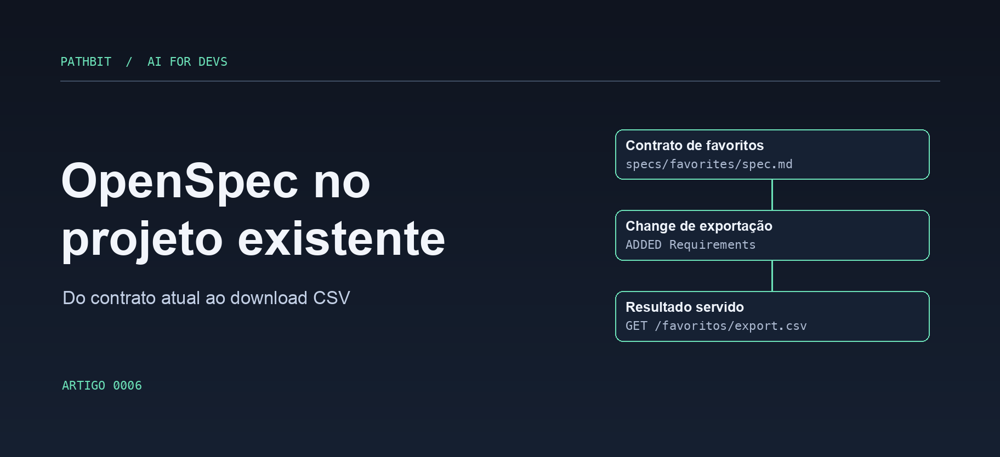

# Evolve the news aggregator with OpenSpec and Claude Code

[Português (Brasil)](ARTICLE.md) · [English](ARTICLE.en.md) · [Español](ARTICLE.es.md)

The aggregator from article 0005 already returns a JSON reading list. A reader asks for an export. The useful change here is a spreadsheet download that preserves the existing route, database and caller behavior. OpenSpec gives the current contract and the proposal separate places to live.

## Start with the existing behavior

Read the favorites router and the shared listing service. `GET /favoritos` returns favorited articles in a JSON list with the existing order and a limit of 100. The change adds `GET /favoritos/export.csv`, a UTF-8 attachment named `favoritos.csv` with `titulo,link,fonte`. An empty list produces only the header. The dashboard is outside this change.

## Give each OpenSpec artifact one job

The main specification under `openspec/specs/favorites/spec.md` describes the JSON list. The change under `openspec/changes/export-favorites-csv/` carries a proposal, design, task list, and `ADDED Requirements` delta. Write scenarios for a list with content, an empty list, and a field with quotes or formula-like text.

## Install the integration in the lab project

Use OpenSpec 2.2.0 with `init --tools claude --scope project`. Copy the sample change to repeat the lab or start a new change with `/openspec-propose`. Compare the result against the real route before implementing. The exercise uses `/openspec-apply-change export-favorites-csv` to implement through Claude Code. The reference files provide a second path.

## Make the representations safe to consume

Reuse the same filter for JSON and CSV. Quote record values, double inner quotes, and prefix common formula-like text with an apostrophe before writing CSV. The lab's raw JSON keeps the original title. Spreadsheet import behavior varies, so verify the importer used by your readers.

## Run and archive the change

Structural validation proves the delta format. Start the Express app, seed the disposable SQLite database, then run `verify_export.py` to check the attachment, quoted fields, filtering, header-only output, and existing JSON route. Run the original suite. Mark completed tasks and archive the change. The new requirement moves into the current favorites spec.

[Quick start](../README.en.md) · [Practical example](../examples/README.en.md) · [Official documentation](https://github.com/Fission-AI/OpenSpec/blob/main/docs/cli.md)

Developed with ❤️ by [Pathbit](https://pathbit.co/)
