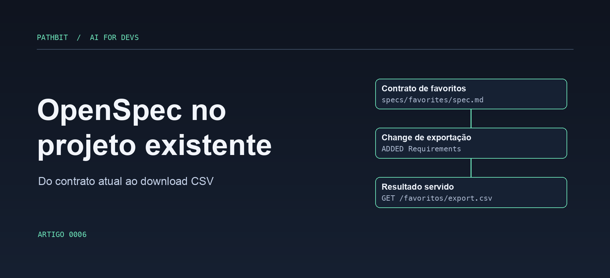

# Evoluciona el agregador con OpenSpec y Claude Code

[Português (Brasil)](ARTICLE.md) · [English](ARTICLE.en.md) · [Español](ARTICLE.es.md)

El agregador del artículo 0005 ya devuelve una lista de lectura en JSON. Una persona pide exportarla. El cambio útil aquí es una descarga para hojas de cálculo que conserva la ruta actual, la base y el comportamiento de sus consumidores. OpenSpec separa el contrato vigente de la propuesta.

## Parte del comportamiento existente

Revisa la ruta de favoritos y el servicio compartido. `GET /favoritos` devuelve los artículos favoritos en JSON, en el orden actual y con un máximo de 100. El cambio añade `GET /favoritos/export.csv`, un adjunto UTF-8 llamado `favoritos.csv` con `titulo,link,fonte`. Una lista vacía conserva solo el encabezado. El dashboard queda fuera del alcance.

## Da una función a cada artefacto de OpenSpec

La especificación de `openspec/specs/favorites/spec.md` describe la lista JSON. El cambio en `openspec/changes/export-favorites-csv/` contiene propuesta, diseño, tareas y un delta `ADDED Requirements`. Escribe escenarios para una lista con datos, una lista vacía y un campo que contiene comillas o parece una fórmula.

## Instala la integración dentro del laboratorio

Usa OpenSpec 2.2.0 con `init --tools claude --scope project`. Copia el cambio del ejemplo o crea otro con `/openspec-propose`. Contrasta el resultado con la ruta real antes de implementar. `/openspec-apply-change export-favorites-csv` inicia la implementación con Claude Code. Los archivos de referencia permiten repetir el ejercicio local.

## Cuida las dos representaciones de salida

Las dos rutas comparten el filtro. Delimita los valores de CSV, duplica las comillas internas y antepone un apóstrofo a textos que podrían interpretarse como fórmulas. La salida JSON conserva el título original. Comprueba cómo importa archivos la hoja de cálculo que usarán los lectores.

## Ejecuta y archiva el cambio

La validación estructural comprueba el delta. Arranca Express, carga la base SQLite descartable y ejecuta `verify_export.py`. Comprueba el adjunto, las comillas, el filtro, la respuesta sin filas y el JSON. Ejecuta la suite original, marca las tareas y archiva el cambio para incorporar el requisito a la especificación vigente.

[Inicio rápido](../README.es.md) · [Ejemplo práctico](../examples/README.es.md) · [Documentación oficial](https://github.com/Fission-AI/OpenSpec/blob/main/docs/cli.md)

Developed with ❤️ by [Pathbit](https://pathbit.co/)
