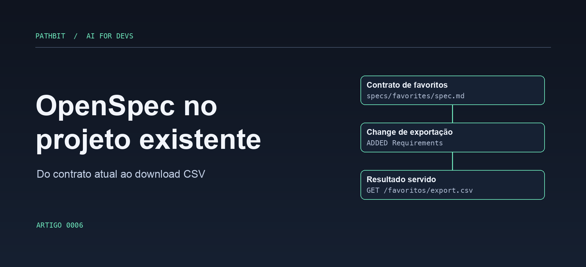
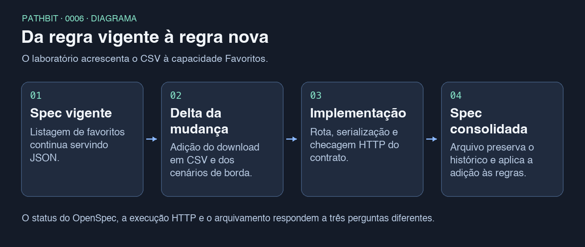
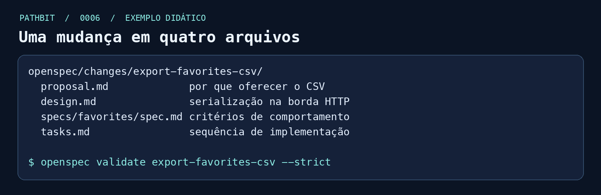
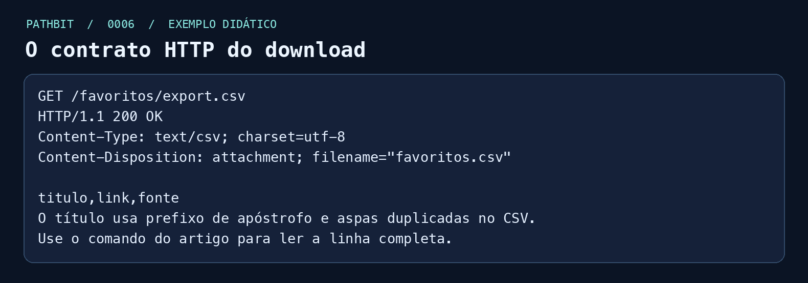
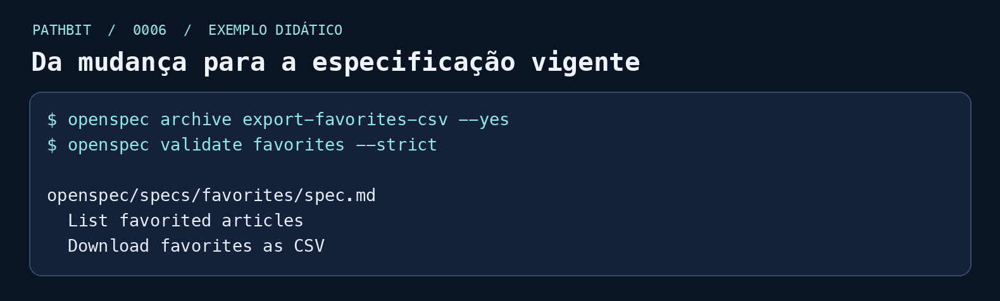
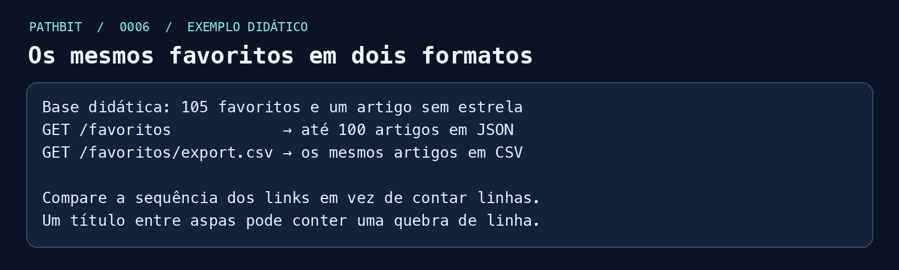

# OpenSpec e Claude Code no projeto existente: do contrato dos favoritos à exportação CSV



O [artigo 0005](../../0005_sdd_do_vibe_coding_a_engenharia_deterministica/article/ARTICLE.md) termina com um Agregador de Notícias em funcionamento. Seis ciclos de especificação deixaram para trás rotas, decisões de arquitetura e critérios verificáveis. É nesse momento que começa um problema diferente do primeiro dia de um projeto: como acrescentar uma funcionalidade sem fazer o agente redescobrir o produto a cada conversa?

Imagine que alguém peça **«quero exportar os meus favoritos»**. A frase parece pequena. Ela deixa em aberto, porém, o formato, a ordem, o tamanho máximo, o comportamento da lista vazia e a diferença entre exportar e sincronizar. Se a equipe aprova a frase e passa direto ao código, duas implementações opostas podem receber a mesma avaliação de “pronto”: uma acrescenta uma rota de download, a outra substitui a resposta JSON que uma extensão já utiliza.

Neste artigo vamos tratar a alteração como o sétimo incremento daquele estudo de caso. O pedido vira uma proposta revisável, a proposta vira um delta de especificação, e o delta ganha uma prova contra o Express e o SQLite da aplicação. No final, a regra exercitada entra na especificação vigente. O fluxo de autoria usa **OpenSpec e Claude Code**. A repetição do experimento tem um caminho com implementação de referência e sem depender de uma resposta de modelo.

---

## O ponto de partida é o código que já atende leitores

Há três comportamentos que parecem iguais quando alguém usa a palavra «favoritos». A aplicação distingue cada um deles.

| Comportamento no Agregador | Interface existente | Papel no incremento |
| --- | --- | --- |
| Marcar ou remover um artigo | `POST /artigos/:id/favoritar` e `DELETE /artigos/:id/favoritar` | Continuam sendo as operações que alteram a marcação |
| Consultar o conjunto de favoritos | `GET /favoritos` | Continua produzindo a representação JSON |
| Exportar esse conjunto para abrir em uma planilha | `GET /favoritos/export.csv` | É a única interface acrescentada |

Abra a [rota de favoritos do artigo 0005](../../0005_sdd_do_vibe_coding_a_engenharia_deterministica/src/routes/favoritos.js). Ela chama `listarArtigos({ apenasFavoritos: true, limit: 100 })` e entrega o resultado em JSON. Leia também a [consulta do serviço](../../0005_sdd_do_vibe_coding_a_engenharia_deterministica/src/services/feedService.js). É ali que a seleção e a ordenação acontecem. Uma segunda consulta escrita só para exportação introduziria outro lugar capaz de decidir o que significa «minha lista». Reutilizar a consulta coloca uma única decisão de produto atrás das duas representações.

O arquivo da proposta responde à pergunta que o código ainda não pode responder: **qual experiência o produto quer acrescentar?** Neste capítulo a resposta é uma fotografia da lista limitada que o leitor já consegue obter. Se o produto mudar o pedido para «exportar todo o meu histórico», o limite deixará de ser um detalhe. A revisão terá de cobrir tamanho máximo, forma de leitura, consumo de memória e comportamento diante de mudanças na lista durante o download. Antecipar uma fila de exportação para o pedido atual aumentaria o custo de revisão sem resolver uma exigência existente.

### Faça o pedido atravessar uma tabela de decisões

| Pergunta que aparece na revisão | Escolha para este incremento | Evidência no laboratório |
| --- | --- | --- |
| O arquivo é uma nova representação da coleção? | Sim. O JSON continua acessível na rota atual | Consulta da rota original antes e depois de chamar o CSV |
| Que colunas o leitor vai importar? | `titulo,link,fonte`, nessa ordem | A primeira linha e os valores obtidos por um leitor CSV |
| Quais linhas entram? | Os mesmos favoritos, na ordem da consulta existente e dentro do teto de 100 | Artigo marcado incluído. Artigo sem marcação ausente |
| O que significa uma lista vazia? | Download com cabeçalho e nenhuma linha de dados | Marcação retirada pelo verificador, consulta repetida e marcação restaurada |
| Como baixar o arquivo? | `200`, `text/csv` em UTF-8 e cabeçalho de anexo com `favoritos.csv` | Cabeçalhos recebidos pelo cliente HTTP |
| O que acontece se o título contém vírgula, aspas ou início de fórmula? | Campo delimitado, aspas internas duplicadas e apóstrofo nos valores que coincidem com a proteção adotada | Comparação do título original em JSON com o título decodificado no CSV |

A tabela já permite revisar uma proposta sem abrir o editor de código. A decisão do título vem da origem dos dados. O Agregador lê conteúdo produzido fora do aplicativo. Um título como `=Arquitetura, "em prática"` pertence à lista como qualquer outro. Cercar o campo com aspas protege a estrutura CSV. Uma planilha ainda pode interpretar o valor interno como fórmula. Por isso o serializador aplica duas transformações em sequência: trata a representação de texto para os casos previstos no contrato e, depois, escapa a sintaxe CSV. O título persistido e o JSON conservam o valor original.

Há importadores que fazem conversões adicionais ao ler CSV. O apóstrofo é uma decisão explícita deste laboratório e precisa ser testado com o importador que a equipe suporta. O verificador usa um leitor CSV e confirma o valor recebido. Ele não abre uma planilha nem presume o comportamento de todos os editores.

---

## A arquitetura do OpenSpec em um projeto que já existe



> **Figura 1.** A especificação vigente descreve a aplicação que já existe. A mudança acrescenta uma regra, o teste confirma o contrato HTTP e o arquivamento registra a nova descrição vigente.

Considere a alternativa mais comum: abrir `specs/favorites/spec.md`, escrever lá o requisito novo e começar a implementar. Quando outra pessoa consulta a mesma pasta, já encontra a exportação como se existisse. Se a proposta for abandonada, sobra uma descrição que o software jamais cumpriu. Se duas equipes estiverem alterando a mesma capacidade, a revisão começa pelo conflito no arquivo que deveria representar o que já foi entregue.

O OpenSpec dá endereço próprio ao estado temporário. A spec vigente fica sob `openspec/specs`. O pacote de trabalho fica sob `openspec/changes` com um nome que permite localizá-lo no Git. Nesse pacote, o arquivo de especificação registra somente a diferença que interessa para a mudança. Depois do aceite, o arquivamento aplica o delta à regra vigente e guarda os artefatos da alteração no histórico do projeto.

```text
openspec/
├── specs/
│   └── favorites/
│       └── spec.md
└── changes/
    └── export-favorites-csv/
        ├── proposal.md
        ├── design.md
        ├── tasks.md
        └── specs/
            └── favorites/
                └── spec.md
```

Existem dois arquivos chamados `spec.md` com responsabilidades diferentes. O primeiro diz que `GET /favoritos` obtém a lista como JSON. O segundo usa `ADDED Requirements` e acrescenta o download à mesma capacidade `favorites`. Abra a [spec vigente do exercício](../examples/openspec/specs/favorites/spec.md) e o [delta](../examples/openspec/changes/export-favorites-csv/specs/favorites/spec.md) lado a lado. Ler só o delta deixa de fora o limite e a ordem da lista de referência. Ler só a base não mostra precisamente o que será entregue agora.

### Escolha a forma do delta pelo efeito sobre o consumidor

- **Requisito acrescentado.** Um novo download que convive com o JSON recebe uma exigência adicional na mesma capacidade.
- **Requisito modificado.** Mudar o que `GET /favoritos` devolve altera o contrato que um consumidor usa hoje. Uma intervenção desse tipo precisa citar a regra vigente, descrever o novo comportamento e discutir compatibilidade.
- **Requisito removido.** Eliminar a última interface que um cliente utiliza exige plano de transição, identificação dos consumidores e evidência de que a retirada pode ocorrer.

Foi importante escolher **acrescentar** aqui. Se o agente renomear `GET /favoritos` para `GET /favoritos.json`, o problema já mudou de categoria. Uma revisão orientada pelo delta detecta isso antes de discutir estilo de JavaScript.

### O que revisamos em cada arquivo

| Artefato | Pergunta de revisão | Onde o Agregador de Notícias expõe o detalhe |
| --- | --- | --- |
| [Proposta](../examples/openspec/changes/export-favorites-csv/proposal.md) | A equipe concorda com o benefício e com o escopo? | Exportar a leitura atual para planilha |
| [Design](../examples/openspec/changes/export-favorites-csv/design.md) | O desenho aproveita a arquitetura existente? | Consulta compartilhada, serialização na borda HTTP e nenhum esquema novo |
| [Delta](../examples/openspec/changes/export-favorites-csv/specs/favorites/spec.md) | Um leitor conseguiria dizer se passou ou falhou? | Anexo, seleção de linhas, cabeçalho e tratamento dos campos |
| [Tarefas](../examples/openspec/changes/export-favorites-csv/tasks.md) | A implementação e a prova cabem em etapas que podem ser revisadas? | Contrato de saída, mudança na rota e verificações HTTP |

A proposta tem espaço para razões de produto. O design tem espaço para alternativas. A spec tem espaço para comportamento verificável. Uma tarefa marcada informa que a revisão avançou, mas o resultado que sustenta a marcação fica na execução. Manter esses endereços separados evita que uma decisão importante fique enterrada na mensagem de uma conversa.

---

## Monte a alteração em uma cópia da aplicação

O [README do módulo](../README.md) mantém a sequência inteira pronta para repetir. Use Node.js 22.20 ou superior dentro da linha 22, Python 3.10+ e Git. A aplicação carrega SQLite nativo, então escolha a versão do Node antes de instalar as dependências naquela cópia. O Claude Code pede uma sessão autenticada se você escolher o fluxo com agente. O verificador HTTP e a solução de referência funcionam sem essa sessão.

### Passo 1 — Tome nota do estado inicial

A partir da raiz deste repositório:

```bash
repo="$PWD"
lab=$(mktemp -d)
python3 tools/prepare_aggregator_lab.py "$lab/app"
cd "$lab/app"
npm ci
npm test
```

O preparador copia fontes, manifests e testes do Agregador para um diretório descartável. A base usada no exercício nasce fora do checkout de leitura. Isso separa três coisas que podem ficar confundidas durante uma demonstração: a história original da série, a árvore onde será feita a alteração e os dados que o servidor grava.

### Passo 2 — Instale a integração no projeto

O laboratório usa **OpenSpec 2.2.0**. A opção de escopo instala a configuração para a cópia atual.

```bash
export OPENSPEC_TELEMETRY=0
npx -y @fission-ai/openspec@2.2.0 init --tools claude --scope project .
cp -R "$repo/0006_openspec_claude_code/examples/openspec/." openspec/
npx -y @fission-ai/openspec@2.2.0 validate export-favorites-csv --strict
npx -y @fission-ai/openspec@2.2.0 status --change export-favorites-csv
```



> **Figura 2.** O terminal confirma a estrutura da mudança. Neste ponto o servidor ainda não realizou o download.

O comando `status` acompanha a preparação dos artefatos. Abra a pasta em paralelo e confira o que `validate` acabou de ler. Uma validação estrutural pode passar com a rota ausente, com o serializador incorreto ou com o servidor desligado. Cada ferramenta dá uma prova específica. Na ordem do exercício, a primeira pergunta é se a mudança foi descrita no formato que o OpenSpec entende. A segunda é se o aplicativo a entrega.

### Passo 3 — Peça uma proposta a partir da base

Se quiser escrever em vez de copiar a mudança pronta, repita o preparo em **outra cópia**, instale a integração e mantenha o arquivo de spec vigente. Na raiz dessa cópia, abra o Claude Code e use o comando proposta apresentado na instalação.

```text
/openspec-propose export-favorites-csv

Use a rota de favoritos e a consulta de artigos como ponto de partida.
Acrescente um download HTTP UTF-8 com título, link e fonte.
Preserve o contrato JSON, o limite e a ordem da lista existente.
Inclua os casos de lista vazia, vírgulas, aspas e campos que parecem
fórmulas de planilha. Deixe o dashboard fora desta alteração.
```

Compare o resultado com os arquivos versionados do exercício. Se o plano adicionar botão, agendamento ou tabela, pergunte qual requisito exige a mudança. Se descrever a regra como «será compatível» sem nomear o `GET /favoritos`, peça que declare qual consumidor mantém sua interface. O ponto da comparação é descobrir quais decisões o agente tentou completar em silêncio.

Ao terminar a revisão, `/openspec-apply-change export-favorites-csv` inicia a implementação pelo fluxo integrado. Os nomes das invocações podem variar de acordo com como a ferramenta e o perfil foram instalados. Use a saída da versão fixada e confira o estado antes de trocar uma invocação por outra. [Documentação da CLI](https://github.com/Fission-AI/OpenSpec/blob/main/docs/cli.md) · [Fluxo OPSX](https://github.com/Fission-AI/OpenSpec/blob/main/docs/opsx.md).

---

## O patch reserva a transformação para a borda HTTP

Na solução de referência, a rota obtém os objetos pelo mesmo serviço. Os cabeçalhos da resposta só pertencem à representação CSV. O módulo de serviço que busca os artigos continua entregando objetos, e outro consumidor pode continuar usando esses objetos para qualquer formato.

O [serializador](../examples/reference/favoritesCsv.js) começa fixando as colunas em uma lista. Cada objeto é projetado nessa ordem, evitando que uma mudança na ordem de inserção de propriedades JavaScript altere um contrato externo. A regra para aspas também é localizada: cada célula recebe aspas externas e as aspas internas são dobradas. O texto final usa CRLF entre registros e mantém o cabeçalho mesmo quando não há favoritos.

Ao revisar a [rota de referência](../examples/reference/favoritos.js), acompanhe o caminho do dado sem pular para a saída:

1. `listarArtigos` seleciona os favoritos e aplica o limite atual.
2. A rota de download escolhe os cabeçalhos de mídia e anexo.
3. `serializeFavorites` transforma os objetos na representação CSV.
4. A rota JSON original faz sua própria resposta a partir da mesma consulta.

Em uma revisão manual, olhe os dois lados da alteração. O CSV pode estar certo e o JSON ter sido modificado por um helper que aplica apóstrofos ao objeto original. A decisão de neutralizar a fórmula pertence ao valor exportado. O teste de compatibilidade compara o título da rota JSON para pegar essa classe de erro.

### Coloque a solução de referência para rodar

Se escolheu implementar com o agente, preserve o seu patch e comece pelas variáveis de ambiente do próximo bloco. Para repetir exatamente o código de referência, use também as duas cópias abaixo.

```bash
cp "$repo/0006_openspec_claude_code/examples/reference/favoritesCsv.js" src/services/
cp "$repo/0006_openspec_claude_code/examples/reference/favoritos.js" src/routes/
export HOST=127.0.0.1 PORT=19806 DATABASE_PATH="$PWD/data/lab.sqlite"
node "$repo/tools/seed_aggregator_lab.mjs"
npm start
```

A semente tem artigos suficientes para distinguir uma exportação correta de uma exportação que pega tudo. Há um favorito com pontuação e início de fórmula, artigos sem marcação e um caminho documentado para retirar e recolocar a marcação. Como a base é descartável, o verificador pode mudar esse estado para observar o caso vazio. Use somente a base do exercício para esse passo.

---

## Show-Me-The-Code no HTTP e no Git

Em um segundo terminal, na raiz deste repositório:

```bash
curl -fsS -i http://127.0.0.1:19806/favoritos/export.csv
python3 0006_openspec_claude_code/examples/verify_export.py
```



> **Figura 3.** O cliente recebe cabeçalho de anexo e conteúdo CSV. O verificador lê a resposta, compara o JSON e testa a lista vazia usando a base temporária.

Uma conferência de cabeçalhos sozinha é insuficiente. Um servidor pode devolver `200` com o nome certo e repetir todos os artigos em vez de aplicar o filtro. O [verificador](../examples/verify_export.py) usa o leitor CSV da biblioteca padrão de Python. Ele compara as células depois de decodificar aspas, em vez de assumir que cada vírgula separa uma coluna. Também compara o título recebido em JSON para distinguir alteração de representação de alteração do dado persistido.

Depois execute `npm test` na cópia. Essa suíte protege os comportamentos originais e é uma evidência complementar ao verificador do incremento. Marque em `tasks.md` só as etapas conferidas e revise o resultado no Git antes de arquivar.

```bash
npx -y @fission-ai/openspec@2.2.0 archive export-favorites-csv
npx -y @fission-ai/openspec@2.2.0 validate favorites --strict
```



> **Figura 4.** Depois de arquivar, a spec de favoritos inclui tanto a lista JSON quanto o download. A alteração arquivada conserva a motivação e os passos que levaram a esse estado.

Abra `openspec/specs/favorites/spec.md` e confira os dois requisitos. Se entrou uma descrição que não bate com o resultado no terminal, ainda há uma divergência para corrigir. O arquivo arquivado não substitui a revisão do contrato; ele faz com que a próxima mudança comece da descrição que a equipe acabou de verificar.

---

## O aceite precisa preservar o que já funcionava

Quando a mudança implementa uma representação nova, divida a verificação em três comparações. Primeiro, compare o CSV com a lista original de favoritos. Depois, isole a regra de representação com um título que um serializador ingênuo quebraria. Por último, verifique o comportamento antigo em separado. Assim fica mais fácil descobrir quando a implementação mudou corretamente o arquivo, mas alterou indevidamente a resposta JSON.

| Comparação | Ponto de inspeção | O que um falso positivo deixaria passar |
| --- | --- | --- |
| Lista e CSV | Conjunto de favoritos e cabeçalho | Um CSV válido que inclui artigos sem marcação |
| Valor original e célula exportada | Parser CSV e conteúdo em memória | Aspas duplicadas incorretamente ou perda de texto |
| CSV cheio e CSV vazio | Estrutura das colunas e número de registros | Rota que usa `204` e deixa a planilha sem cabeçalho |
| JSON original e valor na planilha | Consulta `/favoritos` | Apóstrofo de proteção permanecido no texto exibido |
| Spec vigente e patch | Diff depois do arquivamento | Descrição documentada sem relação com o comportamento aceito |

O verificador da série exercita uma cópia descartável. Primeiro lê o CSV e o JSON e compara os campos. Depois desmarca o favorito, chama novamente o download e restaura a marcação. O `finally` cuida da restauração mesmo se a verificação do CSV vazio detectar um problema. Numa base em que outras pessoas escrevem, o mesmo ensaio precisaria de dados próprios e de outro isolamento. Aqui a cópia e o seed tornam explícito quem pode modificar o estado.

A condição de limite aparece na spec e na chamada compartilhada ao serviço. A primeira execução HTTP tem só um favorito e deixa a amostra fácil de ler. Para exercitar o limite, preparamos outra cópia com 105 favoritos e um artigo mais recente sem marcação. Tanto o JSON quanto o CSV devolveram 100 registros e a mesma ordenação por link. O primeiro era o favorito mais recente e o último tinha ID de amostra 6. O artigo sem marcação ficou de fora e uma quebra de linha no primeiro título permaneceu dentro da célula CSV.



> **Figura 5.** O exercício de volume compara a sequência inteira dos links. Um programa que verificasse só o número de registros deixaria passar uma ordem diferente ou linhas extraídas da coleção errada.

O [roteiro de verificação do limite](../examples/README.md#repita-a-verificação-de-limite-e-ordem) traz a semeadura e a comparação. Para conferir a igualdade de dois conjuntos, escolha uma chave estável. Um título pode se repetir e um campo pode ter tratamento próprio em uma representação. Usar o link compara a identidade dos itens. Ler o título separadamente confirma o tratamento da quebra de linha.

### O que deve virar uma mudança posterior

Uma planilha pode solicitar outros campos ou uma ordem diferente. O botão de exportação ainda pode entrar no painel, num incremento com seus próprios estados de sucesso e erro. O limite da coleção pode evoluir para exportação completa em outro contrato. Separar essas solicitações mantém o artefato atual com uma única razão para mudar. Também deixa possível revisar cada alteração com o mecanismo que melhor observa seu comportamento: HTTP para o anexo, navegador para a interação, cenário de volume para a exportação maior.

## Quando o resultado diverge, descubra qual camada falhou

| Sintoma | Primeira pergunta | Como isolar |
| --- | --- | --- |
| A invocação do agente não aparece | A sessão abriu no laboratório inicializado? | Compare o diretório atual com aquele em que foi executado `init --scope project` |
| `validate` rejeita a change | O delta nomeia o requisito e tem os cenários esperados? | Abra a pasta da alteração e compare com o [exemplo](../examples/openspec/changes/export-favorites-csv/specs/favorites/spec.md) |
| O CSV responde `404` e o JSON funciona | A cópia que está servindo tem a rota nova? | Confira processo, porta e arquivo `src/routes/favoritos.js` |
| O CSV não contém linhas e o caso deveria ter um favorito | O servidor e a semente usam o mesmo arquivo SQLite? | Confira `DATABASE_PATH` e consulte `GET /favoritos` |
| O título chega quebrado em duas colunas | O campo foi lido como CSV ou dividido por vírgulas? | Use o verificador e confira o escape de aspas |
| O registro foi exportado, mas abriu incorretamente na planilha | Como o importador detecta UTF-8 e separador? | Importe explicitamente como UTF-8 e compare a representação de texto |
| O Node falha ao carregar SQLite | A dependência foi instalada para a mesma versão do Node? | Confira `node --version` e execute `npm ci` na cópia usando a versão escolhida |

Uma equipe pode parar depois de reproduzir o laboratório ou usar a mesma arquitetura numa mudança real. O que merece ser transportado para outro projeto é a distinção entre regra vigente, alteração revisável e prova executada. No [artigo 0007](../../0007_skills_claude_code/article/ARTICLE.md), vamos tratar outro custo que apareceu aqui: repetir, conversa após conversa, como o agente descobre a interface e o que precisa citar antes de sugerir um patch.

## Referências técnicas

- [OpenSpec e os comandos de operação](https://github.com/Fission-AI/OpenSpec/blob/main/docs/cli.md).
- [Express e os métodos de resposta](https://expressjs.com/en/4x/api.html#res.attachment).
- [RFC 4180 e o formato CSV](https://www.rfc-editor.org/rfc/rfc4180).

[Figuras e roteiro do exercício](../assets/figuras.md)

Developed with ❤️ by [Pathbit](https://www.pathbit.com.br/)
