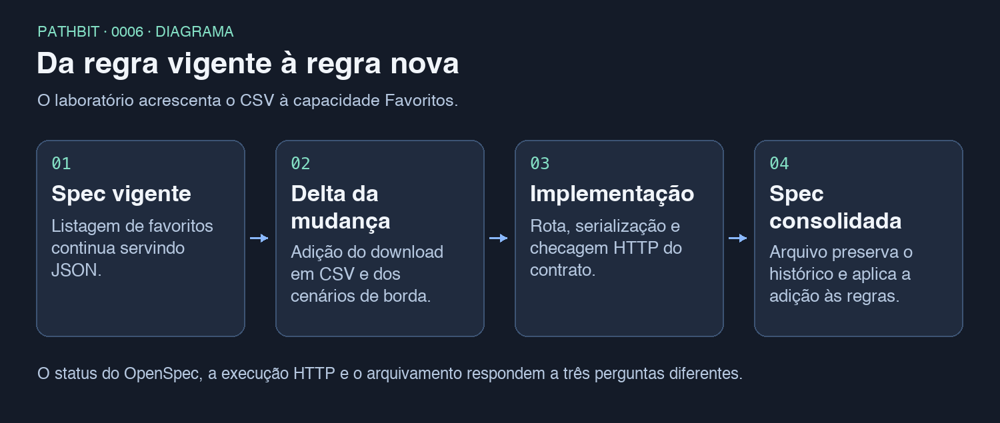
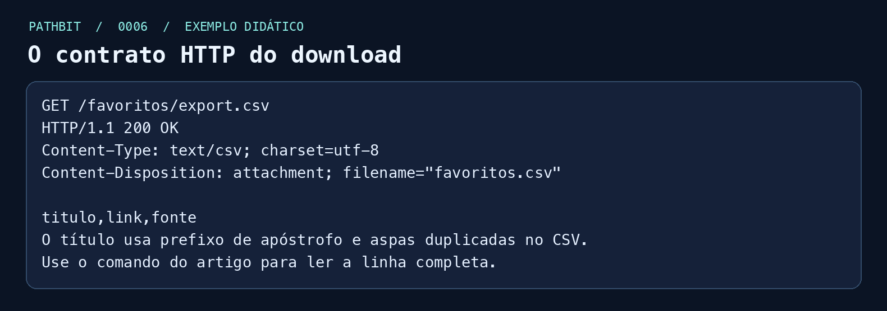

# Pediram um CSV. Qual contrato você preservaria antes de abrir o Claude Code?

A primeira versão do Agregador já lista favoritos. O painel pede JSON para montar seus cartões e usa as ações existentes para marcar e desmarcar artigos. Quando surgiu a ideia de baixar essa lista para uma planilha, o pedido tinha três palavras que qualquer desenvolvedor entenderia: “exportar favoritos em CSV”.

O problema era o que não cabia nessas palavras. A lista de origem exigia os mesmos filtros? O download teria as mesmas colunas que a tabela do banco? Uma lista vazia geraria um arquivo, uma mensagem ou um erro? Se um título contivesse vírgula e aspas, a planilha conseguiria abrir o arquivo? Em qual lugar ficaria documentado que o painel ainda precisa de JSON?

Usei esse caso para trabalhar com OpenSpec e Claude Code. Quem vem do [artigo sobre SDD](../../0005_sdd_do_vibe_coding_a_engenharia_deterministica/article/ARTICLE.md) já conhece a ideia de tornar decisões revisáveis. Aqui o laboratório mostra onde cada decisão fica quando o projeto tem uma implementação em uso e uma evolução pequena a entregar.

## A regra vigente e a proposta têm endereços diferentes

A regra atual de Favoritos fica em `openspec/specs/favorites/spec.md`. A proposta da mudança, o desenho técnico, as tarefas e o delta moram em `openspec/changes/export-favorites-csv/`. Os cenários do delta registram o que o produto ganha: um anexo CSV com colunas fixas, mesmas regras de seleção e uma definição explícita para a lista vazia. A listagem JSON continua existindo.

Com isso, duas pessoas podem discutir a regra sem precisar abrir o código. No CSV vazio, preferimos entregar o cabeçalho. Quem faz download recebe o mesmo formato, seja o resultado vazio ou populado. A hipótese também vira um teste pequeno. Se o produto pedir uma mensagem diferente na interface, conseguimos discutir a apresentação sem mudar o formato que o servidor entrega.

Cada documento responde a uma dúvida distinta.

| Pergunta em revisão | Onde encontrei a resposta |
| --- | --- |
| Por que abrir essa mudança? | Na proposta de exportação |
| Qual nova promessa o produto assume? | No delta com requisito e cenários |
| Onde fica a transformação de dados? | No desenho e no patch da rota de favoritos |
| Como repetir a aceitação? | Nas tarefas e no verificador HTTP |
| Como a regra vigente será atualizada? | No arquivamento e na nova spec de Favoritos |

É possível fazer uma alteração de uma linha sem esses arquivos todos. Vale usar a estrutura quando a pergunta reaparece em mais de uma revisão, muda um contrato público ou pode confundir o que já existe com o que está sendo acrescentado.

## O caso que valeu o laboratório

Escolhemos um título de exemplo com vírgula, aspas e um caractere que pode iniciar fórmula em planilha. Um CSV produzido com `join(',')` parece correto com o título “Arquitetura”. Já um título como `=Arquitetura, "em prática"` obriga o código a escapar as aspas, cercar o campo completo e tratar o prefixo antes de entregar o arquivo. Essa decisão fica na transformação para CSV. Colocar o prefixo no título persistido mudaria o conteúdo que o painel mostra no JSON.

O endpoint novo e o existente passam pela aplicação. No experimento, a verificação conferiu o tipo de conteúdo, o nome do anexo, a forma que o parser recupera dos campos, a seleção da lista e o arquivo só com cabeçalho. O JSON foi verificado em separado na mesma execução.

Dá para ver dois níveis de confirmação. `openspec validate export-favorites-csv --strict` conferiu a estrutura da alteração e o `status` encontrou os quatro artefatos. O verificador chamou a rota de verdade e confirmou o contrato em execução. Arquivos de planejamento completos ajudam a explicar um diff. Cabeçalho, aspas e filtros precisam passar pelo comportamento que a pessoa usuária recebe.

## Onde entrou o Claude Code

O projeto foi inicializado com OpenSpec 2.2.0 e as Skills foram criadas no checkout. O fluxo interativo começa com `/openspec-propose` e avança para `/openspec-apply-change` quando os critérios estão discutidos. Usei o patch de referência para obter uma reprodução independente de conta, escolha de modelo ou variação de uma resposta do agente.

Faria a revisão em dois momentos. Antes de aplicar, abriria a spec e perguntaria se um campo a mais transforma o CSV em contrato público. Depois de aplicar, leria a rota e rodaria os cenários pelo HTTP. Se o `validate` já passa e o CSV vazio vem sem cabeçalho, o próximo passo está na serialização ou no caminho que trata listas vazias. Se o HTTP passa e `validate` rejeita o delta, a ambiguidade está nos artefatos. A separação evita gastar uma rodada pedindo que o agente reescreva tudo.

Com a verificação concluída, o arquivamento atualizou a spec de Favoritos. O requisito de listagem permaneceu e o requisito de download foi incorporado. Quem pegar a próxima evolução do painel pode abrir aquele baseline e saber o que já precisa continuar funcionando.

## Onde a solução realmente toca a aplicação

A rota de exportação chama a mesma consulta usada pelo JSON. É ali que já estão a ordenação, o filtro de favoritos e o limite da lista. A transformação para planilha ocorre depois da consulta, no ponto em que a rota prepara a resposta. É uma escolha pequena de arquitetura e tem um efeito direto na manutenção. Uma mudança futura na ordenação da lista precisa ficar em um lugar só.

O código de referência separa a escolha das colunas da função que escreve uma célula. Fixar `titulo,link,fonte` esclarece o contrato. Escapar as aspas dentro de uma célula cuida da sintaxe. O tratamento para um valor interpretável como fórmula vem antes, nesse mesmo caminho de saída. Se o agente aplicar a transformação à consulta, qualquer rota que consuma os objetos pode começar a exibir o texto destinado à planilha.

Três observações encerram a revisão desse diff.

1. O `Content-Type` informa CSV em UTF-8 e o cabeçalho de anexo sugere o nome esperado.
2. O parser recupera as três colunas mesmo quando o título tem vírgula e aspas.
3. A saída JSON contém o valor original e a própria rota continua acessível.

O verificador executa essas comparações em sequência e reinstala a marcação que remove temporariamente para criar o caso vazio. Por isso ele é executado numa cópia semeada para o exercício. Para uma revisão de produção eu usaria registros destinados ao teste e observaria também o importador que a equipe pretende suportar. O parser confirma que a sintaxe do arquivo chegou inteira. O comportamento de uma planilha tem suas próprias regras de leitura.

### O que a decisão inclui na próxima revisão

Alguém pode sugerir que o download inclua todo o histórico. A chamada atual pega até 100 itens, exatamente como a representação JSON que o cenário reaproveita. Remover esse limite muda a promessa. Antes de aprovar, eu esperaria uma amostra que distingue 100, 101 e muito mais linhas e uma decisão sobre a ordem enquanto a lista é atualizada. Um botão no painel também é outra decisão. Ele adiciona estados da interface que merecem ser exercitados no navegador. A feature atual avança com o contrato curto que o código e as evidências conseguem sustentar.

## Uma forma de levar o exercício a outro projeto

Escolha uma operação cotidiana e delimite um formato, um caso vazio e um comportamento existente que precisa continuar. Uma boa primeira mudança permite testar esses três itens com dados descartáveis. No Agregador, essa pequena seleção transformou o pedido de planilha numa história que cabe numa revisão, com arquivos que outra pessoa pode abrir e comandos que ela pode executar.

O artigo completo traz a arquitetura, a preparação do SQLite, os caminhos com Claude Code ou patches e o roteiro de diagnóstico. [OpenSpec e Claude Code no Agregador](ARTICLE.md) · [Módulo 0006 no GitHub](https://github.com/pathbit/pathbit-ai-for-devs/tree/master/0006_openspec_claude_code)

Developed with ❤️ by [Pathbit](https://www.pathbit.com.br/)
