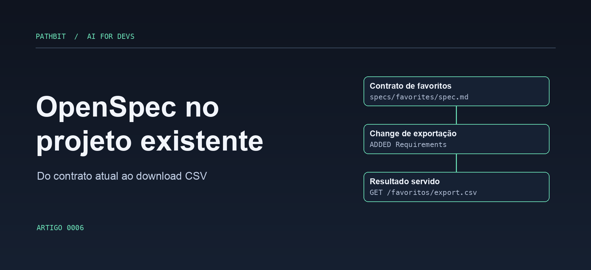

# Como evoluir o Agregador do artigo 0005 com OpenSpec e Claude Code




Você publica a primeira versão do Agregador. O usuário já consegue salvar artigos e ver a lista de favoritos. Na semana seguinte, alguém pede «exportar meus favoritos». Essa frase pode virar um CSV, um JSON, um PDF ou um botão que envia links por e-mail. O código em produção tem consumidores da lista atual e uma coleção SQLite que não precisa mudar para atender ao pedido.

No [artigo 0005](https://github.com/pathbit/pathbit-ai-for-devs/blob/master/0005_sdd_do_vibe_coding_a_engenharia_deterministica/article/ARTICLE.md), construímos o sistema a partir de seis especificações. Agora vamos continuar a partir desse código. O [OpenSpec](https://github.com/Fission-AI/OpenSpec) organiza a descrição vigente do produto e a mudança em andamento em diretórios diferentes. O Claude Code lê esses arquivos para ajudar a propor e implementar a mudança. O contrato HTTP e a resposta observada decidem quando ela terminou.

## Comece pela funcionalidade que já funciona

Abra `src/routes/favoritos.js` no [Agregador original](https://github.com/pathbit/pathbit-ai-for-devs/tree/master/0005_sdd_do_vibe_coding_a_engenharia_deterministica). O `GET /favoritos` chama `listarArtigos({ apenasFavoritos: true, limit: 100 })` e devolve JSON. A alteração vai acrescentar outra representação da mesma lista em `GET /favoritos/export.csv`. O filtro, a ordem e a fronteira de 100 itens continuam iguais aos da lista existente.

| Pergunta de produto | Decisão deste artigo | Como conferir |
| --- | --- | --- |
| O que entra no arquivo? | `titulo`, `link` e `fonte`, nessa ordem | Leia o cabeçalho e compare as linhas com o JSON |
| O que acontece com uma lista vazia? | O download contém apenas o cabeçalho | Remova o favorito no ambiente descartável e repita a chamada |
| O que acontece com aspas, vírgulas e títulos parecidos com fórmulas? | Aspas internas dobradas, campos delimitados e apóstrofo nos campos arriscados | Abra o arquivo com um leitor CSV e confira o título de demonstração |
| Quem já consome `/favoritos` precisa fazer algo? | O contrato JSON permanece disponível | Compare conteúdo e `Content-Type` da rota anterior |
| A interface ganha botão? | O escopo cobre só o endpoint | O diff da solução de referência se limita à rota e ao serializador |

O título de um artigo vem de uma fonte de conteúdo. Ele é dado, inclusive quando começa com `=`. Cercar o campo com aspas resolve a sintaxe CSV. A planilha ainda pode interpretar o valor interno como fórmula. A representação deste laboratório prefixa um apóstrofo antes de citar os campos cujo primeiro caractere relevante é `=`, `+`, `-` ou `@`. O JSON mantém o texto original. Antes de usar a exportação com planilhas da sua empresa, confira as opções de importação que elas aplicam aos campos.

## Onde cada artefato do OpenSpec mora

Em uma cópia do aplicativo, inicialize o OpenSpec direcionado ao Claude Code. O [exemplo versionado](https://github.com/pathbit/pathbit-ai-for-devs/blob/master/0006_openspec_claude_code/examples/README.md) já fornece uma especificação mínima da funcionalidade existente e uma change para o CSV.

```text
openspec/
├── specs/
│   └── favorites/
│       └── spec.md
└── changes/
    └── export-favorites-csv/
        ├── proposal.md
        ├── design.md
        ├── tasks.md
        └── specs/favorites/spec.md
```

A especificação em `specs/favorites` é o ponto de partida aceito. Ela afirma o que o JSON devolve. A change tem um delta em `changes/.../specs/favorites` com `ADDED Requirements`, porque o download se soma à capacidade existente. Se a mudança alterasse o formato de `GET /favoritos`, seria uma modificação do requisito vigente e exigiria discutir compatibilidade com quem já o usa.

| Arquivo na change | Pergunta que ele responde | Exemplo |
| --- | --- | --- |
| `proposal.md` | Por que mexer no sistema? | Levar uma lista de leitura a uma planilha |
| `design.md` | Como fazer com o código que existe? | Reusar o serviço de favoritos e serializar na saída |
| `specs/favorites/spec.md` | Que comportamento o leitor poderá observar? | O download vazio tem cabeçalho e zero registros |
| `tasks.md` | Como dividir implementação e verificação? | Serializador, rota adicional e cenários HTTP |

Esse formato resolve um problema comum de manutenção. Uma tarefa pode ser concluída mesmo que o arquivo Markdown ainda contenha uma hipótese velha. Durante a implementação, volte à change para atualizar a decisão com a revisão da equipe. Quando ela for aceita, o arquivo vigente passa a representar o comportamento novo. Quem investigar favoritos no futuro consegue separar a regra atual do contexto histórico daquela mudança.

## Crie a proposta e confronte o que o agente supôs

Há dois pontos de entrada. Você pode copiar a change pronta, revisar o delta e reproduzir os resultados. Em uma segunda cópia, instale a integração e abra o Claude Code para escrever a própria proposta com `/openspec-propose`. Use um pedido que amarre o modelo ao código existente.

```text
/openspec-propose export-favorites-csv

Leia src/routes/favoritos.js e o serviço de artigos. Proponha um download UTF-8
em GET /favoritos/export.csv com título, link e fonte. Preserve a lista JSON,
o limite atual e a ordem. Inclua lista vazia e campos que contenham aspas
ou pareçam fórmulas de planilha. Deixe o dashboard fora desta mudança.
```

Confronte a proposta com a situação inicial. Se ela adicionar autenticação, migração ou interface, peça que explique qual requisito exigiu a alteração. Se ela descrever «a API continua compatível» sem especificar qual rota preserva, faça o agente registrar o caso verificável. Se houver uma decisão ainda aberta, trate-a no design antes que o modelo produza um patch.

Em OpenSpec 2.2.0, prepare os arquivos de projeto com `init --tools claude --scope project`. A CLI `validate --strict` verifica os artefatos no formato da ferramenta. A validação estrutural pode passar com o servidor parado ou com o CSV incorreto. Use-a antes de aplicar a change e volte à API depois. Os comandos de agente dependem da integração instalada. [Fluxo OPSX](https://github.com/Fission-AI/OpenSpec/blob/main/docs/opsx.md) · [Referência da CLI](https://github.com/Fission-AI/OpenSpec/blob/main/docs/cli.md).

## Conecte o delta ao código do Agregador

Faça a lista JSON e a exportação chamarem a mesma função de consulta. O exemplo mantém o limite de 100 e usa `res.attachment('favoritos.csv')` para sinalizar o download. O tipo de mídia sai como `text/csv` com UTF-8. O serializador recebe os objetos do serviço e devolve um texto com quebra CRLF e cabeçalho fixo. [Rota de referência](https://github.com/pathbit/pathbit-ai-for-devs/blob/master/0006_openspec_claude_code/examples/reference/favoritos.js) · [Serializador de referência](https://github.com/pathbit/pathbit-ai-for-devs/blob/master/0006_openspec_claude_code/examples/reference/favoritesCsv.js).

Depois de revisar os artefatos, `/openspec-apply-change export-favorites-csv` orienta a implementação no Claude Code. Os dois arquivos de referência permitem reproduzir o contrato sem conta de modelo. Use um dos caminhos na cópia do laboratório. Em ambos, observe o diff antes de executar os cenários e marque as tarefas à medida que elas forem verificadas.

## Show-Me-The-Code

1. Prepare a cópia do Agregador com [o guia rápido](https://github.com/pathbit/pathbit-ai-for-devs/blob/master/0006_openspec_claude_code/README.md) e execute `npm test` no estado inicial.
2. Inicialize OpenSpec, instale os artefatos da change e confirme `validate export-favorites-csv --strict`.
3. Implemente pela integração do Claude Code ou use os dois arquivos de referência. Carregue os artigos de demonstração na base SQLite local.
4. Faça `curl -i http://127.0.0.1:19806/favoritos/export.csv`. Compare a resposta com a lista JSON e execute o [verificador HTTP](https://github.com/pathbit/pathbit-ai-for-devs/blob/master/0006_openspec_claude_code/examples/verify_export.py). O verificador percorre lista preenchida e lista vazia e restaura o favorito de demonstração ao terminar.
5. Rode novamente `npm test`. Depois da revisão, use `openspec archive export-favorites-csv` pela CLI da versão do laboratório. Observe a especificação vigente e o diretório arquivado.

Uma resposta válida da base de demonstração tem esta forma. O apóstrofo no título é parte da escolha de exportação para planilha.

```csv
titulo,link,fonte
"'=Arquitetura, ""em prática""","https://example.org/architecture","Pathbit Lab"
```

## Diagnóstico quando os resultados divergem

| Sintoma | O que observar primeiro |
| --- | --- |
| `/openspec-propose` não aparece | Abra Claude Code na cópia inicializada e confira os arquivos que `openspec init --tools claude --scope project` gerou |
| O delta falha na validação | Leia o requisito nomeado e confirme que o cenário tem `WHEN` e `THEN` |
| O servidor responde `404` ao exportar | Confira qual processo está ouvindo a porta e se ele usa a rota nova |
| O CSV vem vazio durante o exercício | Compare a variável `DATABASE_PATH` usada para semear com a do servidor |
| O Node reclama da ABI de SQLite | Confira a versão de `node` e faça `npm ci` para essa versão na cópia |

Na próxima etapa, vamos transformar o roteiro de descoberta de rota e definição de aceite em uma [Skill do Claude Code](https://github.com/pathbit/pathbit-ai-for-devs/blob/master/0007_skills_claude_code/article/ARTICLE.md).

[Repositório e arquivos do laboratório](https://github.com/pathbit/pathbit-ai-for-devs/tree/master/0006_openspec_claude_code)

Developed with ❤️ by [Pathbit](https://pathbit.co/)
