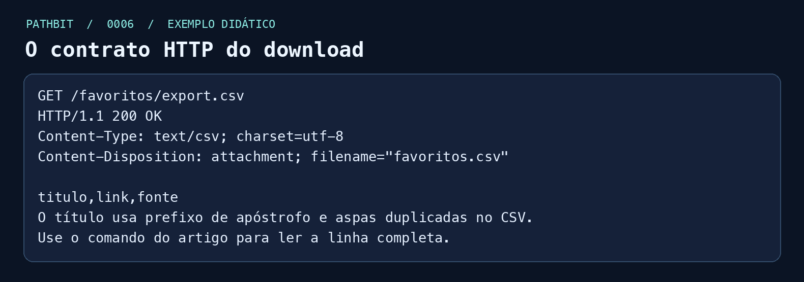

# Pediram “exportar favoritos”. Três palavras que renderam seis decisões.

O Agregador da série já lista favoritos em JSON. A novidade era baixar a lista como CSV. Antes de abrir o Claude Code, fiquei com algumas perguntas bem concretas.

- Se o painel usa JSON, o download entra em qual rota?
- O que a pessoa recebe quando a lista está vazia?
- Como ficam vírgula e aspas num título de artigo?
- Quem revisa a mudança no futuro consegue ver que a listagem original continua sendo um contrato?

No laboratório do módulo 0006, usei OpenSpec para registrar uma spec vigente e o delta da exportação. Depois fiz a prova pelo HTTP com uma base SQLite descartável. Consegui abrir a resposta como CSV, confirmar os campos, conferir o anexo e verificar que a resposta JSON continuava disponível. Fiz também a prova da lista vazia: o arquivo ainda traz o cabeçalho.

A parte que mais ajuda na revisão é saber qual evidência procurar. O OpenSpec encontra os quatro arquivos de planejamento. O verificador HTTP encontra o contrato da aplicação. O arquivamento consolida o requisito novo e conserva o anterior para a próxima pessoa que chegar ao projeto.

Deixei o roteiro com Claude Code e a alternativa reproduzível por patches. [Artigo completo no GitHub](https://github.com/pathbit/pathbit-ai-for-devs/tree/master/0006_openspec_claude_code)

#OpenSpec #ClaudeCode #SDD #DesenvolvimentoDeSoftware
