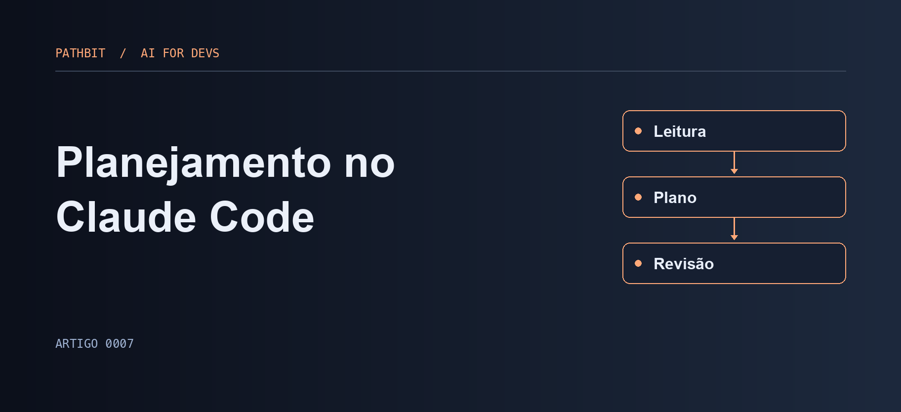

# Plan a compatible change with Claude Code Plan Mode

[Português (Brasil)](ARTICLE.md) · [English](ARTICLE.en.md) · [Español](ARTICLE.es.md)

A daily export produces `orders-2026-06-07.csv`. The hourly export adds `-02`. An implementation that introduces weekly names by rewriting the daily formatter can break consumers that still expect the original paths.

## How it works

Start the interactive client with `claude --permission-mode plan`. Ask Claude to inspect `src/reports.py` and the tests, name the paths that need edits, and identify what must survive the patch. Review the plan in the client and select the permissions for the implementation stage.

## Run the exercise

In `examples`, run `python3 -m unittest discover -s tests -v` before planning. Ask for `weekly_filename(day)` with an ISO week year. Use `date(2021, 1, 1)` as the acceptance case. The expected file name is `orders-2020-W53.csv`, because that date belongs to the last ISO week of 2020.

## Check the result

Check that the plan calls `date.isocalendar()` for both the year and the week. After reviewing and implementing it, inspect `git diff -- src tests` and rerun the test suite. The new assertion should cover the year boundary alongside the unchanged daily and hourly cases.

[Quick start](../README.en.md) · [Official documentation](https://code.claude.com/docs/en/permission-modes#analyze-before-you-edit-with-plan-mode)

Developed with ❤️ by [Pathbit](https://pathbit.co/)
