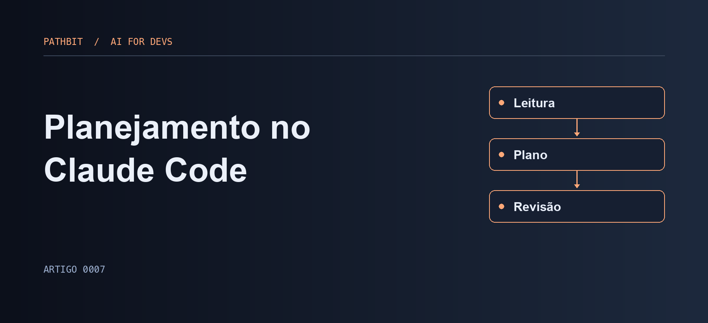

# Planifica un cambio compatible con Plan Mode de Claude Code

[Português (Brasil)](ARTICLE.md) · [English](ARTICLE.en.md) · [Español](ARTICLE.es.md)

Una exportación diaria genera `orders-2026-06-07.csv`. La exportación horaria añade `-02`. Incorporar nombres semanales reescribiendo el formato diario puede romper consumidores que esperan las rutas anteriores.

## Cómo funciona

Inicia el cliente interactivo con `claude --permission-mode plan`. Pide a Claude que inspeccione `src/reports.py` y las pruebas, enumere los archivos que cambiarían y explique qué debe conservar el parche. Revisa el plan y elige los permisos para la implementación.

## Ejecuta el ejercicio

Desde `examples`, ejecuta `python3 -m unittest discover -s tests -v` antes de planificar. Pide `weekly_filename(day)` con año y semana ISO. El caso de aceptación es `date(2021, 1, 1)`. Debe producir `orders-2020-W53.csv`, porque esa fecha pertenece a la última semana ISO de 2020.

## Comprueba el resultado

Comprueba que el plan obtiene tanto el año como la semana con `date.isocalendar()`. Tras revisar e implementar, inspecciona `git diff -- src tests` y vuelve a ejecutar las pruebas. El caso nuevo de cambio de año debe coexistir con los formatos diario y horario.

[Inicio rápido](../README.es.md) · [Documentación oficial](https://code.claude.com/docs/en/permission-modes#analyze-before-you-edit-with-plan-mode)

Developed with ❤️ by [Pathbit](https://pathbit.co/)
