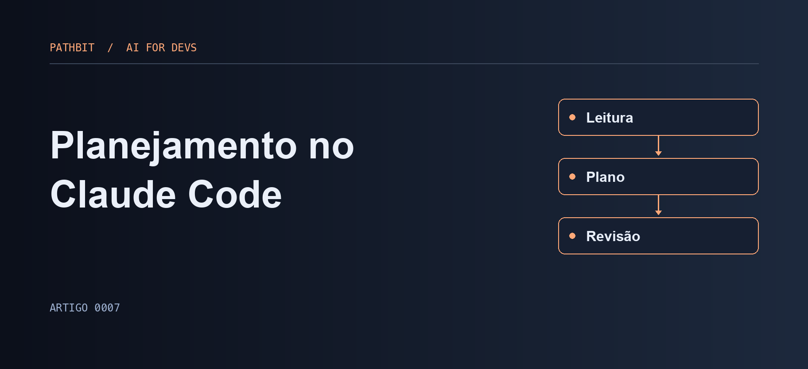

# Como usar o Plan Mode do Claude Code antes de alterar uma API



Uma rotina diária grava `orders-2026-06-07.csv`. Outra guarda uma exportação por hora e cria `orders-2026-06-07-02.csv`. Se a equipe introduzir um nome semanal, alterações precipitadas na função diária podem quebrar consumidores que ainda dependem do formato original. O Plan Mode dá espaço para investigar esses contratos antes de solicitar a edição.

## Comece com um resultado verificável

A tarefa do exemplo é adicionar `weekly_filename(day)` com ano e semana ISO. O argumento `date(2021, 1, 1)` precisa devolver `orders-2020-W53.csv`. Aquele dia pertence à última semana ISO de 2020, embora esteja no ano civil de 2021. Esse caso expõe implementações que juntam `day.year` com uma semana calculada à parte.

| Função | Entrada de referência | Saída esperada |
| --- | --- | --- |
| `daily_filename` | 7 de junho de 2026 | `orders-2026-06-07.csv` |
| `hourly_filename` | Mesmo dia, hora 2 | `orders-2026-06-07-02.csv` |
| `weekly_filename` | 1.º de janeiro de 2021 | `orders-2020-W53.csv` |

## Investigue em Plan Mode

Entre na pasta `examples` e execute `claude --permission-mode plan` em uma sessão interativa. O modo permite explorar o projeto e preparar um plano antes de editar os arquivos do workspace. O cliente apresenta o plano para revisão e oferece as opções de permissão da etapa seguinte. Leia os comandos que a ferramenta propõe e selecione as permissões adequadas ao seu projeto. [Modos de permissão do Claude Code](https://code.claude.com/docs/en/permission-modes#analyze-before-you-edit-with-plan-mode).

Peça ao agente que cite as funções que já existem, proponha os arquivos afetados e descreva os testes. Um plano para o exemplo precisa manter os dois formatos existentes, usar o ano retornado por `date.isocalendar()` e cobrir a fronteira de ano. Devolva o plano para ajuste se ele tentar renomear os arquivos antigos.

## Show-Me-The-Code

O [guia rápido](../README.md) executa a suíte antes de abrir o Claude. O [roteiro da sessão](../examples/README.md) tem o pedido completo e exemplos de critérios para revisar o plano. Registre a situação inicial para identificar o que mudou.

```bash
git status --short
python3 -m unittest discover -s tests -v
claude --permission-mode plan
```

Depois de revisar o plano, escolha implementar com revisão de edições quando a interface oferecer a opção. Confira `git diff -- src tests`. A alteração deve acrescentar a função semanal e um teste que cubra a virada de ano. Rode a suíte novamente para validar os nomes diário e horário junto com o novo formato.

## Trate o plano como uma hipótese

A leitura pode revelar consumidores que o pedido original desconhecia. Registre os caminhos que sustentam as decisões e peça nova leitura quando o plano citar um arquivo que não existe. O teste de fronteira responde se a implementação funciona. O plano serve para escolher o que será implementado e o que o patch precisa preservar.

Quando a mudança for pequena e você quiser trabalhar com um modelo local e arquivos selecionados, continue com [Aider e Ollama](../../0008_aider_ollama_local/article/ARTICLE.md).

---

Developed with ❤️ by [Pathbit](https://pathbit.co/)
