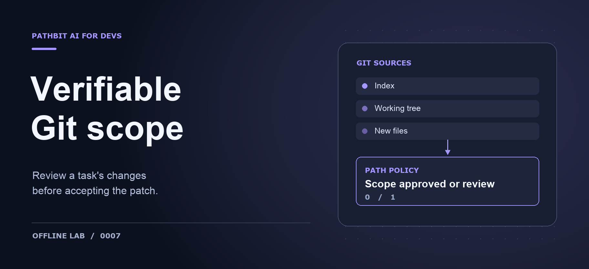

# Git review with verifiable scope

[Português (Brasil)](ARTICLE.md) · **English** · [Español](ARTICLE.es.md)

The [acceptance gate in article 0006](../../0006_gate_de_release_de_contratos/article/ARTICLE.md) measures the behavior the application delivers. Before running it on an agent-produced patch, I want to answer a different question. Do the changed files match what we agreed on? A small search fix can pass its tests and still include edits to a release workflow or generated code.

## Requirements

- [Python 3.10 or later](https://www.python.org/downloads/). The lab recommends [Python 3.14.7](https://www.python.org/downloads/release/python-3147/), with installers for each system.
- [Git 2.28 or later](https://git-scm.com/downloads) available in your terminal. Check with `git --version`.
- Optional virtual environment. See the [setup instructions](../README.en.md#requirements).

## Turn scope into a reviewable rule

In the task for the agent, describe both the desired result and the task boundary. For a checkout fix, start with `src/`, `tests/` and `README.md`. The `src/generated/` exception remains protected, even inside an allowed directory. The person who approves the scope keeps the policy outside the editable checkout. The [example file](../examples/scope.json.example) shows the two fields the checker uses.

A trailing slash denotes a directory prefix. Therefore `src/` covers `src/cart.py`, while `src-other/cart.py` calls for review. A path without a trailing slash, such as `README.md`, needs an exact match. Rules use the spelling and case Git reports. The `protect` list takes precedence over `allow`.

## Read three Git sources

| Source | What can appear |
| --- | --- |
| `git diff --cached --name-status -z` | Changes staged in the index since the current commit. |
| `git diff --name-status -z` | Working-tree changes since the index. |
| `git ls-files --others --exclude-standard -z` | New files Git shows under its ignore rules. |

Reading the index and working tree separately keeps a file visible if it was staged and then edited again. NUL delimiters keep names with accents, spaces or line breaks intact. For a rename, the checker evaluates both the source and destination. Moving `settings.yml` to `src/settings.yml` therefore still flags the source outside the agreed scope. [git diff options](https://git-scm.com/docs/git-diff) · [git ls-files options](https://git-scm.com/docs/git-ls-files).

## Use the report to decide

Exit 0 means the observed paths passed the policy. Exit 1 means at least one violation and the JSON identifies its path, source and reason. Exit 2 means the check could not run, for example because of malformed JSON or missing Git. Have the automation block on 1 and 2 and use the reason to route the review.

Run the checker in a dedicated checkout. Ignored files stay out of the untracked list and submodules appear as parent repository entries. To review existing commits or submodule content, also inspect the corresponding commit range and repository. Scope checks complement diff review, tests and the acceptance gate.

## Show-Me-The-Code

### Option 1. Run in the task checkout

The [module guide](../README.en.md) shows the command and tests. Review the policy and run the CLI against the root of the checkout that contains the work.

### Option 2. Run the isolated scenario

The [lab](../examples/README.en.md) builds a temporary tree and shows the difference between an approved change and a change to a protected file.

## Continue with the next step

After reviewing the paths, stabilize the data you use to prove behavior. Continue with [reproducible fixtures](../../0008_fixtures_reproduziveis/article/ARTICLE.en.md).
