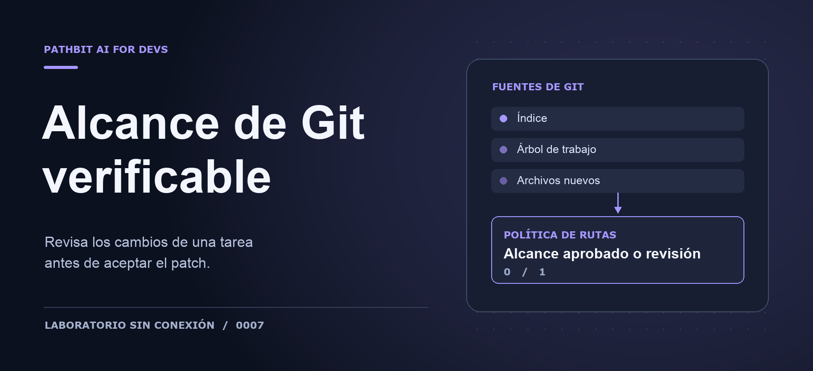

# Revisión de Git con alcance verificable

[Português (Brasil)](ARTICLE.md) · [English](ARTICLE.en.md) · **Español**

El [control de aceptación del artículo 0006](../../0006_gate_de_release_de_contratos/article/ARTICLE.md) mide el comportamiento que entrega la aplicación. Antes de ejecutarlo sobre un cambio de un agente, quiero responder otra pregunta. ¿Los archivos modificados corresponden al acuerdo? Una pequeña corrección de búsqueda puede superar las pruebas e incluir cambios en un workflow de publicación o en código generado.

## Requisitos

- [Python 3.10 o posterior](https://www.python.org/downloads/). El laboratorio recomienda [Python 3.14.7](https://www.python.org/downloads/release/python-3147/), con instaladores para cada sistema.
- [Git 2.28 o posterior](https://git-scm.com/downloads) disponible en la terminal. Comprueba la versión con `git --version`.
- Entorno virtual opcional. Consulta [cómo prepararlo](../README.es.md#requisitos).

## Convierte el alcance en una regla revisable

En la tarea del agente, describe el resultado y los límites del trabajo. Para una corrección de checkout, empieza por `src/`, `tests/` y `README.md`. La excepción `src/generated/` permanece protegida, incluso dentro de una carpeta permitida. La persona que aprueba el alcance guarda la política fuera del checkout editable. El [archivo de ejemplo](../examples/scope.json.example) muestra los dos campos que usa el verificador.

Una barra final indica un prefijo de carpeta. Por eso `src/` abarca `src/cart.py`, mientras que `src-other/cart.py` requiere revisión. Una ruta sin barra final, como `README.md`, exige coincidencia exacta. Las reglas respetan la grafía y las mayúsculas de la ruta que muestra Git. La lista `protect` tiene prioridad sobre `allow`.

## Consulta las tres fuentes de Git

| Fuente | Qué puede aparecer |
| --- | --- |
| `git diff --cached --name-status -z` | Cambios preparados en el índice desde el commit actual. |
| `git diff --name-status -z` | Cambios del árbol de trabajo desde el índice. |
| `git ls-files --others --exclude-standard -z` | Archivos nuevos que Git muestra según sus reglas de ignore. |

Consultar por separado el índice y el árbol de trabajo mantiene visible un archivo preparado y luego editado de nuevo. El separador NUL conserva nombres con acentos, espacios o saltos de línea. En un cambio de nombre, el verificador evalúa origen y destino. Mover `settings.yml` a `src/settings.yml` sigue marcando el origen fuera del alcance. [Opciones de git diff](https://git-scm.com/docs/git-diff) · [Opciones de git ls-files](https://git-scm.com/docs/git-ls-files).

## Decide con base en el informe

El código 0 indica que las rutas observadas cumplen la política. El código 1 señala al menos una infracción y el JSON identifica ruta, fuente y motivo. El código 2 significa que la verificación no pudo ejecutarse, por ejemplo por un JSON mal formado o porque falta Git. Bloquea los códigos 1 y 2 en la automatización y usa el motivo para dirigir la revisión.

Ejecuta el verificador en un checkout dedicado. Los archivos ignorados quedan fuera de la lista de nuevos y los submódulos aparecen como entradas del repositorio padre. Para revisar commits ya creados o el contenido de submódulos, inspecciona también el intervalo y el repositorio correspondientes. El control de alcance complementa la revisión del diff, las pruebas y el control de aceptación.

## Show-Me-The-Code

### Opción 1. Ejecuta en el checkout de la tarea

La [guía del módulo](../README.es.md) muestra el comando y las pruebas. Revisa la política y ejecuta la CLI en la raíz del checkout que contiene el trabajo.

### Opción 2. Ejecuta el escenario aislado

El [laboratorio](../examples/README.es.md) crea un árbol temporal y muestra la diferencia entre un cambio aprobado y uno en un archivo protegido.

## Sigue al próximo paso

Después de revisar las rutas, estabiliza los datos que usas para probar el comportamiento. Continúa con [fixtures reproducibles](../../0008_fixtures_reproduziveis/article/ARTICLE.es.md).
