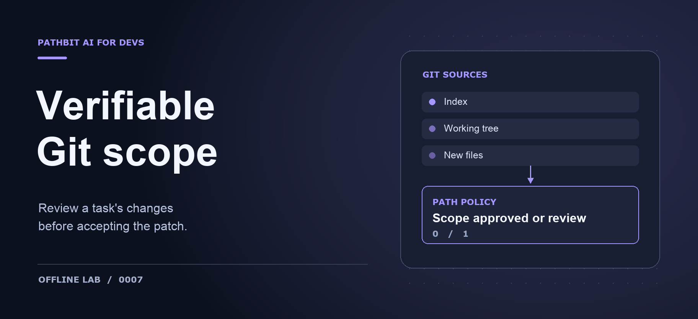

# How to check the scope of an agent-made patch

[Português (Brasil)](ARTICLE_LINKEDIN.md) · **English** · [Español](ARTICLE_LINKEDIN.es.md)

The agent fixed search and the tests passed. Did the patch also touch a file the task asked it to preserve?

## Requirements

Python and, for article 0007, Git. See [requirements and downloads](../README.en.md#requirements).

A path policy makes the question measurable. The lab allows edits in `src/`, `tests/` and `README.md`, with explicit exceptions for generated code and workflows. The checker reads the index, local changes and new files. It evaluates both paths of a rename, the source and the destination.

## What the lab shows

The allowed case creates `src/app.py`. The lab then adds a fictional file under `.github/workflows/` and observes a `protected` violation. It prints both decisions as JSON and leaves the article checkout intact.

Keep the approved policy outside the task's editable scope. Use the result to guide diff review and run behavioral tests before promoting the patch.

## Show-Me-The-Code

### Option 1. Follow the setup guide

[Setup guide](../README.en.md)

### Option 2. Reproduce in the isolated scenario

[Practical example](../examples/README.en.md)

[Full article](ARTICLE.en.md)
