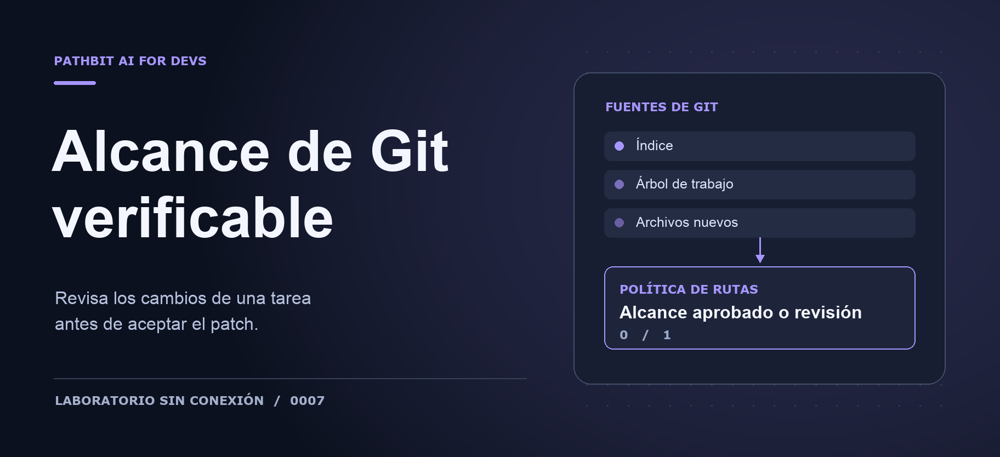

# Cómo comprobar el alcance de un cambio de un agente

[Português (Brasil)](ARTICLE_LINKEDIN.md) · [English](ARTICLE_LINKEDIN.en.md) · **Español**

El agente corrigió la búsqueda y las pruebas pasaron. ¿El cambio también tocó un archivo que la tarea pedía conservar?

## Requisitos

Python y, para el artículo 0007, Git. Consulta [requisitos y descargas](../README.es.md#requisitos).

Una política de rutas convierte la pregunta en algo verificable. El laboratorio permite cambios en `src/`, `tests/` y `README.md`, con excepciones explícitas para código generado y workflows. El verificador consulta el índice, los cambios locales y los archivos nuevos. Evalúa el origen y el destino de un cambio de nombre.

## Qué muestra el laboratorio

El caso permitido crea `src/app.py`. Después, el laboratorio añade un archivo ficticio bajo `.github/workflows/` y observa una infracción `protected`. Presenta las dos decisiones en JSON y conserva el checkout del artículo.

Guarda la política aprobada fuera del alcance de edición de la tarea. Usa el resultado para orientar la revisión del diff y ejecuta las pruebas de comportamiento antes de promover el cambio.

## Show-Me-The-Code

### Opción 1. Sigue la guía de ejecución

[Guía de ejecución](../README.es.md)

### Opción 2. Reproduce el caso aislado

[Ejemplo práctico](../examples/README.es.md)

[Artículo completo](ARTICLE.es.md)
