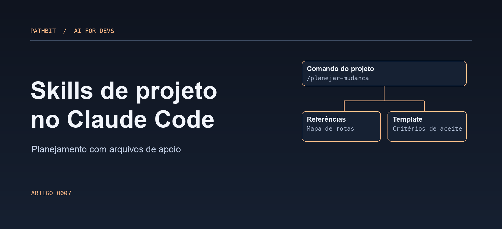

# Crea Skills de proyecto en Claude Code para una aplicación existente

[Português (Brasil)](ARTICLE.md) · [English](ARTICLE.en.md) · [Español](ARTICLE.es.md)

El equipo repite que el agente debe localizar la ruta, leer el dashboard, comprobar qué existe y proponer criterios de aceptación. Una Skill de proyecto reúne ese procedimiento, las referencias y un modelo de propuesta. El ejemplo usa el agregador del artículo 0005.

## Separa los tipos de contexto

Guarda convenciones permanentes en `CLAUDE.md`, el procedimiento en `.claude/skills/planejar-mudanca/SKILL.md` y las decisiones de cada funcionalidad en su especificación. El mapa de la aplicación lleva al agente a las rutas y pruebas reales.

## Organiza la Skill y sus archivos de apoyo

El front matter contiene nombre, descripción y pista de argumentos. `disable-model-invocation: true` reserva la invocación a la persona. `$ARGUMENTS` entrega el pedido al procedimiento. El paquete incluye `references/aggregator-map.md` y `templates/proposal.md`. Para el ejercicio, inicia Claude Code en Plan Mode y revisa los permisos que aparezcan.

## Prueba el contador del dashboard

Ejecuta `/planejar-mudanca` y pide mostrar cuántos artículos aparecen al filtrar por categoría. La propuesta debe ubicar `GET /artigos`, el parámetro de categoría y el código de renderizado. El JSON es un array. El número devuelto por la página es un requisito distinto del total almacenado o del total filtrado.

## Pregunta por algo que ya existe

Pide una confirmación después de añadir o quitar un favorito. El dashboard ya muestra los dos mensajes. Una propuesta útil cita las ramas existentes y pregunta qué diferencia se espera. Compara la evidencia con el código antes de aceptar archivos o cambios propuestos.

## Cierra la planificación antes de editar

Ejecuta `git status --short` antes y después. Conserva la propuesta revisada y pasa los escenarios aprobados a OpenSpec o a la especificación que use el proyecto. La Skill mantiene el procedimiento común y cada funcionalidad conserva su decisión de alcance.

[Inicio rápido](../README.es.md) · [Ejemplo práctico](../examples/README.es.md) · [Documentación oficial](https://code.claude.com/docs/en/skills)

Developed with ❤️ by [Pathbit](https://pathbit.co/)
