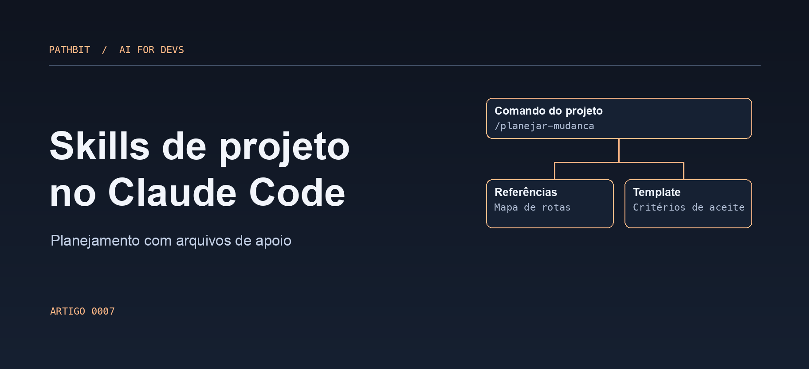

# Como criar Skills de projeto no Claude Code para evoluir o Agregador



[Português (Brasil)](ARTICLE.md) · [English](ARTICLE.en.md) · [Español](ARTICLE.es.md)


Depois de implementar algumas changes, o time percebe que repete o mesmo começo de conversa: descubra a rota usada pelo dashboard, leia o serviço, verifique se o comportamento já existe e proponha cenários de aceite antes de editar. Uma pessoa se lembra de pedir essas etapas. Outra começa direto pela tela. O resultado depende do que o prompt trouxe para aquela sessão.

No [artigo 0005](../../0005_sdd_do_vibe_coding_a_engenharia_deterministica/article/ARTICLE.md), o `CLAUDE.md` define contexto permanente e os comandos `/spec` e `/implementar-spec` orientam a atividade. O [artigo 0006](../../0006_openspec_claude_code/article/ARTICLE.md) mostrou como guardar a decisão em uma change. Aqui vamos empacotar um roteiro de planejamento com referências e um modelo de saída em uma Skill versionada.

## O que colocar no CLAUDE.md e o que colocar na Skill

| Informação | Onde ela ajuda mais | Exemplos |
| --- | --- | --- |
| Regra que vale em toda sessão do projeto | `CLAUDE.md` | Aplicativo usa Node.js 22. Preserve as rotas públicas existentes |
| Procedimento que alguém usa sob demanda | `.claude/skills/<nome>/SKILL.md` | Inspecione a rota, a tela e a suíte e escreva critérios |
| Dados que só interessam ao procedimento | Arquivos de apoio da Skill | Mapa das rotas e formato da proposta |
| Comportamento aceito para uma feature | Especificação da mudança | O contador do dashboard representa a página exibida |

O efeito prático dessa divisão aparece depois de alguns meses. O contexto permanente permanece curto e pode acompanhar o projeto inteiro. A Skill orienta um fluxo específico e aponta para leituras que o agente faz quando precisa. Quando o endpoint muda de arquivo, atualize o mapa da Skill no mesmo PR. Se a mudança for uma regra de produto, atualize a especificação que a descreve.

## Monte a pasta de uma Skill que o time consegue revisar

O [exemplo completo](../examples/README.md) usa como raiz o Agregador copiado. Coloque nele os arquivos abaixo. O front matter do `SKILL.md` apresenta o nome, a descrição, a instrução de argumentos e a regra de invocação.

```text
.claude/skills/planejar-mudanca/
├── SKILL.md
├── references/
│   └── aggregator-map.md
└── templates/
    └── proposal.md
```

```yaml
---
name: planejar-mudanca
description: Draft a bounded SDD change for the news aggregator using its existing routes, data, and acceptance checks.
argument-hint: "[requested behavior]"
disable-model-invocation: true
---
```

Quando você digita `/planejar-mudanca ...`, `$ARGUMENTS` leva o pedido ao procedimento. O arquivo aponta para o mapa e o modelo por links relativos. O mapa diz onde começar, por exemplo `src/routes/artigos.js` para o contrato da lista e `src/public/index.html` para os dados que a tela de fato pede. O modelo serve para escrever a proposta como saída da sessão. [Referência de Skills do Claude Code](https://code.claude.com/docs/en/skills).

`disable-model-invocation: true` reserva a invocação à pessoa que está conduzindo o trabalho. Isso é adequado quando você quer terminar uma leitura e voltar ao chat antes de iniciar um procedimento maior. A regra de invocação define o momento de uso da Skill. Os modos de permissão da sessão controlam ações de ferramenta, e pedir «somente leitura» no texto é uma instrução de trabalho revisável. No exercício, abra em Plan Mode e mantenha os prompts de permissão conforme sua política. [Modos de permissão](https://code.claude.com/docs/en/permission-modes).

## A mesma Skill, duas perguntas com resultados diferentes

Abra o Claude Code na raiz da cópia do Agregador. Abra o [roteiro](../examples/prompts.md) e rode o primeiro caso.

```text
/planejar-mudanca Mostrar no dashboard quantos artigos aparecem depois que
a pessoa filtra por categoria. Diferencie a quantidade retornada do total
armazenado.
```

Uma proposta consistente identifica `GET /artigos`, o filtro `categoria` e o código que monta o cartão. Ela verifica o formato da resposta antes de decidir se a tela pode mostrar o total armazenado. A contagem da página atual pode ser derivada do vetor recebido. Se produto quer informar o total global ou o total depois do filtro, o contrato da API pode precisar de metadados além do vetor. Essa diferença deve aparecer como pergunta, e não como alteração silenciosa em SQLite.

Faça a proposta aceitar uma categoria que devolve artigos e outra que deixa a lista vazia. A resposta deve nomear o elemento visual que exibirá o número e mostrar a origem do dado. Se o pedido precisar de dados de paginação, escreva um cenário para a última página e outro para um filtro que reduz o total. A Skill orienta onde olhar. A equipe decide quais cenários entram nessa entrega.

No segundo caso, peça mensagens depois de favoritar e remover um favorito. O dashboard já usa `showToast` ao fim dessas operações. Uma boa resposta cita o ramo que exibe `Adicionado aos favoritos` ou `Removido dos favoritos` e pergunta qual comportamento adicional a equipe quer. Esse cenário exercita algo que um procedimento de planejamento precisa resolver: às vezes o melhor resultado da investigação é reconhecer que o pedido descreve uma função existente.

## Transforme a saída em uma revisão útil

Leia as referências citadas na proposta. Se o agente apontar a rota `GET /favoritos` como origem do contador da lista geral, compare com o JavaScript do dashboard. A interpretação deve bater com a requisição que a tela monta. Confira também se o texto distingue fato observado de requisito novo.

| Trecho da proposta | Evidência que sustenta o trecho |
| --- | --- |
| «A rota recebe uma categoria» | Parâmetro lido pelo handler e repassado ao serviço |
| «O total deve aparecer ao lado do filtro» | Decisão de produto registrada na proposta |
| «A lista vazia mostra zero» | Cenário com filtro sem correspondência e texto esperado |
| «O JSON atual permanece um vetor» | Contrato existente conferido e preservado no escopo |

Depois de aprovar a proposta, mova o que interessa para a change do OpenSpec ou para a especificação que a equipe usa. A Skill continua sendo um procedimento. O artefato da entrega tem os detalhes aprovados daquela funcionalidade. A separação ajuda a evitar que o procedimento acumule decisões de todas as features antigas.

## Show-Me-The-Code

1. Prepare a cópia do Agregador e instale a Skill conforme o [início rápido](../README.md).
2. Abra `claude --permission-mode plan` na cópia. Comece com um pedido do [roteiro](../examples/prompts.md).
3. Compare a proposta com os arquivos reais. Em uma segunda sessão, execute o outro caso e verifique se o agente encontra as mensagens de favoritos já existentes.
4. Confira `git status --short` antes e depois da sessão. Execute a implementação em uma etapa própria depois da revisão.

## Quando o comando ou as referências não aparecem

Se `/planejar-mudanca` não estiver disponível, confirme a raiz aberta no aplicativo e a estrutura `.claude/skills/planejar-mudanca/SKILL.md`. Uma sessão iniciada com os slash commands desativados também não oferece a Skill. Se o nome aparece e o modelo não lê o apoio, mande citar o caminho encontrado e revise os links de `SKILL.md`. Evite colar todos os arquivos da aplicação dentro dele. A Skill cresce a cada referência desnecessária e o caso real fica mais difícil de achar.

Na [próxima etapa](../../0008_claude_code_worktrees/article/ARTICLE.md), vamos executar duas mudanças do mesmo Agregador em sessões que trabalham em cópias de código independentes.

---

Developed with ❤️ by [Pathbit](https://pathbit.co/)
