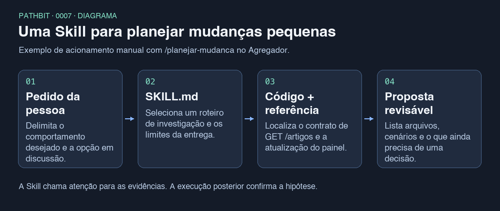
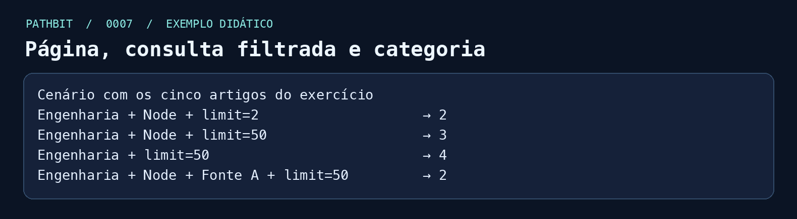
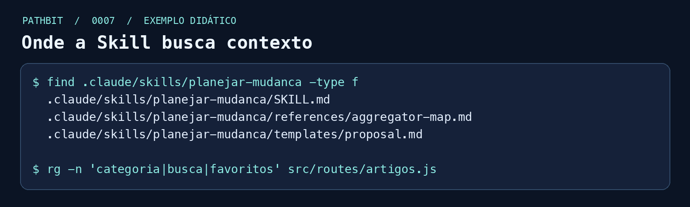

# Skills de projeto no Claude Code: como ensinar o agente a investigar o Agregador antes de editar código


No [artigo 0005](../../0005_sdd_do_vibe_coding_a_engenharia_deterministica/article/ARTICLE.md), o Agregador cresce em ciclos de especificação. No [0006](../../0006_openspec_claude_code/article/ARTICLE.md), uma alteração passa por proposta, delta e prova HTTP. A prática resolve como versionar uma decisão, mas deixa outra pergunta no terminal: **como fazer duas pessoas iniciarem análises diferentes com a mesma disciplina de leitura?**

Hoje a tarefa é mostrar quantos artigos aparecem quando o leitor filtra por categoria. Amanhã alguém pedirá uma mensagem depois de favoritar. O primeiro pedido exige esclarecer o que «quantos» mede. O segundo pode descrever uma confirmação que já está na aplicação. Se o agente resolver os dois com o mesmo impulso de editar o HTML, a primeira entrega corre o risco de atribuir significado errado ao número e a segunda pode duplicar um aviso existente.

Vamos versionar esse roteiro de investigação como uma **Skill de projeto do Claude Code**. Ela recebe um pedido pequeno, encaminha a leitura ao caminho certo e utiliza um formato de proposta que a equipe pode conferir. O laboratório demonstra os contratos a partir dos arquivos reais do Agregador. Os resultados de uma sessão com modelo são avaliados pela pessoa que a conduz, pois dependem do contexto e das respostas daquele atendimento.

---

## O custo aparece quando o projeto tem mais de um caminho plausível

Quem começa num repositório costuma procurar o primeiro arquivo que contém a palavra do pedido. No Agregador, «favoritos» aparece em rotas de atualização, no filtro de busca, no resumo de estatísticas e na renderização de cartões. Cada ocorrência prova uma coisa. A rota de persistência explica o que aconteceu no servidor. O texto do aviso está no navegador. O filtro decide o conjunto que a grade mostra. Um mapa de apoio reduz a busca inicial sem transformar uma lista de caminhos em um novo contrato de produto.

| Pedido | Primeiro ponto de entrada | Verificação antes de concluir |
| --- | --- | --- |
| Mostrar quantidade de resultados de uma categoria | `GET /artigos` e a função que renderiza a grade | Descobrir se a API entrega só a página ou também o total |
| Avisar quando o leitor favorita | Manipulador de favoritos no dashboard | Encontrar quando aparece a mensagem de sucesso e se existe aviso de erro |
| Mudar como artigos entram na lista | Serviço que aplica busca e filtros | Conferir a seleção efetiva e que consumidores usam o mesmo serviço |
| Preservar o comportamento durante a alteração | Testes do Agregador e contrato vigente | Separar cobertura existente de novos casos a acrescentar |

A Skill não faz a pergunta de produto desaparecer. Ela faz com que a pergunta seja encontrada no momento certo. Se `artigos.length` for exibido como «quantidade total», a interface funciona do ponto de vista de JavaScript e pode comunicar uma informação falsa. Se o texto disser «exibidos nesta página», a mesma computação corresponde a outro contrato. A proposta precisa registrar a distinção antes de pedir código.

## Onde cada tipo de contexto deve morar



> **Figura 1.** O contexto permanente indica convenções. Uma Skill introduz o procedimento sob demanda, e a proposta de cada mudança registra as decisões aprovadas para aquela entrega.

No [artigo de SDD](../../0005_sdd_do_vibe_coding_a_engenharia_deterministica/article/ARTICLE.md), o `CLAUDE.md` orienta a sessão de forma ampla. Uma regra como «os testes da aplicação devem rodar na versão de Node adotada pelo projeto» pode ser útil em qualquer tarefa. Incluir no mesmo arquivo um roteiro completo de pesquisa de código para todas as funcionalidades produz custo recorrente: em todo assunto novo, o agente carrega material que serve a poucos casos.

| Tipo de informação | Onde fica | Exemplo |
| --- | --- | --- |
| Convenção válida no projeto | `CLAUDE.md` | Node.js 22 e preservação das rotas existentes |
| Procedimento que começa por escolha explícita | `.claude/skills/planejar-mudanca/SKILL.md` | Ler rota, serviço e teste antes de propor |
| Referência consultada durante o procedimento | `references/aggregator-map.md` | Caminhos da leitura de artigos, dos favoritos e do dashboard |
| Formato que permite revisar a resposta | `templates/proposal.md` | Comportamento atual, limites, exemplos e pergunta aberta |
| Decisão aprovada para uma funcionalidade | Spec ou change da entrega | Contar artigos efetivamente renderizados |

Os comandos do 0005 já mostraram como trocar prompts longos por uma invocação curta. A Skill deste artigo acrescenta uma unidade de manutenção: o arquivo central, as referências e o modelo podem envelhecer e ser atualizados juntos. Quando uma rota mudar de pasta, altere o mapa da Skill no mesmo trabalho que move a rota. Quando mudar o comportamento, altere a especificação da capacidade. A separação torna visível qual revisão cobre qual decisão.

### Compare com três jeitos de fazer a mesma investigação

| Abordagem | Quando ajuda | O que precisa ser revisto |
| --- | --- | --- |
| Prompt direto no chat | Investigação única com contexto bem delimitado | A próxima pessoa precisa repetir ou descobrir os mesmos passos |
| `CLAUDE.md` com convenções curtas | Decisões recorrentes que se aplicam ao projeto todo | Cada regra precisa continuar útil em tarefas que não tratam desta feature |
| Skill manual com arquivos de apoio | O time repete o procedimento, com assuntos diferentes | O mapa deve continuar apontando para o código vigente |
| Spec da mudança | A regra já foi aprovada e precisa governar implementação e teste | O resultado precisa ser verificável sem reler o histórico do chat |

Esses recursos se combinam. Uma sessão começa pelas convenções do projeto, chama a Skill quando a tarefa pede descoberta e escreve a proposta na change depois de resolver ambiguidades. A automação executável que verifica o produto continua sendo uma etapa separada.

---

## Monte a Skill de forma que a revisão caiba em um diff

A [Skill versionada](../examples/.claude/skills/planejar-mudanca/SKILL.md) mora em um diretório que a própria equipe pode rever e copiar. A estrutura tem três responsabilidades pequenas.

```text
.claude/skills/planejar-mudanca/
├── SKILL.md
├── references/
│   └── aggregator-map.md
└── templates/
    └── proposal.md
```

O front matter define o nome da invocação. `description` descreve seu propósito e `argument-hint` sugere o argumento na interface. `disable-model-invocation: true` reserva a invocação a uma pessoa. No corpo, `$ARGUMENTS` leva o pedido ao roteiro. Leia as regras da versão que você usa antes de adotar o mesmo front matter. [Documentação de Skills](https://code.claude.com/docs/en/skills).

A primeira instrução manda abrir o [mapa do Agregador](../examples/.claude/skills/planejar-mudanca/references/aggregator-map.md) e identificar quais dimensões do pedido aparecem em rota, serviço e teste. O [modelo de proposta](../examples/.claude/skills/planejar-mudanca/templates/proposal.md) pede uma saída que separe os fatos encontrados da opção que o agente sugere. O agente pode citar outro arquivo quando ele sustenta a interpretação. O mapa dá um ponto de partida, e a leitura confirma se a referência ainda é verdadeira.

### Uma regra de invocação tem alcance diferente de uma permissão

Escolher manualmente quando a Skill entra em cena dá controle sobre o início do procedimento. O modo da sessão continua determinando quais ações de ferramenta são permitidas. A frase «trabalhe em leitura» dentro do arquivo orienta a execução. Confirme o modo na interface e mantenha os pedidos normais de autorização. Nesse exercício, abra o Claude Code com `--permission-mode plan`. Use uma cópia descartável, inspecione `git status` no início e confira a mesma árvore quando a sessão terminar. [Modos de permissão do Claude Code](https://code.claude.com/docs/en/permission-modes).

---

## Caso 1 — Um contador de categoria parece simples até alguém escrever «total»

Abra o [primeiro pedido do roteiro](../examples/prompts.md). O dashboard precisa mostrar quantos artigos aparecem quando a pessoa filtra por categoria. A palavra «aparecem» sugere contar o que está na grade. Antes de aprovar essa leitura, peça que o agente mostre a requisição que a tela faz.

No `src/public/index.html`, localize `carregarArtigos`. A função monta a consulta com `URLSearchParams`, define o limite enviado pela grade e aplica categoria, fonte, busca e favoritos conforme o estado da página. Em `src/routes/artigos.js`, a rota recebe esses parâmetros, valida paginação e devolve um vetor. A resposta não inclui um campo com o total de correspondências no armazenamento. Leia a rota e a renderização antes de inferir um número global a partir de uma página.

| Contagem que podemos pedir | Observação que comprova | Consequência |
| --- | --- | --- |
| Artigos renderizados nesta página | Tamanho do vetor usado na renderização | A interface pode calcular sem criar uma rota |
| Correspondências para o filtro em toda a coleção | Total separado que respeita os mesmos filtros | Pode exigir mudança de contrato ou uma consulta de contagem |
| Total no banco | Estatística de outra abrangência | Pode ser útil em seu próprio card, mas responde a outra pergunta |

Um bom resultado da sessão contém **uma pergunta de confirmação** quando o produto ainda não decidiu entre essas opções. Depois da decisão, o exemplo de aceite deixa de ser «o contador é correto». Passe a usar algo que uma segunda pessoa possa conferir.

| Dado | Quando | Resultado observável |
| --- | --- | --- |
| A API devolve três registros para a seleção atual | A grade termina de renderizar a categoria | A indicação de registros exibidos mostra 3 |
| A consulta da categoria não devolve registros | O estado vazio aparece | A indicação mostra 0 |
| O leitor muda o filtro e a resposta nova é menor | A renderização mais recente termina | O número reflete a seleção atual |

Em produção, dois pedidos rápidos podem retornar fora de ordem. Isso é outra decisão de escopo: o contador deve acompanhar **a renderização efetivamente exibida**, e a proteção contra respostas antigas deve ser analisada no fluxo de atualização do dashboard. Se o pedido original trata apenas de rótulo e contagem, coloque o caso concorrente como pergunta de revisão em vez de modificar várias rotas por antecipação.

## A interpretação do contador dá para validar agora

O laboratório exercitou a rota do Agregador com cinco artigos de demonstração. Quatro pertencem a Engenharia. Entre eles, três contêm Node no título. Dois dos resultados da busca pertencem à Fonte A, enquanto o mais recente vem da Fonte B. A primeira consulta enviou o mesmo filtro de busca com limite 2. Rodamos em seguida a busca com um limite que comporta todos os artigos desta base, a categoria sem busca e por fim a busca com fonte.

| Consulta HTTP | Itens recebidos | Contrato que representa |
| --- | --- | --- |
| `categoria=Engenharia&busca=Node&limit=2` | 2 | Quantidade na página exibida para essa busca |
| `categoria=Engenharia&busca=Node&limit=50` | 3 | Todas as correspondências nesta base conhecida |
| `categoria=Engenharia&limit=50` | 4 | Todos os artigos da categoria nesta base |
| `categoria=Engenharia&busca=Node&fonte=Fonte%20A&limit=50` | 2 | Correspondências para categoria, busca e fonte |



> **Figura 2.** O terminal reduz cada resposta ao tamanho do array e aos títulos. Um limite alto foi suficiente para esta base de cinco artigos. Para uma coleção maior, o tamanho de uma resposta paginada continua representando aquela página.

Você pode repetir a prova sem depender da resposta de um modelo. Reutilize o comando de preparo deste artigo, rode `npm ci` e, a partir da cópia do Agregador antes de iniciar o servidor, faça a seguinte semeadura.

```bash
node --input-type=module <<'JS'
process.env.DATABASE_PATH = './data/lab.sqlite';
const { db, inicializarSchema } = await import('./src/db/index.js');
inicializarSchema();

const insert = db.prepare(
  'INSERT INTO artigo (titulo, link, fonte, data_publicacao, categoria) VALUES (?, ?, ?, ?, ?)'
);
const titles = ['Node e SQLite', 'Git para projetos', 'Node com Express', 'Node no Linux', 'CSS com grids'];
for (const [index, title] of titles.entries()) {
  const id = index + 1;
  const source = id === 4 ? 'Fonte B' : 'Fonte A';
  const category = id === 5 ? 'Interface' : 'Engenharia';
  insert.run(title, `https://example.org/article-${id}`, source, `2026-11-27T0${id}:00:00Z`, category);
}
db.close();
JS
HOST=127.0.0.1 PORT=19807 DATABASE_PATH="$PWD/data/lab.sqlite" npm start
```

Em outro terminal, consulte cada combinação da tabela. O leitor JSON mostra o tamanho da resposta e os títulos. Use uma cópia recém-criada ao repetir a semeadura, pois a URL identifica unicamente o artigo.

```bash
curl -fsS 'http://127.0.0.1:19807/artigos?categoria=Engenharia&busca=Node&limit=2' |
  python3 -c 'import json, sys; rows=json.load(sys.stdin); print(len(rows), [a["titulo"] for a in rows])'
```

Na revisão, peça ao agente que associe a especificação do contador a uma dessas consultas e explique como uma mudança de filtro atualiza o número. Para a contagem da página, a entrega pode ficar no ciclo de renderização. Para o total de correspondências, dá para propor uma nova operação de contagem ou uma representação que publique itens e metadados. A segunda escolha muda a interface que clientes podem consumir. Alguém que já faz `for (const artigo of dados)` sobre a resposta vai precisar adaptar a leitura se o servidor passar a responder um objeto. Esse efeito pertence à proposta da mudança, junto com o teste de compatibilidade.

## Caso 2 — Um pedido que redescreve comportamento já presente

O [segundo pedido](../examples/prompts.md) pede aviso depois de adicionar ou remover um favorito. A rota de favoritos pode mostrar persistência, mas a prova do aviso está no manipulador executado pelo navegador. Nele encontram-se as mensagens de sucesso das duas ações. A revisão precisa conferir também o ramo de erro, porque uma mensagem vista no código por si só não confirma em que condição é exibida.



> **Figura 3.** O comando da CLI informa a versão, o terminal lista os três arquivos de apoio e a busca aponta os trechos que sustentam a investigação. A figura orienta a leitura da fonte local, sem reproduzir uma resposta de modelo.

Uma resposta tecnicamente útil diz em que condições as mensagens já aparecem e pergunta qual mudança visual ou textual falta. Por exemplo, se o usuário quer que a confirmação fique acessível após desaparecer, a equipe precisa discutir a duração e o canal, não simplesmente chamar o mesmo aviso duas vezes. Se a mensagem existente atende ao pedido, a investigação pode terminar com evidência e sem um patch.

---

## Show-Me-The-Code em uma cópia revisável

O [guia de execução](../README.md) traz o preparo em um único bloco. Na raiz deste repositório, faça a cópia, instale a Skill somente nela e registre uma base limpa. Use uma identidade Git de trabalho apropriada no laboratório.

```bash
repo="$PWD"
lab=$(mktemp -d)
python3 tools/prepare_aggregator_lab.py "$lab/app"
cd "$lab/app"
mkdir -p .claude/skills
cp -R "$repo/0007_skills_claude_code/examples/.claude/skills/planejar-mudanca" .claude/skills/
git init -b main
git add .
git commit -m 'Registrar base do Agregador e Skill de planejamento'
git status --short
claude --permission-mode plan
```

Na sessão autenticada, execute um pedido por vez. Depois do primeiro resultado, confira os caminhos citados e compare os requisitos com o que a rota realmente devolve. Saia ou inicie uma nova conversa para o segundo assunto. Assim você consegue perceber se a própria Skill fornece o contexto necessário sem depender da conclusão da primeira sessão.

Um roteiro simples para conferir a proposta:

1. **Comportamento atual.** A resposta lista ao menos uma fonte que realmente existe e explica o que observou nela.
2. **Mudança pedida.** A resposta identifica o que o usuário poderá observar e distingue o que já existe.
3. **Fronteira da implementação.** A resposta explica por que o problema pode ser resolvido na tela ou exige uma alteração de API.
4. **Casos de aceite.** Os exemplos distinguem dados de entrada, ação e resultado, inclusive o caso vazio quando se aplica.
5. **Dúvida remanescente.** A resposta pede a decisão que alteraria o desenho, em vez de adivinhar.
6. **Estado do projeto.** O trabalho de planejamento termina com a árvore limpa. Compare o `git status --short` da mesma cópia.

Uma comparação justa entre sessões mantém a pergunta, os arquivos e o critério de avaliação fixos. Uma única resposta boa não mede melhora de produtividade. A evidência reaproveitável é a proposta poder ser checada por outra pessoa, com os mesmos apontamentos, e levada à change do [OpenSpec](../../0006_openspec_claude_code/article/ARTICLE.md) depois da revisão.

### Como diagnosticar quando a Skill não ajuda

| Sintoma | Teste pequeno | Interpretação |
| --- | --- | --- |
| A invocação não aparece | Confira raiz, nome do diretório, front matter e política da sessão | O arquivo pode estar fora do projeto aberto |
| A invocação aparece sem os arquivos citados | Abra os links de apoio no repositório | Alguma referência pode ter envelhecido ou estar em caminho incorreto |
| A resposta inventa um campo `total` | Inspecione a rota e o teste da resposta | A leitura não confirmou a hipótese |
| A proposta duplica avisos | Peça o trecho que já mostra a ação no navegador | O pedido precisa de investigação antes da implementação |
| A proposta altera arquivos durante o planejamento | Confira o modo e o estado da cópia | A sessão não estava executando só a etapa esperada |

A Skill está pronta para o time quando outra pessoa consegue aplicar o procedimento ao mesmo tipo de pedido, entender as fontes da conclusão e revisar a próxima etapa. No [artigo 0008](../../0008_claude_code_worktrees/article/ARTICLE.md), vamos executar duas mudanças com fronteiras suficientemente claras para trabalhar em checkouts independentes.

## Referências técnicas

- [Claude Code e Skills de projeto](https://code.claude.com/docs/en/skills).
- [Claude Code e modos de permissão](https://code.claude.com/docs/en/permission-modes).
- [Guia de uso de worktrees no Claude Code](https://code.claude.com/docs/en/worktrees).

[Figuras e roteiro do exercício](../assets/figuras.md)

Developed with ❤️ by [Pathbit](https://www.pathbit.com.br/)
