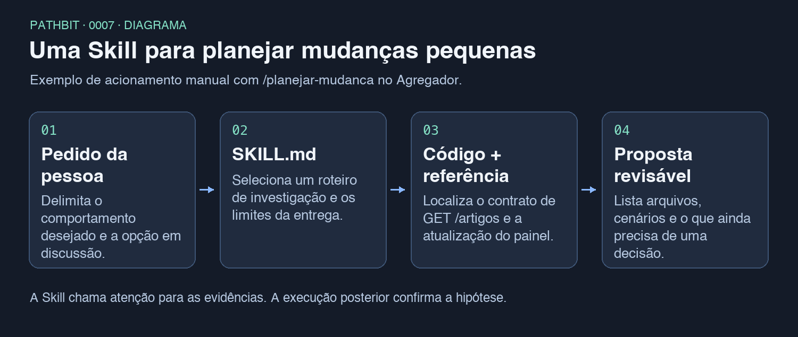
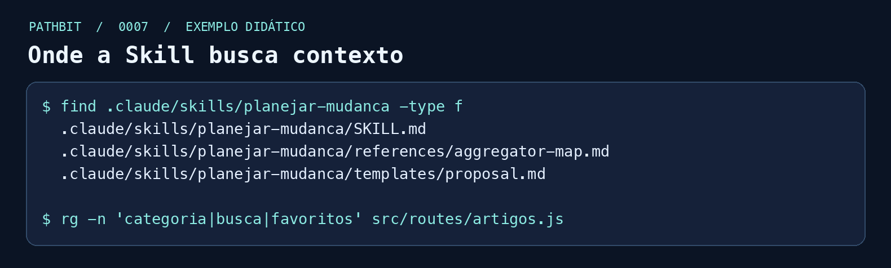
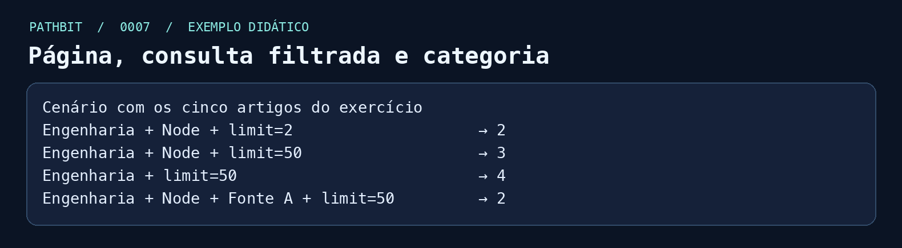

# A Skill que eu queria no Claude Code começava com uma pergunta sobre contagem

Um pedido chegou no Agregador: “Coloque um contador perto do filtro de categorias”. No quadro de tarefas parece simples. Um número ao lado de um seletor. No código, o número pode vir da página atual, do total de artigos que atendem aos filtros ativos ou do total da categoria ignorando busca e fonte.

Essas contagens podem coincidir quando ninguém filtra e cabem dez artigos na tela. Com paginação ativa, uma conta de exemplo deixa a diferença visível. Imagine seis itens na página, nove artigos com o conjunto de filtros e doze na categoria inteira. Se a interface disser “12 resultados” quando a pessoa espera nove, dá para ter uma implementação rápida, um teste que passa e um painel que comunica um dado incorreto.

O próximo passo não era repetir “leia o repositório com cuidado” em todo prompt. Reparei que o mesmo inventário surgia quando uma mudança envolvia o painel: qual rota entrega os itens, quem compõe filtros, o que o payload promete e em que arquivo o comportamento atual vive? Isso pode ser uma **Skill de projeto**.

## O que vale registrar como rotina

A Skill do laboratório abre com um nome, uma descrição curta e acionamento manual. Em `.claude/skills/planejar-mudanca/SKILL.md` ela pede que o Claude Code descreva o comportamento pedido, encontre o ponto de entrada no repositório e diga como verificar a aceitação. O arquivo de referência mapeia a aplicação. O template deixa o plano revisável. A proposta do contador ainda pertence à mudança do contador.

| Tipo de informação | Onde faz sentido ficar |
| --- | --- |
| Convenção de projeto que vale para qualquer trabalho | `CLAUDE.md` |
| Roteiro para investigar uma classe recorrente de mudança | `SKILL.md` e referências |
| Decisão sobre o contador e suas condições de aceitação | Proposta da mudança |
| Contrato observado | Implementação e testes |

A proposta pode dizer “contar a página carregada”. A Skill deve ensinar a encontrar a decisão e a apresentar a diferença. Se ela ordenar `response.length` para todos os contadores, vai herdar silenciosamente essa decisão em outra mudança.

## Onde o código tirou a dúvida

Na captura que acompanha o artigo, o terminal mostra a instalação de Claude Code disponível, os arquivos da Skill, a rota que lê `categoria`, `fonte`, `busca`, `favoritos`, `limit` e `offset`, e o ponto onde o painel informa que um favorito foi adicionado ou removido. É um ponto de partida que outro desenvolvedor pode abrir. A resposta de `GET /artigos` é uma lista de resultados. O array não anuncia por si só o total global filtrado.

Quando a pessoa solicita o total filtrado, prefiro discutir o contrato antes de escrever a UI. Um valor local calculado do array resolve “quantos estão à vista”. Para contar todos os resultados, a implementação precisa representar a mesma combinação de filtros em uma consulta que possa informar o total. Fazer essa mudança na resposta JSON também exige considerar os consumidores que leem diretamente o array.

O segundo pedido do laboratório foi “mostre um aviso ao favoritar”. A inspeção revelou as duas mensagens e a condição que as escolhe. Nesse ponto o agente ganha mais se localizar e confirmar o comportamento do que se adicionar um segundo componente. Uma variação legítima, como ajustar o texto ou tornar o aviso perceptível para mais pessoas, vira outro pedido com seu próprio teste.

## O que duas consultas já esclarecem

Em uma base descartável, registrei quatro artigos da categoria Engenharia e um de Interface. Três títulos de Engenharia contêm “Node”. Uma das três correspondências vem de outra fonte. Fiz a mesma busca com limite 2 e com um limite grande o suficiente para essa amostra. A resposta trouxe dois itens na página e três no conjunto filtrado. Retirei a busca e a categoria trouxe quatro. Ao limitar também pela Fonte A, o array voltou a ter dois registros.

Nesse ponto a divergência virou observável. Se o contador diz “exibidos”, dois é correto para a página pequena. Se diz “encontrados em Engenharia com Node”, a base dá três. Se diz “artigos de Engenharia”, são quatro. O mesmo componente poderia mostrar qualquer um desses números com aparência convincente. O rótulo e os critérios da proposta são o que transformam um cálculo numa informação para a pessoa que está lendo.

A diferença também orienta o tamanho da mudança. Um contador da página cabe no ciclo de renderização. Um contador global precisa reproduzir o filtro, preservar a semântica da seleção e talvez alterar o contrato da API. Antes de transformar uma lista em objeto com itens e total, procure consumidores que tratam a resposta diretamente como array. Um checkout de leitura mais um teste de contrato evitam resolver a ambiguidade com uma alteração de compatibilidade escondida.

### O significado de iniciar manualmente

A Skill declara `disable-model-invocation: true`. Quem opera escolhe o momento de carregá-la. No laboratório interativo o Claude Code abre em modo de planejamento. Ao final, vale comparar o status do checkout. O corpo da Skill explica como investigar e quais provas procurar. O modo de trabalho governa as ações que a sessão pode executar. As duas escolhas juntas tornam o exercício mais fácil de revisar por alguém que queira repetir a análise em outra máquina.

## Deixe o ponto de verificação disponível para outra pessoa

A [pasta do exercício](../examples/README.md) deixa copiar a Skill para uma cópia do Agregador e chamar `/planejar-mudanca`. Comece com um pedido com duas interpretações plausíveis. Confira se a proposta cita os arquivos certos, documenta qual opção exige uma decisão e descreve um caso em que os resultados divergem.

Para este contador eu montaria a base com artigos de duas fontes dentro da mesma categoria e usaria uma página menor que o conjunto filtrado. Em seguida testaria busca, troca de categoria e resultado vazio. As três contagens diferem e fica barato comprovar o que o texto da interface promete. Se o agente só disser “adicionar um contador” e não indicar qual resultado será exibido, ainda falta definir aceitação.

O mesmo roteiro vale quando a equipe aciona uma Skill para preparar documentação, revisar um teste ou mapear um endpoint. Mantenha a parte repetível curta, passe uma tarefa delimitada e traga a decisão para a proposta. O melhor indicador de uma Skill é a revisão que outra pessoa consegue fazer abrindo o código que ela citou.

[Leitura completa, início rápido e exemplo no GitHub](https://github.com/pathbit/pathbit-ai-for-devs/tree/master/0007_skills_claude_code)

Developed with ❤️ by [Pathbit](https://www.pathbit.com.br/)
