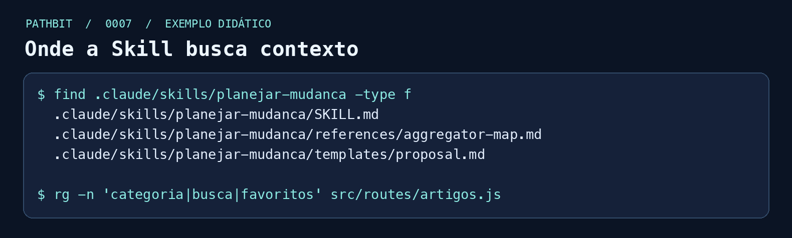

# “Adicione um contador ao filtro” parece claro até ligar a paginação.

No Agregador da série, achei três números plausíveis: itens da página, total que combina com os filtros ativos e total da categoria inteira. Em uma base pequena os valores podem coincidir. Assim fica fácil entregar algo que parece certo na demonstração e se comporta mal com dados reais.

Para o módulo 0007 eu montei uma Skill do Claude Code que orienta o planejamento desse tipo de mudança. Ela pede um pedido delimitado, um inventário do código existente, as decisões pendentes e um cenário de aceitação em que as opções dão resultados diferentes.

O segundo exercício partiu de outro pedido simples: “mostre um aviso ao favoritar”. Abrimos o painel e encontramos as mensagens de adição e remoção já ligadas ao botão. Antes de guardar mais código, já valia confirmar o comportamento que a pessoa queria alterar.

O exemplo inclui a árvore da Skill e as linhas reais de onde vieram as duas conclusões. Você pode copiá-la para uma pasta de laboratório, experimentar `/planejar-mudanca` e conferir a proposta junto com o código. [Artigo e exemplo no GitHub](https://github.com/pathbit/pathbit-ai-for-devs/tree/master/0007_skills_claude_code)

#ClaudeCode #Skills #SDD #DesenvolvimentoDeSoftware
