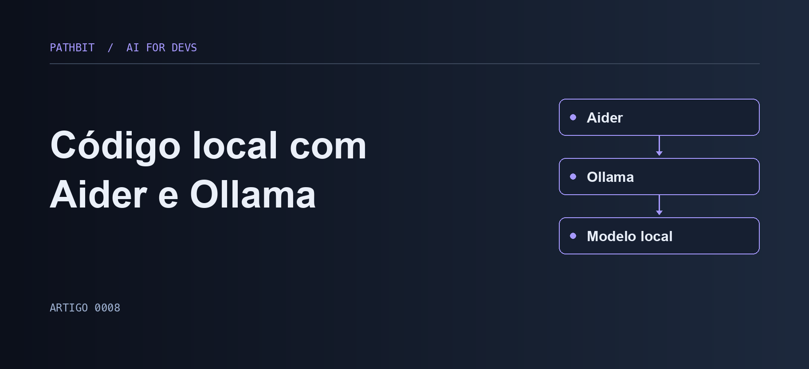

# Edit a small Python project with Aider and Ollama

[Português (Brasil)](ARTICLE.md) · [English](ARTICLE.en.md) · [Español](ARTICLE.es.md)

The example function returns `75` for `total_minutes(1, 15)`. It also accepts `total_minutes(1, 75)`. Put a local model in charge of proposing the validation and let the tests tell you whether the patch works.

## How it works

Ollama serves the model over loopback. Aider sends context to `OLLAMA_API_BASE=http://127.0.0.1:11434` and applies edits. Use the `ollama_chat/` prefix. The first download needs network access and disk space. Use `--no-auto-commits` to review changes before committing and `--no-analytics` for the session.

## Run the exercise

Copy `examples` to a disposable Git repository and commit `src` and `tests` as a baseline. Start Ollama and run `ollama pull qwen2.5-coder:7b`. Run `aider --model ollama_chat/qwen2.5-coder:7b --no-auto-commits --no-dirty-commits --no-analytics --no-check-update src/durations.py tests/test_durations.py` with the loopback variable set.

## Check the result

Ask for `ValueError` for negative hours or minutes outside `0` to `59`. Cover `59` and `60`, and preserve the existing conversion. Review `git diff` and rerun `python3 -m unittest discover -s tests -v`. On a machine with less memory, use the `3b` tag in both commands and keep the task small.

[Quick start](../README.en.md) · [Official documentation](https://aider.chat/docs/llms/ollama.html)

Developed with ❤️ by [Pathbit](https://pathbit.co/)
