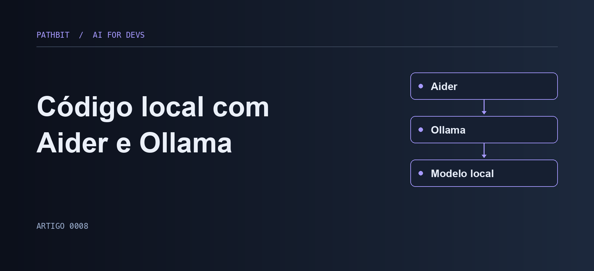

# Edita un proyecto Python pequeño con Aider y Ollama

[Português (Brasil)](ARTICLE.md) · [English](ARTICLE.en.md) · [Español](ARTICLE.es.md)

La función del ejemplo devuelve `75` para `total_minutes(1, 15)`. También acepta `total_minutes(1, 75)`. Pide a un modelo local que proponga la validación y comprueba el parche con las pruebas.

## Cómo funciona

Ollama sirve el modelo en la interfaz de loopback. Aider envía el contexto a `OLLAMA_API_BASE=http://127.0.0.1:11434` y aplica los cambios. Usa el prefijo `ollama_chat/`. La primera descarga requiere red y espacio en disco. Usa `--no-auto-commits` para revisar los cambios antes de confirmarlos y `--no-analytics` en la sesión.

## Ejecuta el ejercicio

Copia `examples` a un repositorio Git descartable y crea un commit de base con `src` y `tests`. Inicia Ollama y ejecuta `ollama pull qwen2.5-coder:7b`. Ejecuta `aider --model ollama_chat/qwen2.5-coder:7b --no-auto-commits --no-dirty-commits --no-analytics --no-check-update src/durations.py tests/test_durations.py` con la variable de loopback configurada.

## Comprueba el resultado

Pide `ValueError` para horas negativas o minutos fuera de `0` a `59`. Cubre `59` y `60` y conserva la conversión existente. Revisa `git diff` y vuelve a ejecutar `python3 -m unittest discover -s tests -v`. En un equipo con menos memoria, usa la etiqueta `3b` en los dos comandos y mantén la tarea acotada.

[Inicio rápido](../README.es.md) · [Documentación oficial](https://aider.chat/docs/llms/ollama.html)

Developed with ❤️ by [Pathbit](https://pathbit.co/)
