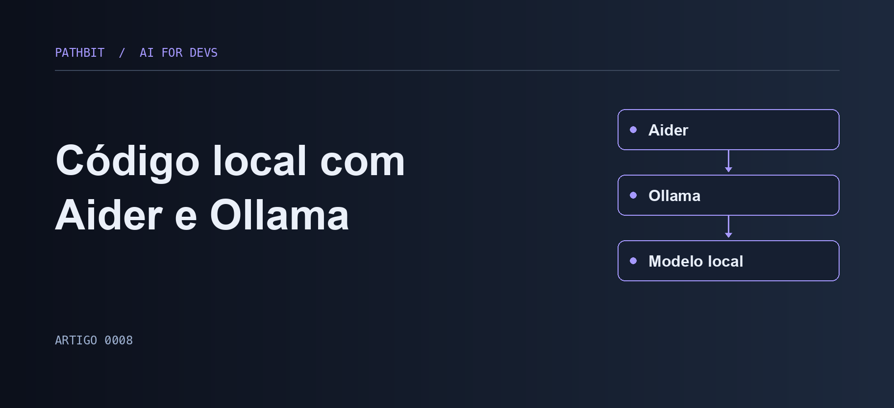

# Como editar código localmente com Aider e Ollama

Uma função de conversão aceita `total_minutes(1, 15)` e devolve `75`. O problema aparece quando alguém chama `total_minutes(1, 75)`. A entrada passa e mistura duas unidades. Vamos pedir ao Aider que proponha uma validação curta usando um modelo servido pelo Ollama e conferir o patch com a suíte de testes.

## Como as ferramentas conversam

| Componente | Responsabilidade |
| --- | --- |
| Ollama | Carrega o modelo e responde pela API de loopback |
| Aider | Monta a conversa com os arquivos selecionados e aplica edições |
| Git e `unittest` | Mostram o patch e executam o contrato revisado |

`OLLAMA_API_BASE` aponta o Aider para `http://127.0.0.1:11434`. Use o prefixo `ollama_chat/` no identificador do modelo para a integração de chat. O download do modelo exige rede e espaço em disco. A inferência do exercício usa o servidor local e dispensa credenciais de um provedor de modelos na nuvem. [Integração Aider com Ollama](https://aider.chat/docs/llms/ollama.html).

## Escolha o contexto antes de aumentar o modelo

O procedimento usa `qwen2.5-coder:7b` como exemplo disponível no catálogo do Ollama. O tamanho do arquivo baixado e a memória durante a geração são medidas diferentes. Se o computador tiver poucos recursos, comece por `qwen2.5-coder:3b` e ajuste a tag nos dois comandos. Reserve modelos menores para tarefas curtas e confira se a ferramenta consegue interpretar a edição. [Família Qwen 2.5 Coder no Ollama](https://ollama.com/library/qwen2.5-coder).

Passe `src/durations.py` e `tests/test_durations.py` ao iniciar o Aider. Declare no prompt que essa tarefa se limita a esses arquivos. Use `--no-auto-commits` para deixar a criação de commits sob seu controle e `--no-analytics` para desativar a telemetria do Aider na sessão. Revise também opções e configurações locais se estiver adotando a ferramenta para código de trabalho. [Opções do Aider](https://aider.chat/docs/config/options.html).

## Show-Me-The-Code

1. Abra o [guia rápido](../README.md), prepare uma cópia descartável do exemplo e confirme que `ollama list` responde. Baixe a tag escolhida.
2. Use o [prompt do laboratório](../examples/README.md) na sessão do Aider. O resultado deve rejeitar horas negativas e minutos fora de `0` a `59` com `ValueError`, preservar a assinatura e manter `total_minutes(1, 15) == 75`.
3. Ao sair da sessão, examine `git diff` e execute `python3 -m unittest discover -s tests -v`. Inclua `59` como entrada válida e `60` como erro para provar a fronteira.

Se o Aider descrever a correção sem alterar os arquivos, confira quais arquivos entraram na sessão e reduza a solicitação a uma única regra. Se receber erro de conexão, teste primeiro `ollama list` e confirme o endereço de `OLLAMA_API_BASE`. Mantenha a execução restrita a loopback para este exercício.

O próximo guia usa [Playwright MCP](../../0009_playwright_mcp/article/ARTICLE.md) para vincular uma solicitação de IA ao comportamento de uma página em execução.

---

Developed with ❤️ by [Pathbit](https://pathbit.co/)
