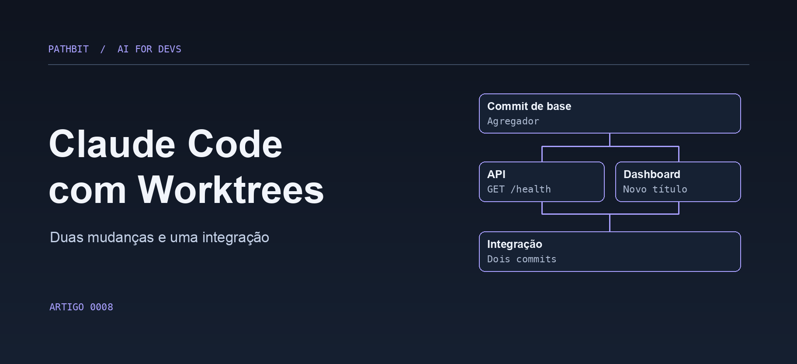

# Trabaja en paralelo con Claude Code y Git Worktrees

[Português (Brasil)](ARTICLE.md) · [English](ARTICLE.en.md) · [Español](ARTICLE.es.md)

Una sesión de Claude Code edita el servidor y otra necesita ajustar el dashboard. En una misma carpeta comparten archivos sin commit y pueden probar por error el mismo proceso. Las worktrees dan a cada tarea un directorio independiente sobre el mismo historial Git.

## Traza el límite en el agregador

Una tarea añade `GET /health` y su prueba. La otra cambia el encabezado del dashboard a `Meu Agregador de Notícias`. Ambas parten del mismo commit. La primera cambia el servidor y la segunda solo la página estática.

## Elige cómo crear las worktrees

Usa `claude --worktree api-health` y `claude --worktree dashboard-title` para el flujo nativo. La base por defecto puede venir de la rama predeterminada remota. `worktree.baseRef` puede usar `head`. Usa `git worktree add -b RAMA RUTA BASE` para fijar commit, ruta y rama. La copia del laboratorio no tiene remoto.

## Aísla los procesos y los archivos

Comprueba rama y raíz con `git status --short --branch` y `git rev-parse --show-toplevel`. Git comparte objetos y no copia `.env`, bases ni dependencias ignoradas. Si arrancas las dos aplicaciones, emplea puertos y rutas de datos distintas.

## Revisa e integra dos commits

Revisa los cambios en su propia carpeta. Los ejemplos incluyen parches de referencia para reproducir el flujo. Crea una worktree de integración y aplica ambos commits al repositorio descartable. Si un conflicto modifica una interfaz pública, compara las dos ramas con la base y revisa el contrato resultante.

## Comprueba la aplicación integrada

Ejecuta `npm ci` y `npm test` con Node.js 22. Arranca la copia integrada en el puerto local 19808. `/health` devuelve `{"status":"ok"}` y `/` sirve el nuevo encabezado. Revisa `git worktree list` antes de limpiar y conserva los directorios con trabajo pendiente.

[Inicio rápido](../README.es.md) · [Ejemplo práctico](../examples/README.es.md) · [Documentación oficial](https://code.claude.com/docs/en/worktrees)

Developed with ❤️ by [Pathbit](https://pathbit.co/)
