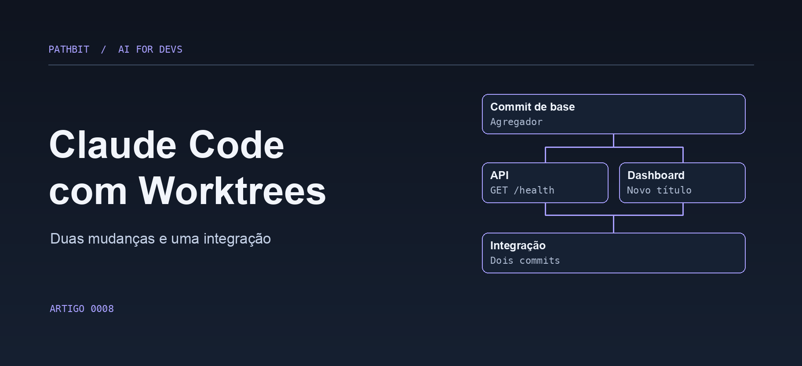
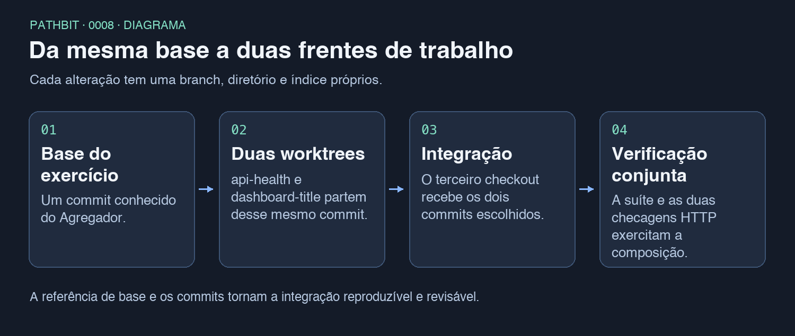
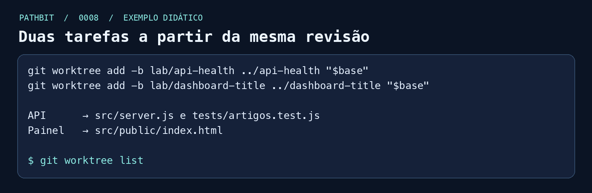
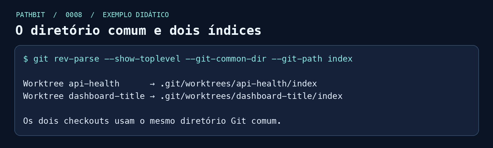
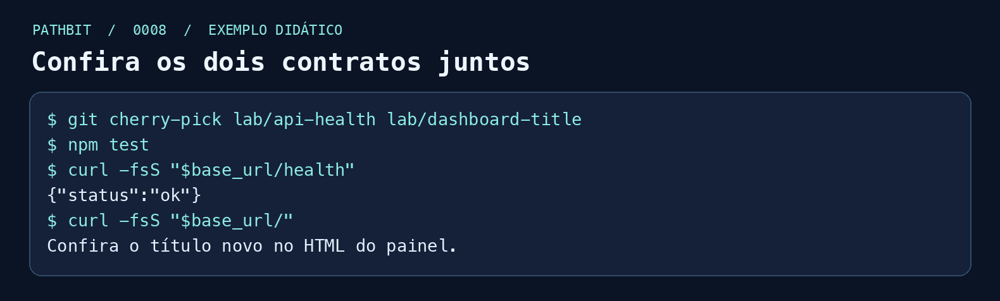

# Claude Code e Git Worktrees — Duas frentes no mesmo repositório, uma integração verificável



← [0007 · Skills do Claude Code](../../0007_skills_claude_code/article/ARTICLE.md) · [Índice da série](../../README.md) · [0009 · OpenCode com 9Router e Ollama](../../0009_opencode_9router_ollama/article/ARTICLE.md) →

## Quando o segundo terminal começa a atrapalhar

Você está adicionando um `/health` ao Agregador. A rota responde no terminal, você está ajustando o teste de integração e ainda não registrou o commit. Chega outro pedido: mudar o título do painel antes de uma demonstração. O prazo é curto e a tarefa cabe em uma linha. Você abre outro terminal e outra sessão do Claude Code na mesma pasta. Quando volta, `git status` mistura a linha do título, a rota nova e o teste que ainda estava em andamento.

Cada terminal tem seu próprio processo, mas ambos apontam para o mesmo diretório. A branch atual, os arquivos editados e o índice do Git são compartilhados. Uma troca de branch nesse diretório muda a base de leitura das duas sessões. Uma revisão feita quando o outro processo ainda edita arquivos pode até descrever uma versão transitória do diff. O problema aparece antes de qualquer problema de modelo ou prompt.

Uma worktree é outro checkout do mesmo repositório. Ela dá a cada frente um diretório, um índice e uma branch de trabalho. Podemos abrir duas sessões do Claude Code com contextos independentes e produzir dois commits revisáveis. Ainda precisamos escolher como comparar, testar e integrar as mudanças. Vamos separar essas etapas com dois pedidos reais no Agregador do [artigo 0005](../../0005_sdd_do_vibe_coding_a_engenharia_deterministica/article/ARTICLE.md).

## O que muda quando se abre uma worktree

O Git mantém as referências e os objetos do repositório em comum. Um commit criado em `lab/api-health` pode ser referenciado a partir de uma terceira worktree assim que existe localmente. A árvore de arquivos e o índice de cada checkout são independentes. Você pode ver o mesmo commit como ponto de partida e obter diffs diferentes sem duplicar a história do projeto.

| Camada | O que o laboratório isola | Decisão do desenvolvedor |
| --- | --- | --- |
| Diretório e índice | Arquivos presentes, staged, unstaged e não rastreados pertencem ao checkout | Confira o diretório e a branch antes de editar ou fazer `git add` |
| Referências e objetos | As branches e os commits são visíveis no mesmo repositório | Dê um nome distinto a cada frente e registre a base comum |
| Sessão do agente | Uma execução aberta em cada diretório pode ler seu próprio checkout | Defina escopo, arquivos permitidos e critérios por sessão |
| Processo e porta | O processo web usa a porta que receber ao iniciar | Se rodar dois servidores, atribua portas separadas |
| Banco e arquivos de ambiente | O caminho de banco e os artefatos gerados vêm da configuração de cada processo | Use um arquivo SQLite próprio por checkout ou rode só a instância de integração |
| Dependências | Uma worktree nova precisa das dependências que o projeto usa | Instale com `npm ci` antes de executar a suíte naquele checkout |

Um arquivo `.env` ignorado pelo Git pode faltar numa worktree nova. O mesmo vale para `node_modules` e dados locais. Isso afeta o runtime, embora a diferença entre branches continue vazia. No sentido inverso, dois servidores iniciados em diretórios distintos ainda podem disputar a mesma porta ou escrever no mesmo SQLite por usarem um caminho absoluto igual. O isolamento editorial do agente acompanha seu diretório. O isolamento do estado de execução depende da configuração.



## Antes de abrir dois agentes, recorte o contrato

O experimento funciona porque os pedidos podem ser descritos e avaliados independentemente.

| Frente | Contrato novo | Área esperada no diff | O que preservar |
| --- | --- | --- | --- |
| API | `GET /health` devolve `200` e `{"status":"ok"}` | `src/server.js` e `tests/artigos.test.js` | Rotas `/`, `/artigos` e demais contratos existentes |
| Painel | O `h1` de `/` mostra “Meu Agregador de Notícias” | `src/public/index.html` | Botões, filtros e ações do painel |
| Integração | Os dois comportamentos coexistem no mesmo processo | Os dois commits selecionados | A suíte da aplicação |

O `/health` deste artigo comprova que o processo HTTP responde. Uma aplicação também pode ter uma sonda de prontidão que consulta banco e dependências, mas isso mudaria o pedido, o prazo de resposta e os testes. A alteração de título tem um limite semelhante. O conteúdo da aba, a navegação, a busca e a API continuam fora da tarefa.

Pense agora num pedido diferente. Uma sessão renomeia o campo de favoritos retornado pela API enquanto outra altera o botão que lê aquele campo. Os arquivos podem ser distintos e o Git pode aplicar os dois commits sem conflito. O risco está no contrato compartilhado. Nesse caso vale combinar o contrato primeiro, manter um teste atravessando as duas camadas e decidir a ordem de entrega. A proximidade de caminhos no diff é um sinal útil, mas não mede dependência funcional.

## Passo 1 · Conheça a base antes de dividi-la

O laboratório começa em uma cópia descartável do Agregador. O repositório da série fornece a preparação e os patches. Node.js 22, Git e Python 3.10+ bastam para a reprodução por patches. O caminho com Claude Code usa duas sessões autenticadas, cada uma com seu pedido. Rode na raiz da série.

```bash
repo="$PWD"
lab=$(mktemp -d)
python3 tools/prepare_aggregator_lab.py "$lab/app"
cd "$lab/app"
git init -b main
git add .
git commit -m 'Record aggregator baseline'
base=$(git rev-parse HEAD)
git worktree list
```

`$repo` guarda o caminho da série. `$base` guarda o SHA que as três worktrees usarão. Um commit-base é mais preciso que “de onde a main estiver hoje”. Se a branch avançar durante o experimento, o SHA continua apontando à versão avaliada.

Para repetir em um projeto existente, parta de uma revisão aprovada e confirme o estado do checkout que você usará. `git status --short`, `git branch --show-current` e `git rev-parse HEAD` respondem três perguntas diferentes: se há alterações locais, em que branch a sessão está e qual commit os arquivos representam.

## Passo 2 · Escolha como abrir as duas frentes

### Duas sessões pelo Claude Code

Abra dois terminais no checkout base. Em cada um use um nome de worktree e dê somente o [pedido da frente](../examples/prompts.md) correspondente.

```bash
claude --worktree api-health
claude --worktree dashboard-title
```

A opção `--worktree` cria uma worktree para a sessão. Em workspaces reais, verifique o ponto de partida e o caminho que o produto criou usando `git worktree list` e `git rev-parse HEAD`. Abra os arquivos da API somente na sessão da API e deixe a outra sessão revisar a alteração do painel. As sessões podem ser usadas em sequência. A independência dos diretórios é o que permite paralelizar quando a separação vale a pena. [Claude Code · Git worktrees](https://code.claude.com/docs/en/worktrees)

Se as duas sessões tiverem instruções de projeto comuns, vale dar critérios locais específicos. Para API, inclua código de estado, corpo JSON e preservação das rotas. Para painel, cite o seletor ou arquivo que contém o título e peça confirmação no HTML servido. O [artigo 0007](../../0007_skills_claude_code/article/ARTICLE.md) mostra como concentrar esse inventário numa Skill quando o mesmo roteiro volta com frequência.

### Worktrees explícitas com o Git

A execução documentada nas capturas escolheu esta opção. Os comandos determinam a base e os caminhos e aceitam os patches prontos. Começando no checkout `$lab/app`, crie as duas worktrees e aplique cada patch à pasta correspondente.

```bash
git worktree add -b lab/api-health ../api-health "$base"
git worktree add -b lab/dashboard-title ../dashboard-title "$base"
git -C ../api-health apply "$repo/0008_claude_code_worktrees/examples/health.patch"
git -C ../dashboard-title apply "$repo/0008_claude_code_worktrees/examples/dashboard.patch"
git -C ../api-health diff --stat
git -C ../dashboard-title diff --stat
```

O `git -C` torna explícita a pasta em cada comando. Essa pequena disciplina ajuda quando o mesmo terminal alterna entre revisar API e painel. `git worktree list` permite conferir branch, caminho e commit, inclusive quando uma ferramenta cria as worktrees em outro diretório.



### Descubra onde o Git registrou cada checkout

Depois de criar as worktrees, rode este comando em cada pasta ou use `git -C` a partir do checkout inicial.

```bash
git rev-parse --show-toplevel --git-common-dir --git-path index
```

A primeira linha é a raiz de trabalho. A segunda aponta para o diretório administrativo comum do repositório. A terceira mostra o índice daquele checkout. No laboratório, todas apontam ao `.git` da aplicação, mas cada worktree vinculada tem um caminho independente sob `.git/worktrees/`. O Git pode apresentar o caminho da pasta-base como `.git` relativo ao checkout. Nas worktrees vinculadas do exercício, ele aparece como absoluto.



Essa observação explica o resultado do `git diff --stat` de forma mais direta que contar terminais. Os processos podem levar nomes parecidos e ter uma pasta de trabalho diferente. O Git mostra qual índice cada um usa. Se uma sessão ainda está no checkout inicial, ela vai mostrar o índice da primeira pasta. Isso dá uma checagem antes de preparar o commit.

## Passo 3 · Revise fronteiras e valide cada mudança

A alteração da API é pequena o suficiente para ler inteira. O ponto exato dela fica junto às rotas da aplicação. O teste chama HTTP e verifica o corpo interpretado como JSON. Um teste que procurasse a palavra `ok` na resposta aceitaria um HTML de erro com a palavra no corpo.

```js
app.get('/health', (_req, res) => res.json({ status: 'ok' }));
```

```js
test('GET /health returns process status', async () => {
  const response = await fetch(`${baseUrl}/health`);
  assert.equal(response.status, 200);
  assert.deepEqual(await response.json(), { status: 'ok' });
});
```

Na outra pasta, leia o diff do HTML. O patch troca o texto no elemento `h1` e deixa a classe `main-title` e os botões vizinhos em seus lugares. Cobrir o título com o HTML servido complementa a leitura do patch. Um diff simples prova onde o texto mudou. O HTTP confirma qual arquivo o processo de fato expõe.

Registre cada mudança após conferir o diff. Se quiser rodar a suíte isolada em cada branch, instale as dependências separadamente com `npm ci` e use bancos descartáveis por execução. A evidência publicada neste laboratório inclui os dois diffs separados e a suíte executada depois da composição. O [roteiro do laboratório](../examples/README.md) tem todos os comandos de estágio, commit e integração.

## Passo 4 · Integre em uma terceira worktree

Crie o terceiro checkout do mesmo `$base`. Os nomes das branches identificam o topo de cada alteração no roteiro. Em uma equipe, anotar os SHAs revisados deixa explícito o que entra se as branches receberam novos commits.

```bash
git worktree add -b lab/integracao ../integracao "$base"
git -C ../integracao cherry-pick lab/api-health lab/dashboard-title
git -C ../integracao log --oneline -3
cd ../integracao
npm ci
npm test
HOST=127.0.0.1 PORT=19808 DATABASE_PATH="$PWD/data/lab.sqlite" npm start
```

Abra outro terminal para observar a mesma instância nas duas chamadas. Use a mesma porta informada ao servidor.

```bash
curl -fsS http://127.0.0.1:19808/health
curl -fsS http://127.0.0.1:19808/ | rg -o '<h1[^>]*>[^<]+'
```

A suíte executada no terceiro checkout somou **10 testes aprovados e zero falhas**. As chamadas HTTP devolveram `{"status":"ok"}` e o título esperado. A captura foi feita na mesma execução com uma porta de loopback livre atribuída ao laboratório. Desse modo, a evidência liga os dois commits ao mesmo processo e evita verificar uma instância antiga por engano.



## O que o histórico prova e o que ainda precisa do HTTP

Git consegue dizer se dois commits foram aplicados. O `git log --oneline -3` do exercício conecta o checkout de integração à base e aos commits de API e dashboard. `git diff "$base"..HEAD --stat` ajuda a revisar a mudança composta. Essas observações dizem respeito ao conteúdo. Se outro processo estiver respondendo na porta escolhida, o HTML recebido pode vir de um checkout completamente diferente apesar do histórico correto.

```bash
git diff "$base"..HEAD --stat
git diff "$base"..HEAD -- src/server.js src/public/index.html
git status --short
```

Leia primeiro os dois detalhes que esperava no diff. O registro da rota deve estar perto das rotas Express. O `h1` deve conservar sua classe. Em seguida abra o log da instância que o `npm start` acabou de iniciar e compare a porta ao endereço usado pelo cURL. A ordem é barata: árvore, processo e protocolo.

A escolha do teste depende do tipo de promessa. O teste Node verifica o contrato HTTP do `/health` e preserva as verificações do Agregador. A busca pelo `h1` confirma que a alteração está no HTML entregue. Se o título dependesse do JavaScript após o carregamento, o cURL ficaria aquém da observação necessária. No [módulo 0010](../../0010_playwright_mcp_agregador/article/ARTICLE.md), o navegador passa a ser a ferramenta para confirmar o que a interface exibe e o que o servidor persiste.

### Compare duas formas de integrar os resultados

O `cherry-pick` ajuda neste exercício porque as branches têm uma alteração cada e estamos escolhendo explicitamente os commits. Em um projeto que preserva os branches de cada pull request, o checkout de composição pode receber merges locais com a mesma base. A decisão depende do histórico esperado no projeto. Os critérios dos testes permanecem os mesmos.

Uma worktree de integração local também ajuda a revisar sem alterar o estado de trabalho de ninguém. Se a primeira mudança precisa ser corrigida, volte à worktree da API, prepare o commit que resolve a falha e atualize a composição. Documente qual revisão passou. O nome `lab/api-health` pode apontar a outro commit amanhã. O SHA observado vincula o resultado da suíte à revisão efetivamente exercitada.

## O que fazer quando a separação quebra

| Sintoma | Checagem mínima | Próximo passo |
| --- | --- | --- |
| Dois diffs mostram a mudança do título | Compare `pwd`, `git branch --show-current` e `git worktree list` nos dois terminais | Volte à pasta de cada frente e confira a origem da edição antes de movê-la |
| A branch já está em uso | Veja as worktrees que já usam aquela referência | Abra o checkout existente ou crie uma branch exclusiva naquela base |
| O servidor que retorna o título usa dados inesperados | Confira porta, log de início e `DATABASE_PATH` do processo | Pare a instância do experimento e reinicie no checkout de integração com caminho e porta próprios |
| `cherry-pick` para num conflito textual | Abra o diff e leia o que cada commit quer preservar | Resolva no checkout de integração com testes. Se o recorte precisar mudar, use `git cherry-pick --abort` e revise as frentes |
| Os dois commits entram, mas a suíte quebra | Verifique qual contrato atravessa as frentes e compare também com a base | Faça um teste de composição ou realinhe a mudança em uma mesma revisão |
| Worktree existe, mas o runtime falha antes de responder | Verifique Node, dependências e arquivos locais do checkout | Faça `npm ci` com o runtime do projeto e recupere somente a configuração necessária ao cenário |

Um conflito relatado pelo Git é barato de localizar. Um conflito de contrato costuma dar trabalho justamente porque o merge parece limpo. Eis por que a etapa conjunta tem a maior força de evidência neste exemplo.

## Quando abrir worktree e quando trabalhar em série

Em uma mudança atravessando servidor, tipos e interface, uma sessão mantida no mesmo checkout pode raciocinar melhor sobre o contrato inteiro. Em uma investigação que só lê código, talvez seja suficiente abrir uma sessão sem edições. Uma segunda worktree se paga quando termina com um trabalho útil e delimitado, uma referência revisável e uma forma de integrar os resultados.

| Situação | Escolha provável | Pergunta para decidir |
| --- | --- | --- |
| Correção curta em arquivos sem acoplamento com o trabalho em andamento | Worktree dedicada | O patch pode ser revisado, testado e revertido sozinho? |
| Duas frentes que alteram o mesmo contrato HTTP | Mudança em série ou contrato compartilhado antes de dividir | Qual camada do teste vai descobrir uma incompatibilidade? |
| Mudança com banco de desenvolvimento persistente | Worktree com banco descartável próprio | Qual processo tem permissão para alterar quais dados? |
| Experimento de implementação concorrente | Worktrees partindo do mesmo SHA | Qual critério escolherá um resultado e como o outro será descartado? |

Antes da limpeza, confira `git status --short` em cada pasta e guarde os commits que serão da revisão. `git worktree remove <caminho>` é a operação normal após parar os processos e preservar o trabalho. Se o Git sinalizar alterações locais, leia o status por checkout e decida onde elas devem ficar. A branch pode continuar útil depois de retirar a pasta.

O primeiro ganho vem antes de rodar agentes concorrentes. Saber onde cada edição aparece, qual é o commit de base e em que processo as duas mudanças coexistem já transforma uma revisão apressada numa investigação que outra pessoa consegue reproduzir.

## Referências

- [Documentação do Claude Code sobre Git worktrees](https://code.claude.com/docs/en/worktrees)
- [Manual do git worktree](https://git-scm.com/docs/git-worktree)
- [Manual do git cherry-pick](https://git-scm.com/docs/git-cherry-pick)
- [Início rápido do módulo](../README.md) · [Patches e passos da integração](../examples/README.md) · [Figuras do exercício](../assets/figuras.md)

Developed with ❤️ by [Pathbit](https://www.pathbit.com.br/)
