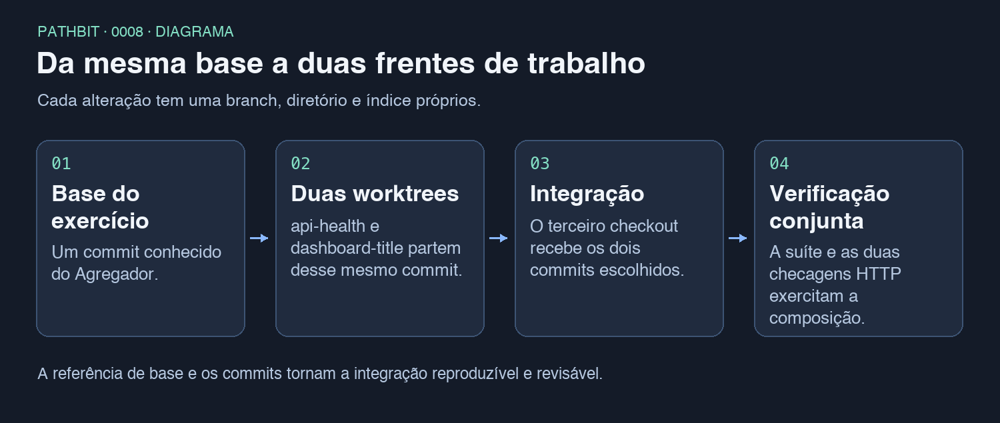
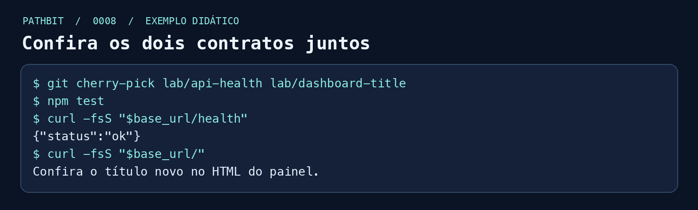

# Dois agentes, o mesmo repositório e três diretórios



Uma tarefa no Agregador pedia um endpoint de saúde. Outra, o novo título do painel. Abrir dois terminais funciona para navegar por arquivos. Para editar em duas sessões do Claude Code, os terminais precisam de uma fronteira melhor. Na mesma pasta, cada sessão vê os arquivos em que a outra está trabalhando. Até o índice que prepara o próximo commit é compartilhado.

Usei duas worktrees no experimento. Ambas partiram do mesmo commit. Uma ficou com `lab/api-health`, outra com `lab/dashboard-title`. Os commits são objetos do mesmo repositório, então uma terceira worktree pôde receber os dois. O Git usa uma única história para referências e objetos. O diretório de trabalho e o índice de cada checkout são próprios.

## O recorte das tarefas fez diferença

A rota deveria retornar `200` e `{"status":"ok"}`, preservando `/` e `/artigos`. Esse contrato virou uma rota em `src/server.js` e um teste em `tests/artigos.test.js`. Na outra worktree, a tarefa foi trocar o `h1` para “Meu Agregador de Notícias” em `src/public/index.html`, sem mexer nos botões e filtros.

| Frente | Diff esperado | Onde dá para ver o resultado |
| --- | --- | --- |
| API | Servidor e teste | Corpo de `GET /health` |
| Painel | Uma alteração no HTML | Título exibido em `GET /` |
| Integração | Os commits das duas frentes | Suíte e dois endpoints no mesmo processo |

Imagine que a primeira frente renomeasse um campo da API e a segunda continuasse usando o nome antigo no painel. Os arquivos ainda poderiam ser distintos. A relação entre os campos, no entanto, exigiria um teste conjunto. A regra que funcionou aqui foi descrever o contrato de cada lado e escolher uma checagem que observa a combinação dos resultados.

## Como o laboratório tornou isso reproduzível

Quem tem Claude Code disponível pode usar `claude --worktree api-health` e `claude --worktree dashboard-title` em dois terminais e seguir os pedidos da série. Para a reprodução que acompanha o artigo, criamos os checkouts com o Git e aplicamos os patches que ficam no próprio módulo. O SHA inicial ficou guardado em `$base` para que a mudança do painel partisse da mesma revisão que a API.

```bash
git worktree add -b lab/api-health ../api-health "$base"
git worktree add -b lab/dashboard-title ../dashboard-title "$base"
git -C ../api-health apply "$repo/0008_claude_code_worktrees/examples/health.patch"
git -C ../dashboard-title apply "$repo/0008_claude_code_worktrees/examples/dashboard.patch"
git -C ../api-health diff --stat
git -C ../dashboard-title diff --stat
```

`git worktree list` mostra as pastas e as branches ativas. `git -C` indica a qual checkout pertence cada checagem. A API alterou dois arquivos. O painel alterou um. Depois de registrar as mudanças, integramos os dois commits na terceira pasta.

Uma worktree nova cria o checkout, e sua aplicação continua responsável pelo ambiente. Se os dois servidores usarem a mesma porta, o segundo pode falhar ao iniciar. Se o caminho do SQLite apontar para o mesmo arquivo, duas instâncias podem influenciar o mesmo estado. Para o laboratório foi suficiente rodar uma única instância de integração e fixar um SQLite descartável naquela pasta.

## A terceira pasta foi a mais importante

O `cherry-pick` aplicou ambos os commits da base conhecida. Rodei `npm test` e obtive 10 testes aprovados. Na sequência, duas chamadas na mesma porta mostraram o JSON de saúde e o novo título. A primeira observação diz que o processo responde. A segunda mostra que esse processo carregou o HTML alterado.



Caso o `cherry-pick` pare, há um conflito de revisão a entender. Caso a operação termine e a suíte de integração falhe, investigue a composição e compare o resultado com a base. Caso o cURL apresente um título antigo com testes verdes, confira a porta e qual checkout iniciou o processo. Nenhum desses sintomas exige refazer as duas frentes antes de localizar o ponto de divergência.

O experimento inteiro ocupa três diretórios adjacentes. O valor aparece quando outra pessoa consegue dizer qual trabalho cada sessão produziu, quais commits entraram e onde os dois comportamentos foram verificados. Para uma tarefa que altera um único contrato de ponta a ponta, uma sequência coesa em uma pasta pode continuar a melhor escolha.

## Um roteiro para a próxima mudança

Antes de dividir uma entrega em branches, escreva os resultados que outra pessoa conseguiria testar. Pergunte se cada diff é legível sozinho, se os dois branches precisam alterar um campo compartilhado e qual teste verá os dois resultados juntos. Para estas duas tarefas, a resposta coube em um contrato de rota e uma mudança no HTML. Em uma tarefa com banco, tipos e interface, a melhor divisão talvez comece com outra revisão: a evolução do contrato comum.

Quando cada trabalho conclui, compare caminhos e estado nas três árvores. Use `git branch --show-current` para confirmar o local. Guarde os SHAs dos commits revisados antes de aplicar novos trabalhos na origem. Um nome de branch pode se mover enquanto o SHA identifica o resultado que passou. Por isso vale guardar o número da revisão junto à saída do teste.

Tem um detalhe que ajuda ao reproduzir. Se o terminal do trabalho de painel ainda estiver rodando com a mesma porta, o cURL pode pegar um HTML que veio de outra pasta. Eu consultaria o log com a porta de início, conferiria o processo e só então leria o resultado HTTP. Uma alteração que só aparece depois de o navegador renderizar o JavaScript pede checagem no navegador. O título deste exercício vive no HTML retornado, o que torna suficiente a consulta direta ao endpoint.

Depois da revisão, encerre os processos e verifique o que ficou em cada diretório. A limpeza normal usa `git worktree remove` em cada checkout dispensável. A branch pode continuar referenciando os commits mesmo depois de retirar a pasta. Se houver edições locais, inspecione, preserve o trabalho desejado e só então retire a worktree.

[Artigo, comandos e patches no GitHub](https://github.com/pathbit/pathbit-ai-for-devs/tree/master/0008_claude_code_worktrees)

Developed with ❤️ by [Pathbit](https://www.pathbit.com.br/)
