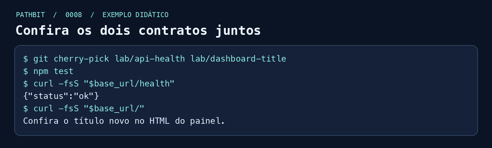

# Dois terminais no mesmo diretório ainda editam o mesmo checkout.

Eu tinha duas tarefas no Agregador. Adicionar `GET /health` e trocar o título do painel. Cabiam numa revisão pequena, mas duas sessões do Claude Code na mesma pasta poderiam misturar as mudanças e até preparar o mesmo commit.

No laboratório do módulo 0008, parti de um SHA conhecido.

1. Uma worktree ficou com a rota e o teste de API.
2. A segunda ficou com a linha do `h1`.
3. Uma terceira recebeu os dois commits e rodou o teste de composição.

Na terceira pasta, `npm test` aprovou 10 testes. Consultei a mesma instância duas vezes: `/health` retornou `{"status":"ok"}` e `/` serviu o novo título.

Essa etapa conjunta vale mesmo quando o Git aplica os commits sem conflito. Duas alterações podem tocar arquivos distintos e ainda assim discordar sobre o contrato que cruza API e interface. Também vale conferir qual instância você está exercitando: diretórios separados podem continuar disputando porta ou banco.

O módulo traz o caminho com `claude --worktree`, a alternativa com Git e os patches do exercício. [Artigo e laboratório no GitHub](https://github.com/pathbit/pathbit-ai-for-devs/tree/master/0008_claude_code_worktrees)

#ClaudeCode #Git #Worktrees #DesenvolvimentoDeSoftware
