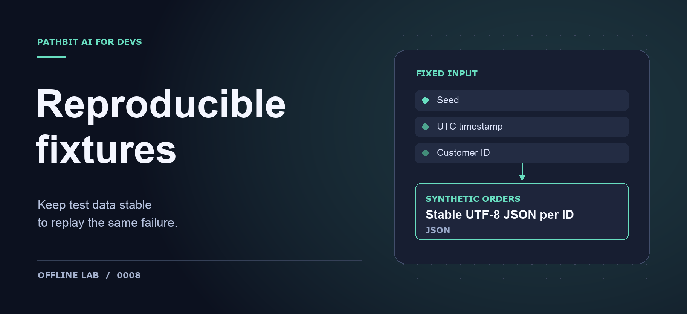

# Reproducible fixtures for integration tests

[Português (Brasil)](ARTICLE.md) · **English** · [Español](ARTICLE.es.md)

A checkout test checks the order, the total and the creation time. If the fixture uses the current clock and a different random draw on each run, every failure comes with different data. Explicit inputs restore a reliable comparison and let you discuss with the agent which part of the behavior changed.

## Requirements

- [Python 3.10 or later](https://www.python.org/downloads/). The lab recommends [Python 3.14.7](https://www.python.org/downloads/release/python-3147/), with installers for each system.
- Optional virtual environment. See the [setup instructions](../README.en.md#requirements).

## Make the clock and seed explicit inputs

The [example specification](../examples/orders.json.example) includes a UTC `created_at`, a `seed` and a list of synthetic customers. The generator validates the date and identifier before producing data. Two customers with the same ID stop execution. Each order can therefore have a stable `order-<id>` key.

The total in cents comes from the first four SHA-256 bytes of a tuple containing the algorithm identifier, the seed and the customer ID. We map the result to 1,000 through 9,999. This gives the lab varied amounts without aiming to model real sales. Deriving values by ID keeps a newly inserted customer from changing the totals of all subsequent ones. [hashlib documentation](https://docs.python.org/3/library/hashlib.html).

## Specify which parts stay stable

| Input change | Expected effect |
| --- | --- |
| Reverse the customer order | Output stays identical because we sort by ID. |
| Add one customer | Existing orders keep their data. |
| Change the seed | The generator derives the amounts again. |
| Change the timestamp | Every order has a new `created_at`. |

The output uses sorted keys, UTF-8, integer numbers and LF line endings. The `.gitattributes` file fixes LF for the golden file to avoid checkout-induced changes. Bytes are part of this contract. In API tests, comparing JSON fields and types usually handles formatting changes better. [json encoding and options](https://docs.python.org/3/library/json.html).

## Review fixture differences as code

Run `--check` before accepting a delivery. If the bytes differ, the command exits 1 and preserves the expected file. For an intentional change, generate the candidate at another path and read the diff. Update the reference after deciding that the new output fits the contract.

The example uses minimal synthetic data and a versioned format. Save the generator version and its input alongside the evidence to reproduce a later failure. To cover a boundary timestamp, an empty cart or an invalid amount, add a specific case instead of relying on chance.

## Show-Me-The-Code

### Option 1. Run the local comparison

The [module guide](../README.en.md) shows the `--check` command and the test group.

### Option 2. Change an isolated copy

The [practical example](../examples/README.en.md) reverses the customers and changes the seed in a temporary directory. The first change preserves the bytes. The second calls for review.

## Continue with the next step

Stable inputs give you data you can replay after a failure. Continue with [CI diagnostics using JUnit reports](../../0009_diagnostico_ci_com_junit/article/ARTICLE.en.md).
