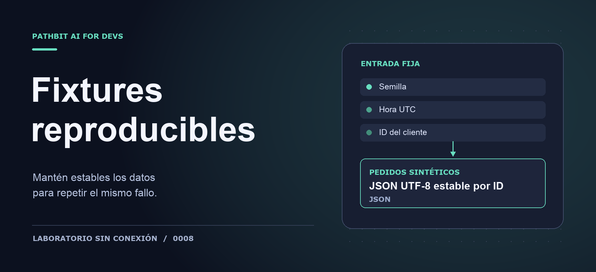

# Fixtures reproducibles para pruebas de integración

[Português (Brasil)](ARTICLE.md) · [English](ARTICLE.en.md) · **Español**

Una prueba de checkout comprueba el pedido, el total y la hora de creación. Si la fixture usa el reloj actual y un sorteo nuevo en cada ejecución, cada fallo llega con datos distintos. Fijar la entrada devuelve a la prueba una comparación fiable y permite discutir con el agente qué comportamiento cambió.

## Requisitos

- [Python 3.10 o posterior](https://www.python.org/downloads/). El laboratorio recomienda [Python 3.14.7](https://www.python.org/downloads/release/python-3147/), con instaladores para cada sistema.
- Entorno virtual opcional. Consulta [cómo prepararlo](../README.es.md#requisitos).

## Haz explícitos el reloj y la semilla

La [especificación de ejemplo](../examples/orders.json.example) incluye `created_at` en UTC, una `seed` y una lista de clientes sintéticos. El generador valida la fecha y el identificador antes de producir datos. Si dos clientes tienen el mismo ID, la ejecución se detiene. Cada pedido puede así tener una clave estable `order-<id>`.

El total en centavos sale de los primeros cuatro bytes de SHA-256 de una tupla con el identificador del algoritmo, la semilla y el ID del cliente. El resultado se lleva al intervalo de 1.000 a 9.999. Esto da importes variados al laboratorio sin intentar reproducir ventas reales. La derivación por ID evita que insertar un cliente cambie los valores de todos los siguientes. [Documentación de hashlib](https://docs.python.org/3/library/hashlib.html).

## Define qué debe permanecer estable

| Cambio en la entrada | Efecto esperado |
| --- | --- |
| Invertir el orden de clientes | La salida conserva los mismos bytes porque ordenamos por ID. |
| Añadir un cliente | Los pedidos existentes conservan sus datos. |
| Cambiar la semilla | El generador recalcula los importes. |
| Cambiar la fecha | Cambia `created_at` en todos los pedidos. |

La salida usa claves ordenadas, UTF-8, números enteros y saltos LF. El archivo `.gitattributes` fija LF en el archivo esperado para evitar diferencias del checkout. Aquí los bytes son parte del contrato. En pruebas de API, comparar campos y tipos JSON suele tolerar mejor los cambios de formato. [Codificación y opciones de json](https://docs.python.org/3/library/json.html).

## Revisa las diferencias de la fixture como código

Ejecuta `--check` antes de aceptar una entrega. Si los bytes difieren, el comando devuelve 1 y conserva el archivo esperado. Si el cambio es intencional, genera un candidato en otra ruta y lee el diff. Actualiza la referencia después de decidir que la salida nueva encaja en el contrato.

El ejemplo usa datos sintéticos mínimos y un formato versionado. Guarda la versión del generador y su entrada junto con la evidencia para reproducir el fallo en el futuro. Si necesitas cubrir una fecha límite, un carrito vacío o un valor inválido, añade un caso específico en lugar de depender del azar.

## Show-Me-The-Code

### Opción 1. Ejecuta la comparación local

La [guía del módulo](../README.es.md) muestra el comando `--check` y el grupo de pruebas.

### Opción 2. Modifica una copia aislada

El [ejemplo práctico](../examples/README.es.md) invierte el orden de los clientes y cambia la semilla en una carpeta temporal. El primer cambio conserva los bytes. El segundo requiere revisión.

## Sigue al próximo paso

Las entradas estables te dan datos que puedes volver a usar después de un fallo. Continúa con [diagnóstico de CI mediante informes JUnit](../../0009_diagnostico_ci_com_junit/article/ARTICLE.es.md).
