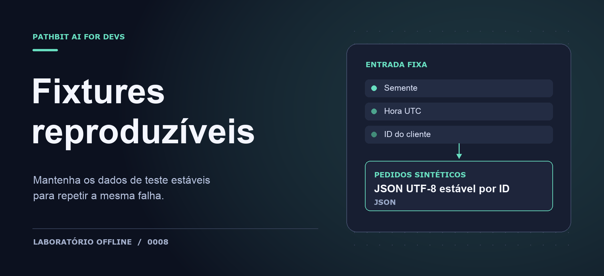

# Fixtures reproduzíveis para testes de integração

**Português (Brasil)** · [English](ARTICLE.en.md) · [Español](ARTICLE.es.md)

Um teste de checkout registra o pedido, o total e a hora de criação. Se a fixture usa o relógio corrente e um sorteio novo a cada execução, cada falha chega acompanhada de dados diferentes. Fixar a entrada devolve ao teste uma comparação confiável e permite discutir com o agente qual comportamento mudou.

## Pré-requisitos

- [Python 3.10 ou posterior](https://www.python.org/downloads/). A versão recomendada para o laboratório é o [Python 3.14.7](https://www.python.org/downloads/release/python-3147/), com instaladores para cada sistema.
- Ambiente virtual opcional. Veja [como preparar](../README.md#pré-requisitos).

## Torne relógio e semente entradas explícitas

A [especificação de exemplo](../examples/orders.json.example) inclui `created_at` em UTC, `seed` e uma lista de clientes sintéticos. O gerador valida a data e o identificador antes de produzir qualquer dado. Se dois clientes têm o mesmo ID, a execução falha. Assim, cada pedido pode ter a chave estável `order-<id>`.

O total em centavos vem dos quatro primeiros bytes de um SHA-256 aplicado à tupla formada pelo identificador do algoritmo, a semente e o ID do cliente. Reduzimos o resultado ao intervalo de 1.000 a 9.999. A distribuição foi escolhida para produzir valores variados no laboratório, sem pretensão de reproduzir vendas reais. A derivação por ID evita que inserir um cliente mude o valor de todos os seguintes. [Documentação de hashlib](https://docs.python.org/3/library/hashlib.html).

## Defina o que precisa permanecer estável

| Alteração de entrada | Efeito esperado |
| --- | --- |
| Inverter a ordem dos clientes | A saída permanece idêntica porque ordenamos por ID. |
| Adicionar um cliente | Os dados dos pedidos existentes continuam iguais. |
| Trocar a semente | Os valores são recalculados. |
| Trocar o horário | O campo `created_at` muda em todos os pedidos. |

A saída usa chaves ordenadas, UTF-8, números inteiros e LF no fim das linhas. O `.gitattributes` fixa LF no arquivo esperado para evitar diferenças introduzidas pelo checkout. Aqui os bytes fazem parte do contrato. Em testes de uma API, comparar campos e tipos do JSON costuma tolerar melhor mudanças de formatação. [Codificação e opções de json](https://docs.python.org/3/library/json.html).

## Revise diferenças na fixture como código

Rode `--check` antes de aceitar a entrega. Em caso de diferença, o comando sai com 1 e preserva o esperado. Para uma mudança intencional, gere o candidato em outro caminho e leia o diff. Substitua o arquivo de referência só depois de decidir que a nova saída faz sentido para o contrato.

O exemplo registra dados sintéticos mínimos e um formato versionado. Salve a versão do gerador e a entrada junto com a evidência para repetir a falha no futuro. Se for preciso testar um horário no limite, um carrinho vazio ou um valor inválido, acrescente um caso específico em vez de depender do acaso.

## Show-Me-The-Code

### Opção 1. Rode a comparação local

O [guia do módulo](../README.md) mostra o comando `--check` e o grupo de testes.

### Opção 2. Modifique uma cópia isolada

O [exemplo prático](../examples/README.md) orienta a inverter clientes e trocar a semente em uma pasta temporária. A primeira mudança conserva os bytes e a segunda exige revisão.

## Acompanhe o próximo passo

Com entradas estáveis, a próxima falha tem dados que podem ser repetidos. Continue com [diagnóstico de CI por relatórios JUnit](../../0009_diagnostico_ci_com_junit/article/ARTICLE.md).
