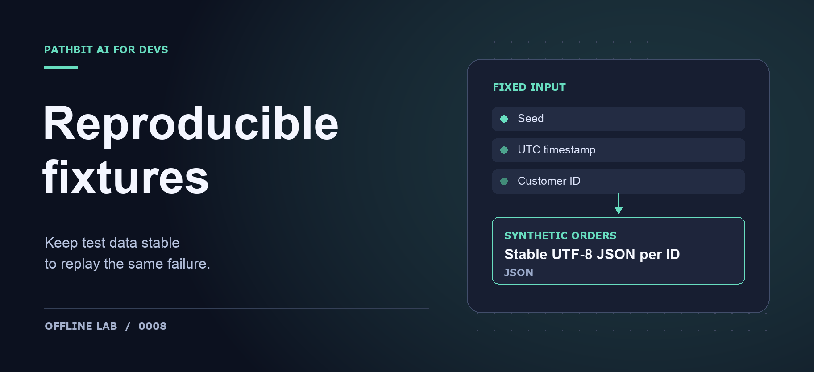

# How to replay test data without rewriting the fixture

[Português (Brasil)](ARTICLE_LINKEDIN.md) · **English** · [Español](ARTICLE_LINKEDIN.es.md)

If every integration failure comes with a different set of orders, how can you confirm you fixed the same problem?

## Requirements

Python. See [requirements and downloads](../README.en.md#requirements).

In the lab, the UTC timestamp and seed are inputs. The ID names the order and derives its amount in cents. Inserting another customer therefore leaves existing records alone. The generator sorts IDs, formats JSON consistently and keeps the expected output under review.

## What the lab shows

The initial comparison passes. Reverse the customers in a copy of the input and the bytes stay identical. Change the seed and the checker exits 1, leaving the golden file available for diff review.

Use a reproducible fixture to replay the failure. Add explicit cases for business boundaries that need to appear every time.

## Show-Me-The-Code

### Option 1. Follow the setup guide

[Setup guide](../README.en.md)

### Option 2. Reproduce in the isolated scenario

[Practical example](../examples/README.en.md)

[Full article](ARTICLE.en.md)
