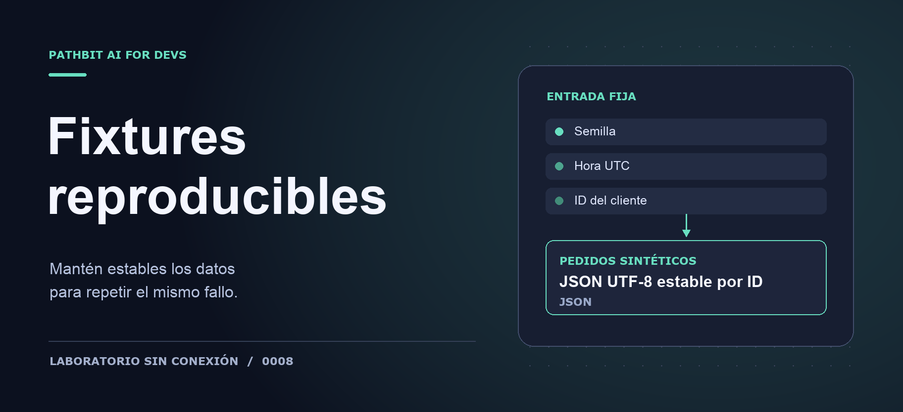

# Cómo repetir datos de prueba sin reescribir la fixture

[Português (Brasil)](ARTICLE_LINKEDIN.md) · [English](ARTICLE_LINKEDIN.en.md) · **Español**

Si cada fallo de integración trae un conjunto nuevo de pedidos, ¿cómo confirmas que resolviste el mismo problema?

## Requisitos

Python. Consulta [requisitos y descargas](../README.es.md#requisitos).

En el laboratorio, la fecha UTC y la semilla forman parte de la entrada. El ID identifica el pedido y determina su valor en centavos. Insertar otro cliente conserva por tanto los registros existentes. El generador ordena IDs, da un formato estable al JSON y mantiene la salida esperada bajo revisión.

## Qué muestra el laboratorio

La comparación inicial pasa. Invierte los clientes en una copia de la entrada y los bytes siguen iguales. Cambia la semilla y el verificador devuelve 1, dejando la referencia disponible para revisar el diff.

Usa una fixture reproducible para repetir el fallo. Añade casos explícitos para los límites de negocio que deben aparecer en todas las ejecuciones.

## Show-Me-The-Code

### Opción 1. Sigue la guía de ejecución

[Guía de ejecución](../README.es.md)

### Opción 2. Reproduce el caso aislado

[Ejemplo práctico](../examples/README.es.md)

[Artículo completo](ARTICLE.es.md)
