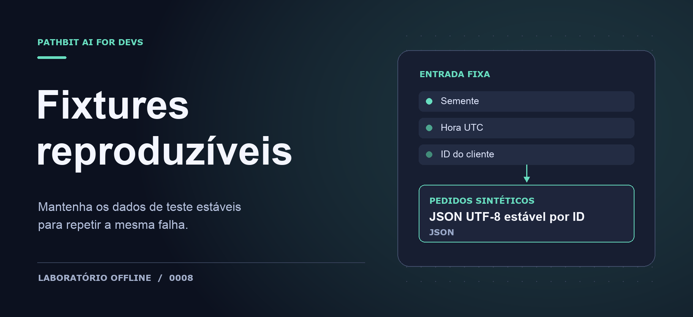

# Como repetir dados de teste sem reescrever a fixture

**Português (Brasil)** · [English](ARTICLE_LINKEDIN.en.md) · [Español](ARTICLE_LINKEDIN.es.md)

Se cada falha de integração traz um conjunto novo de pedidos, como confirmar que você resolveu o mesmo problema?

## Pré-requisitos

Python. Consulte os [pré-requisitos e downloads](../README.md#pré-requisitos).

No laboratório, a data UTC e a semente são parte da entrada. O ID identifica o pedido e deriva seu valor em centavos. Por isso inserir outro cliente não muda os registros existentes. O gerador ordena os IDs, formata o JSON de forma estável e mantém a saída esperada sob revisão.

## O que o laboratório mostra

A comparação inicial passa. Inverta os clientes em uma cópia da entrada e a saída mantém os mesmos bytes. Troque a semente e o verificador sai com 1, mantendo o esperado disponível para inspecionar o diff.

Use a fixture reproduzível para repetir a falha. Acrescente casos explícitos para os limites de negócio que precisam aparecer em toda execução.

## Show-Me-The-Code

### Opção 1. Confira o guia de execução

[Guia de execução](../README.md)

### Opção 2. Reproduza no cenário isolado

[Exemplo prático](../examples/README.md)

[Artigo completo](ARTICLE.md)
