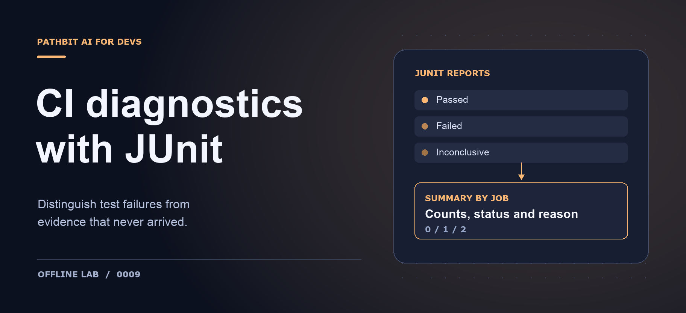

# CI diagnostics with JUnit reports

[Português (Brasil)](ARTICLE.md) · **English** · [Español](ARTICLE.es.md)

When CI turns red, open the evidence from the run before asking an agent for a fix. `api` may have a failed assertion, while `storage` may have produced no report. Those cases lead to different actions. The first calls for investigating behavior. The second calls for recovering the job's evidence.

## Requirements

- [Python 3.10 or later](https://www.python.org/downloads/). The lab recommends [Python 3.14.7](https://www.python.org/downloads/release/python-3147/), with installers for each system.
- Optional virtual environment. See the [setup instructions](../README.en.md#requirements).

## Record which jobs were required

An available report tells you what happened in a suite, but the expected job list must come from outside the XML. In the lab, `--jobs api storage` defines that list. Each source artifact is named `<job>.xml` and comes from the same run. Retain the CI run identifier and commit beside the summary.

The CLI accepts a JUnit XML subset rooted at `<testsuite>` or a `<testsuites>` element containing direct suites. It counts `<testcase>` elements and classifies `<failure>`, `<error>` and `<skipped>`. It checks declared totals against testcase records when totals are present. The lab handles local UTF-8 XML up to 1 MiB and rejects DTDs. Unknown outcome elements leave the report inconclusive. Check your runner's export format before reusing the parser. [ElementTree in the standard library](https://docs.python.org/3/library/xml.etree.elementtree.html).

## Distinguish a failure from insufficient evidence

| Evidence from the run | Overall status | Exit |
| --- | --- | --- |
| All required reports contain tests and all pass | `passed` | 0 |
| Any valid report contains a test failure or error | `failed` | 1 |
| Missing, invalid or empty report or a skipped test, with no observed failure | `inconclusive` | 2 |

An observed failure takes priority in the overall result. In the example, `api` fails a contract and `storage` is missing. The command exits 1 and records both reasons. Under this policy a skipped test leaves the report incomplete. Decide which skips you accept with your team before adapting the rule.

## Pass the right evidence to the next reviewer

Read the summary counters and open the original report to investigate the assertion, environment or setup. The JSON keeps counts and reasons without copying messages and stack traces that might contain internal data. Keep XML files under the artifact access rules of your CI system.

Use the summary alongside job statuses. A build can fail after writing an approved XML file, or CI can exit before tests start. Use the pipeline conclusion, the [article 0006 HTTP gate](../../0006_gate_de_release_de_contratos/article/ARTICLE.md) and test evidence to make the final decision.

## Show-Me-The-Code

### Option 1. Run in your environment

The [module guide](../README.en.md) runs the passing scenario using Python and local XML.

### Option 2. Compare the three local scenarios

The [isolated example](../examples/README.en.md) includes a failure and an inconclusive run. Compare the expected reasons before connecting the checker to CI.

## Use the sequence in a delivery

Check [the scope of the changes](../../0007_revisao_git_com_escopo/article/ARTICLE.en.md), preserve [the test inputs](../../0008_fixtures_reproduziveis/article/ARTICLE.en.md) and inspect the run result. Each step leaves different evidence for review.
