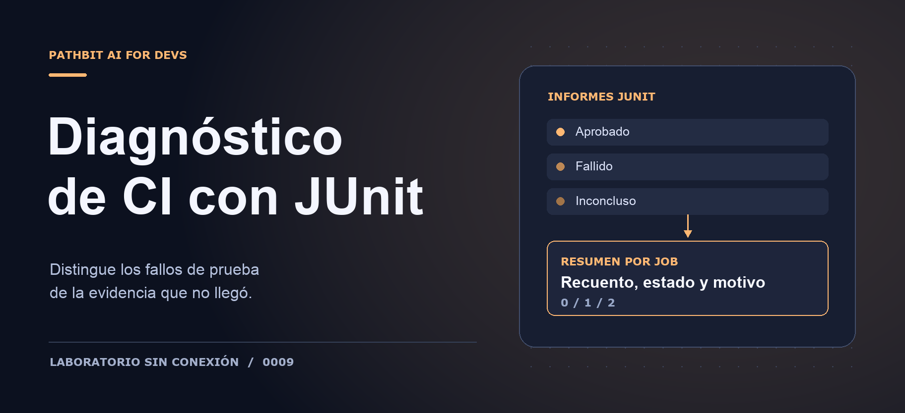

# Diagnóstico de CI con informes JUnit

[Português (Brasil)](ARTICLE.md) · [English](ARTICLE.en.md) · **Español**

Cuando CI falla, abre la evidencia de la ejecución antes de pedir una corrección al agente. `api` puede registrar una aserción fallida, mientras que `storage` puede no haber publicado ningún informe. Son dos acciones distintas. La primera requiere investigar el comportamiento. La segunda requiere recuperar la evidencia del job.

## Requisitos

- [Python 3.10 o posterior](https://www.python.org/downloads/). El laboratorio recomienda [Python 3.14.7](https://www.python.org/downloads/release/python-3147/), con instaladores para cada sistema.
- Entorno virtual opcional. Consulta [cómo prepararlo](../README.es.md#requisitos).

## Registra qué jobs eran obligatorios

Un informe disponible explica qué pasó en una suite, pero la lista de jobs esperados debe venir de fuera de los XML. En el laboratorio, `--jobs api storage` define esa lista. Cada artefacto tiene el nombre `<job>.xml` y procede de la misma ejecución. Guarda el identificador de la ejecución de CI y el commit junto al resumen.

La CLI acepta el subconjunto XML de JUnit con raíz `<testsuite>` o `<testsuites>` con suites directas. Cuenta elementos `<testcase>` y clasifica `<failure>`, `<error>` y `<skipped>`. Si el informe declara totales, deben coincidir con los casos. El laboratorio acepta XML UTF-8 local de hasta 1 MiB y rechaza DTD. Los elementos de resultado desconocidos dejan el informe inconcluso. Comprueba el formato que exporta tu runner antes de reutilizar el analizador. [ElementTree en la biblioteca estándar](https://docs.python.org/3/library/xml.etree.elementtree.html).

## Distingue un fallo de la evidencia insuficiente

| Evidencia de la ejecución | Estado agregado | Salida |
| --- | --- | --- |
| Todos los informes requeridos tienen pruebas y todas pasan | `passed` | 0 |
| Un informe válido contiene un fallo o error de prueba | `failed` | 1 |
| Informe ausente, inválido o vacío, o prueba omitida, sin un fallo observado | `inconclusive` | 2 |

El fallo observado tiene prioridad en el agregado. En el ejemplo, `api` falla un contrato y falta `storage`. El comando devuelve 1 y registra ambos motivos. Con esta política, una prueba omitida deja el informe incompleto. Acuerda con tu equipo qué omisiones son aceptables antes de adaptar la regla.

## Entrega la evidencia adecuada a quien revisa

Lee los contadores y abre el informe original para investigar la aserción, el entorno o la configuración. El JSON conserva recuentos y motivos sin copiar mensajes y trazas que puedan contener datos internos. Mantén los XML bajo las reglas de acceso de los artefactos de CI.

Usa el resumen junto con los estados de los jobs. Una compilación puede fallar después de escribir un XML aprobado, o el CI puede terminar antes de comenzar las pruebas. Reúne el resultado del pipeline, el [control HTTP del artículo 0006](../../0006_gate_de_release_de_contratos/article/ARTICLE.md) y la evidencia para tomar la decisión final.

## Show-Me-The-Code

### Opción 1. Ejecuta en tu entorno

La [guía del módulo](../README.es.md) ejecuta el caso aprobado con Python y XML locales.

### Opción 2. Compara los tres escenarios locales

El [ejemplo aislado](../examples/README.es.md) incluye un fallo y una ejecución inconclusa. Compara los motivos esperados antes de conectar el verificador a CI.

## Aplica la secuencia en una entrega

Comprueba [el alcance de los cambios](../../0007_revisao_git_com_escopo/article/ARTICLE.es.md), conserva [las entradas de prueba](../../0008_fixtures_reproduziveis/article/ARTICLE.es.md) e inspecciona el resultado. Cada paso deja evidencia distinta para la revisión.
