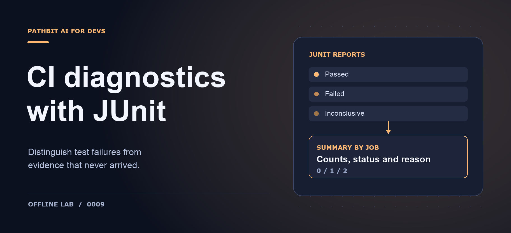

# How to read the evidence behind a red CI run

[Português (Brasil)](ARTICLE_LINKEDIN.md) · **English** · [Español](ARTICLE_LINKEDIN.es.md)

One job recorded a failed assertion and another produced no XML. What does each one need before it can move forward?

## Requirements

Python. See [requirements and downloads](../README.en.md#requirements).

The article 0009 summary starts from the required job list. It reads local XML, counts cases and records the result for each job. Exit 0 requires evidence of a pass in every job. An observed failure exits 1. Insufficient evidence with no recorded failure exits 2.

## What the lab shows

In the failing case, the JSON retains `test-failures` for `api` and `missing-report` for `storage`. The first points to an assertion. The second points to evidence collection. Automation retains both facts in one summary.

Attach the finding to the commit and run ID. In an agent-assisted review, pass along the reason, the relevant artifact and the information you still need.

## Show-Me-The-Code

### Option 1. Follow the setup guide

[Setup guide](../README.en.md)

### Option 2. Reproduce in the isolated scenario

[Practical example](../examples/README.en.md)

[Full article](ARTICLE.en.md)
