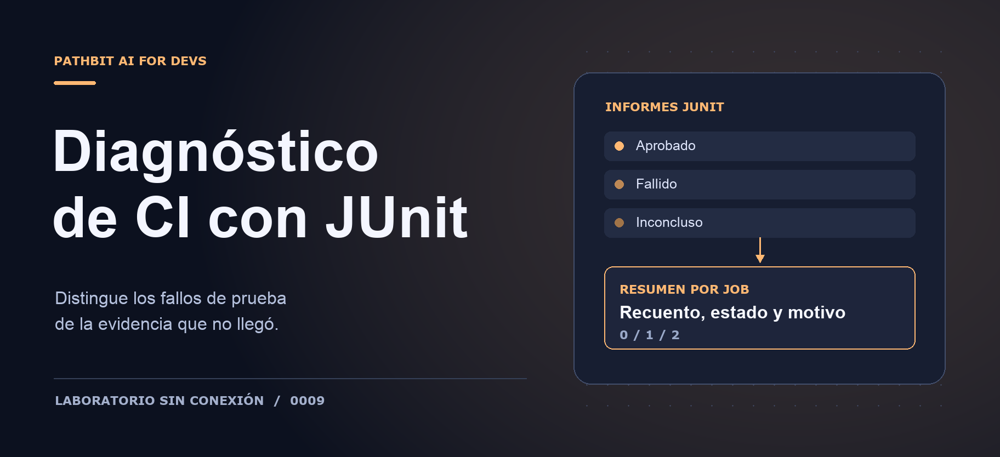

# Cómo leer la evidencia de un CI que falla

[Português (Brasil)](ARTICLE_LINKEDIN.md) · [English](ARTICLE_LINKEDIN.en.md) · **Español**

Un job registró una aserción fallida y otro se quedó sin XML. ¿Qué necesita cada uno para poder avanzar?

## Requisitos

Python. Consulta [requisitos y descargas](../README.es.md#requisitos).

El resumen del artículo 0009 parte de la lista de jobs obligatorios. Lee XML locales, cuenta los casos y registra cada resultado. El código 0 exige evidencia de aprobación en todos. Un fallo observado devuelve 1. La evidencia insuficiente sin fallo registrado devuelve 2.

## Qué muestra el laboratorio

En el caso con fallo, el JSON mantiene `test-failures` para `api` y `missing-report` para `storage`. El primero apunta a la aserción. El segundo apunta a la recolección de evidencia. La automatización conserva los dos hechos en un mismo resumen.

Vincula el hallazgo con el commit y el identificador de ejecución. En una revisión asistida por agentes, comparte el motivo, el artefacto y la información que aún falta.

## Show-Me-The-Code

### Opción 1. Sigue la guía de ejecución

[Guía de ejecución](../README.es.md)

### Opción 2. Reproduce el caso aislado

[Ejemplo práctico](../examples/README.es.md)

[Artículo completo](ARTICLE.es.md)
