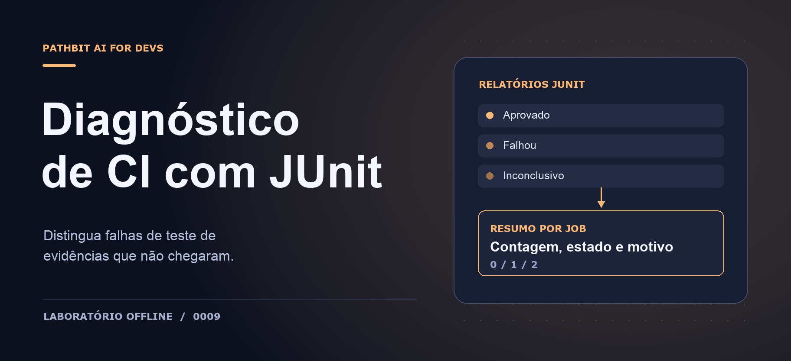

# Como ler a evidência de um CI vermelho

**Português (Brasil)** · [English](ARTICLE_LINKEDIN.en.md) · [Español](ARTICLE_LINKEDIN.es.md)

Um job registrou uma asserção falha e outro ficou sem XML. O que cada um precisa para voltar a avançar?

## Pré-requisitos

Python. Consulte os [pré-requisitos e downloads](../README.md#pré-requisitos).

O resumo do artigo 0009 começa pela lista de jobs obrigatórios. Lê os XMLs locais, conta os casos e registra o resultado de cada job. O código 0 exige evidência de aprovação em todos. Falha observada retorna 1. Evidência insuficiente sem falha registrada retorna 2.

## O que o laboratório mostra

No cenário com falha, o JSON mantém `test-failures` para `api` e `missing-report` para `storage`. O primeiro aponta para a asserção. O segundo aponta para a coleta de evidência. A automação preserva os dois fatos no mesmo resumo.

Anexe a constatação ao commit e ao identificador da execução. Em uma revisão com agentes, entregue o motivo, o artefato correspondente e a informação que falta.

## Show-Me-The-Code

### Opção 1. Confira o guia de execução

[Guia de execução](../README.md)

### Opção 2. Reproduza no cenário isolado

[Exemplo prático](../examples/README.md)

[Artigo completo](ARTICLE.md)
