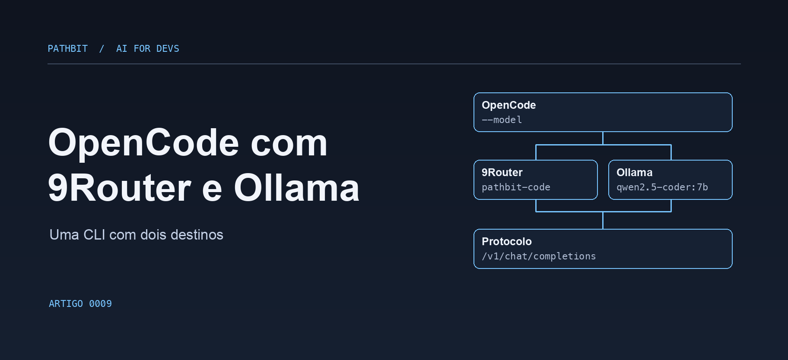

# Enruta OpenCode por 9Router y un modelo local en Ollama

[Português (Brasil)](ARTICLE.md) · [English](ARTICLE.en.md) · [Español](ARTICLE.es.md)

El gateway de los artículos 0002 y 0003 ya administra modelos. Este laboratorio conecta OpenCode a ese gateway y añade una salida local en Ollama. Importa comprobar el destino y el identificador, además del texto que aparece en la terminal.

## Relaciona el selector del cliente con el modelo

OpenCode elige `router/pathbit-code` o `local/qwen2.5-coder:7b`. El prefijo selecciona el proveedor configurado. El gateway recibe `pathbit-code` y Ollama recibe `qwen2.5-coder:7b`. Un gateway local puede delegar a un servicio externo. Revisa el destino y la política antes de adjuntar código.

## Usa el formato de configuración de OpenCode 2.4

El ejemplo usa `providers`, `package` y `settings` con valores del entorno. `baseURL` termina en `/v1` y el runtime añade `/chat/completions`. Guarda la clave real fuera del JSON y usa nombres de modelo reconocidos por los servicios.

## Observa solicitudes reales de la CLI con la sonda

Ejecuta `probe_server.py` y usa las rutas `/router/v1` y `/local/v1` en los dos proveedores. Ejecuta OpenCode con cada `--model`. Busca `PATHBIT_ROUTER_OK` y `PATHBIT_LOCAL_OK` y confirma ruta y modelo en la sonda. Este ejercicio verifica transporte y selección con respuestas deterministas.

## Cambia a servicios reales uno por uno

Consulta el catálogo del gateway, elige un combo y envía una solicitud breve. Inicia Ollama y descarga la etiqueta elegida antes de probar la salida local. Para conectar el ejemplo con el agregador, adjunta solo la ruta de favoritos y pide una explicación del filtro y el límite.

## Distingue selección de destino y fallback

El gateway puede cambiar de proveedor dentro de un combo. El ejemplo elige explícitamente entre gateway y Ollama. Ante un `401`, comprueba la clave. Ante un `404`, comprueba el modelo y la ruta. Una respuesta de texto no demuestra compatibilidad con llamadas de herramientas.

[Inicio rápido](../README.es.md) · [Ejemplo práctico](../examples/README.es.md) · [Documentación oficial](https://opencode.ai/docs/providers/)

Developed with ❤️ by [Pathbit](https://pathbit.co/)
