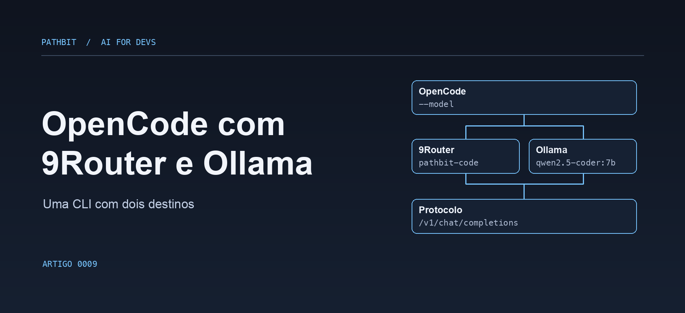
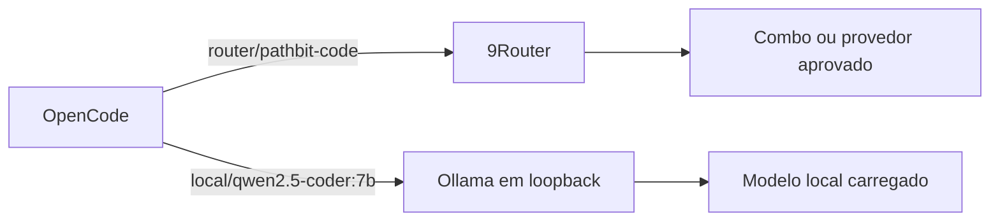

# Como usar OpenCode com o 9Router e um modelo local no Ollama



[Português (Brasil)](ARTICLE.md) · [English](ARTICLE.en.md) · [Español](ARTICLE.es.md)


O [artigo 0002](../../0002_claude_gravity_utilizando_9router/article/ARTICLE.md) conecta o Claude Code ao 9Router. O [0003](../../0003_fallback_modelos_gratuitos_9router/article/ARTICLE.md) usa combos para montar uma cascata dentro do gateway. Ao trocar o cliente para OpenCode, vale manter as rotas onde você já administra os modelos e adicionar uma opção que fala com o Ollama no próprio computador.

O objetivo é escolher a rota de cada sessão com clareza. Você pode pedir ao OpenCode que explique o contrato de favoritos do Agregador usando o combo do gateway e repetir o exercício com um modelo local. Antes de enviar um arquivo do projeto, verifique a URL que realmente recebe a requisição, o identificador de modelo enviado pelo cliente e as capacidades da rota.

## Arquitetura de duas saídas



| Dimensão | Rota `router` | Rota `local` |
| --- | --- | --- |
| URL de base | `http://127.0.0.1:20128/v1` na stack dos primeiros artigos | `http://127.0.0.1:11434/v1` com Ollama local |
| Modelo do OpenCode | `router/pathbit-code` | `local/qwen2.5-coder:7b` |
| Campo `model` enviado | `pathbit-code` | `qwen2.5-coder:7b` |
| Credencial | Chave do gateway, lida do ambiente | Valor `ollama` no exemplo local |
| Onde o código do prompt pode trafegar | O gateway pode encaminhar ao provedor do combo | Instância Ollama configurada para executar o modelo local |

A rota do gateway pode ser local e ainda assim encaminhar prompts para fora da máquina. Leia o combo e as regras de tratamento de dados antes de enviar código de trabalho. A rota local do artigo aponta para loopback e usa um modelo baixado. Se você apontar o serviço para outra máquina ou habilitar um modelo servido remotamente, muda o destino efetivo dos dados.

## Configure o projeto sem alterar os outros workspaces

O laboratório mantém o [arquivo de configuração](../examples/opencode.json.example) dentro do exemplo. Copie-o como `opencode.json` para uma pasta descartável ou, depois de revisar, para a raiz do projeto. A versão usada no teste foi OpenCode **2.4.1**. Nesta linha, use `providers`, `package` e `settings`. Tutoriais que mostram `provider` e `npm` podem se referir a uma geração anterior do formato. [Provedores no OpenCode](https://opencode.ai/docs/providers/) · [Precedência da configuração](https://opencode.ai/docs/config/).

Os valores da URL e da chave do 9Router vêm de `{env:PATHBIT_ROUTER_BASE}` e `{env:PATHBIT_ROUTER_KEY}`. A URL local vem de `{env:PATHBIT_OLLAMA_BASE}`. O prefixo antes da barra escolhe o provedor no cliente. O identificador dentro de `models` precisa bater com o combo no gateway ou com a tag que o Ollama reconhece. O nome amigável serve para exibição no menu.

Nos dois destinos, `baseURL` termina em `/v1`. O runtime compatível adiciona `/chat/completions`. Não coloque `/v1/chat/completions` inteiro no campo de URL de base. O 9Router dos exemplos anteriores expõe também um caminho para compatibilidade com Anthropic. Aqui estamos usando o caminho OpenAI-compatível para o OpenCode conversar com os dois servidores com o mesmo tipo de requisição. [Compatibilidade OpenAI no Ollama](https://docs.ollama.com/api/openai-compatibility).

## Comprove a seleção com uma sonda local

Antes de ligar provedores reais, rode `probe_server.py`. Ele simula dois endereços no seu computador. Cada um aceita um identificador e devolve um recibo fixo no protocolo que o OpenCode usa. O texto do pedido pode ser simples porque a evidência está no caminho e no campo `model` recebidos pelo servidor.

```bash
export PATHBIT_ROUTER_BASE=http://127.0.0.1:19809/router/v1
export PATHBIT_ROUTER_KEY=lab-only
export PATHBIT_OLLAMA_BASE=http://127.0.0.1:19809/local/v1
opencode --standalone run --model router/pathbit-code 'Return only a route receipt.'
opencode --standalone run --model local/qwen2.5-coder:7b 'Return only a route receipt.'
```

A primeira chamada deve incluir `PATHBIT_ROUTER_OK`. A segunda deve incluir `PATHBIT_LOCAL_OK`. O terminal da sonda registra requisições em `/router/v1/chat/completions` e `/local/v1/chat/completions`. Se você trocar o nome do modelo em uma das rotas, a sonda devolve uma resposta de erro com o identificador esperado. Esse percurso comprova roteamento e compatibilidade com o formato de resposta do laboratório. Ele não mede qualidade de geração de um modelo real.

## Passe para o gateway e para o Ollama do seu ambiente

No 9Router, crie ou selecione um combo já validado pelos passos do [artigo 0003](../../0003_fallback_modelos_gratuitos_9router/article/ARTICLE.md). Use a chave do gateway para consultar `/v1/models` e confira o identificador que ele aceita. Ajuste o nome `pathbit-code` no exemplo se o seu combo tiver outro ID. Uma rota pode listar modelos e ainda falhar em inferência por cota ou permissão. Confirme uma resposta pequena antes de tentar abrir o projeto.

Para o caminho local, inicie o Ollama e baixe `qwen2.5-coder:7b` ou escolha um modelo instalado, atualizando a tag nos dois lugares. Confira `ollama list` e o uso de memória da máquina. Um modelo pequeno pode responder bem a perguntas sobre um arquivo e falhar em uso de ferramentas ou em mudanças longas. O catálogo do Ollama documenta os tamanhos e tags disponíveis. [Qwen 2.5 Coder](https://ollama.com/library/qwen2.5-coder).

Rode cada CLI com `--model`, primeiro com uma frase de teste. Depois abra a cópia do Agregador e use `--file src/routes/favoritos.js` se quiser anexar apenas esse trecho ao teste. Peça que a resposta cite o filtro de favoritos e o limite da lista, sem editar código. Compare com a fonte antes de decidir se a rota serve para planejamento, implementação ou revisão.

## Escolher outro provedor e usar fallback são operações diferentes

`opencode run --model router/pathbit-code` pede ao 9Router que execute o combo. A cascata fica dentro do gateway e segue as regras que você configurou lá. `opencode run --model local/...` escolhe a rota do Ollama no lado do cliente. Este exemplo não configura uma troca automática entre `router` e `local`. Quando uma chamada falhar, anote o destino, confira o estado do gateway ou do Ollama e decida se deve repetir com o outro modelo.

Se a primeira chamada retorna `401`, revise qual chave entrou na rota selecionada. `404` pode indicar caminho ou ID de modelo. Uma resposta `429` do gateway pede examinar o provedor real do combo e suas cotas. Se houver timeout local, confirme se o modelo foi baixado e se a primeira carga demorou. Observe também se a tarefa depende de ferramentas. Uma conversa curta em texto pode passar com uma rota que rejeita `tool_calls`.

## Show-Me-The-Code

1. Copie a configuração e rode a sonda de acordo com o [guia](../README.md). Confira os dois recibos e os caminhos.
2. Abra o [roteiro de diagnóstico](../examples/README.md) e confirme o catálogo da sua saída real antes de usá-la.
3. Escolha o destino explicitamente. Adote o exemplo em uma cópia do projeto para examinar precedência, arquivos anexados e permissões da sessão.
4. Quando a rota estiver comprovada, siga para a [validação visual do Agregador](../../0010_playwright_mcp_agregador/article/ARTICLE.md).

---

Developed with ❤️ by [Pathbit](https://pathbit.co/)
