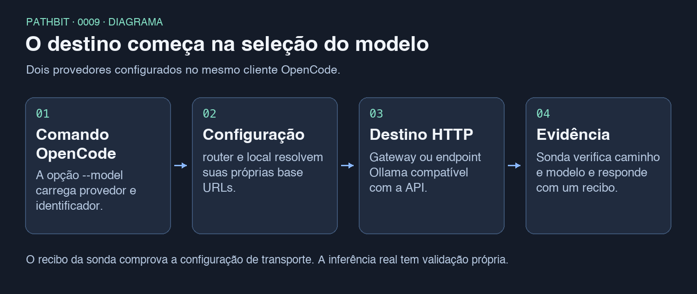
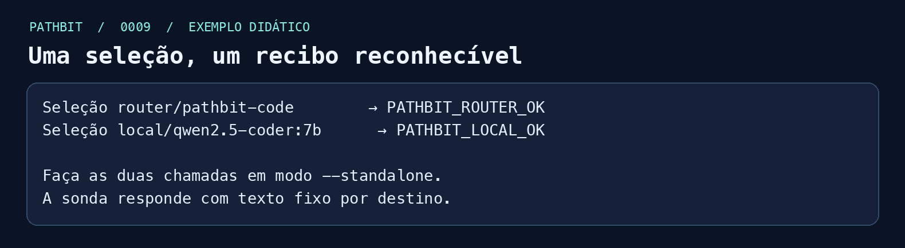
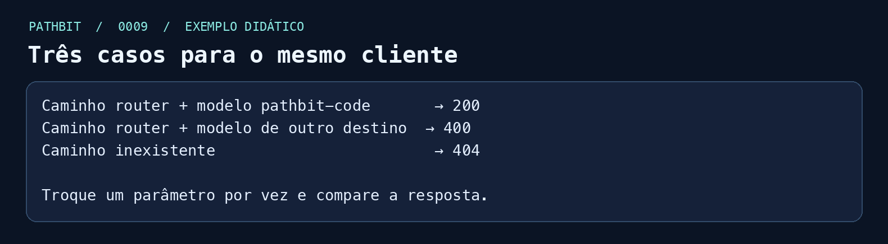

# O OpenCode respondeu. Como você conferiria qual servidor recebeu o pedido?

Configurei duas saídas no mesmo cliente. Uma representava um combo do 9Router, a outra um Ollama local. Se eu perguntasse ao modelo “qual modelo é você?”, receberia uma frase. Eu precisava saber por qual endpoint passou a requisição antes de decidir se podia anexar um arquivo do projeto.

É a diferença entre observar o que o modelo gerou e observar o que o cliente fez. O OpenCode lê `--model provedor/id`, escolhe as configurações do provedor e faz a chamada. O gateway pode decidir outro upstream. O Ollama pode receber a tag de um modelo que ainda precisa ser carregado. Cada transição pede uma evidência.

## Duas saídas, sem precisar ligar as duas plataformas

Usei uma sonda HTTP local. Ela reconhece dois prefixos compatíveis com a API usada pelo cliente. Se o modelo do corpo bate com o modelo esperado para aquele caminho, a sonda envia um recibo. Um prefixo errado devolve `404`. Um modelo incorreto naquele caminho devolve `400`. A mesma configuração se presta ao teste sem acionar serviços pagos nem baixar um modelo.

| Seleção no OpenCode | Rota observada na sonda | Recibo |
| --- | --- | --- |
| `router/pathbit-code` | `/router/v1/chat/completions` | `PATHBIT_ROUTER_OK` |
| `local/qwen2.5-coder:7b` | `/local/v1/chat/completions` | `PATHBIT_LOCAL_OK` |

O `opencode.json` do exercício usa o adaptador compatível para ambas as entradas. O `baseURL` e o modelo disponível mudam em cada uma. A configuração funciona em um diretório temporário. O pedido da execução foi a mesma frase para as duas rotas, sem arquivos do Agregador.

O terminal do servidor também registrou os caminhos das duas chamadas. A combinação verificar caminho mais corpo é importante. Uma sonda que devolve `200` antes de olhar o modelo aceitaria a tag local na rota do gateway. Uma frase que parece correta também não demonstraria que o gateway selecionou determinado membro do combo.

## Controle de rota e controle de modelo

O próximo teste foi enviar deliberadamente três pedidos à mesma sonda. O primeiro usou `pathbit-code` na rota do gateway e recebeu `200`. O segundo manteve o caminho e enviou `qwen2.5-coder:7b`, que recebeu `400` com o nome esperado. O terceiro colocou o modelo certo em um caminho inválido e recebeu `404`. Os casos negativos deixam mais claro por que os dois recibos anteriores significam alguma coisa.

Quem mantém o cliente pode usar os três resultados como uma tabela de diagnóstico. Se o caminho chegou ao servidor e o corpo diverge, procure o identificador selecionado e a entrada de configuração. Se o servidor recusa o caminho, revise a base que o cliente usou antes de trocar nomes de modelo. Se o serviço gerou texto mas a interface não exibiu, verifique a camada de streaming e a compatibilidade do adaptador. Cada hipótese pede observar uma parte diferente da chamada.

O mesmo raciocínio ajuda com vários projetos no notebook. Eu guardaria uma configuração de projeto com nomes de variáveis, nunca o valor da chave. A primeira chamada pode ser um pedido sem arquivos, suficiente para confirmar catálogo e transporte. Antes de anexar um trecho do projeto, o destino real precisa estar aprovado para aquele conteúdo. O serviço que escuta em loopback pode ser um proxy. A confirmação do caminho posterior fica com a instância que encaminha o pedido.

## A etapa real começa no catálogo

Depois do laboratório, é hora de consultar o serviço real. No 9Router, use o catálogo da sua instância para achar o identificador do combo e configure a chave no ambiente. No Ollama, veja os modelos que a máquina tem e confirme a tag que você pretende chamar. Em cada caso, mantenha o identificador do comando e o que o servidor espera alinhados.

Uma falha antes de aparecer tráfego costuma apontar para a seleção ou para onde o cliente leu a configuração. Um `404` no destino pode ser o caminho montado com uma base incompleta. Um `401` ou `403` do gateway dá outra pista, a credencial e seu escopo. Se a primeira resposta do Ollama demorar, vale verificar modelo carregado, memória e os recursos disponíveis antes de mudar o prompt.

## A mesma pergunta com dois modelos

No Agregador, o arquivo `src/routes/favoritos.js` tem escopo pequeno. Podemos pedir a duas sessões que indiquem quais métodos HTTP o módulo expõe, que formatos usa e quais linhas sustentam a resposta. Em seguida abrimos o arquivo e comparamos os resultados com critérios concretos. Uma resposta com detalhes que a pessoa revisora consegue localizar é mais fácil de avaliar que uma conclusão genérica.

O exercício de transporte foi executado com os endpoints da sonda. Para uma avaliação de inferência, use suas instâncias autorizadas e o mesmo conteúdo nas duas sessões. Olhe qualidade da resposta, latência, recurso local e dados enviados. Em um gateway que pode encaminhar a outro serviço, a URL de loopback indica a primeira conexão. É a política do gateway que esclarece o destino posterior.

Anotar qual camada respondeu tornou a configuração mais fácil de corrigir. A pergunta “qual servidor recebeu?” cabe num laboratório curto. “Qual modelo foi melhor para esta tarefa?” vira outra sessão, com os testes e os critérios que a escolha merece.

## Como escolher uma saída sem adivinhar pela marca do modelo

Em um gateway, você pode centralizar a descoberta dos provedores e a política de fallback. A equipe precisa conseguir rastrear qual membro assumiu a chamada e qual política vale quando algum destino falha. No caminho que chama Ollama diretamente, a decisão passa a depender dos modelos instalados e disponíveis e do que a máquina suporta naquele momento. Nas duas opções, os contratos do cliente continuam sendo o ponto de partida.

Uma comparação honesta usa a mesma tarefa, os mesmos arquivos e critérios conhecidos antes de rodar. Para a leitura de uma rota, eu conferiria se o texto localiza os métodos, se distingue JSON e outras representações e se cita código que ainda existe. Para edição, adicionaria teste, qualidade do diff e mudanças fora de escopo. Só depois mediria latência ou custo. O teste da sonda economiza o diagnóstico de configuração e deixa a avaliação de qualidade para o experimento que realmente envolve modelos.

[Início rápido, configuração e sonda no GitHub](https://github.com/pathbit/pathbit-ai-for-devs/tree/master/0009_opencode_9router_ollama)

Developed with ❤️ by [Pathbit](https://www.pathbit.com.br/)
