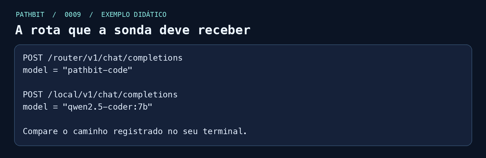

# Onde o OpenCode enviou seu pedido? O texto da resposta não resolve essa dúvida.

No módulo 0009 configurei dois destinos no mesmo cliente: um combo do 9Router e um modelo local do Ollama. Antes de ligar os serviços reais, fiz o cliente conversar com uma sonda local.

A sonda confere duas informações de cada chamada: o caminho HTTP e a tag no campo `model`. A primeira sessão devolveu `PATHBIT_ROUTER_OK`. A segunda devolveu `PATHBIT_LOCAL_OK`. O log do servidor confirmou os dois caminhos.

Esse exercício separou perguntas que costumam cair no mesmo diagnóstico:

- O cliente selecionou o provedor configurado?
- O endpoint recebeu a tag que entende?
- Se o pedido foi ao 9Router, qual membro do combo atendeu?
- A resposta daquele modelo serve para a tarefa?

As duas primeiras perguntas cabem no laboratório. Para a terceira use o trace do gateway real. Para a quarta, compare as respostas com o contrato do seu projeto. O artigo usa o módulo de favoritos do Agregador como um exercício curto de leitura de código.

Você pode rodar a sonda com Python e OpenCode antes de baixar um modelo ou configurar um combo. [Artigo e exemplos no GitHub](https://github.com/pathbit/pathbit-ai-for-devs/tree/master/0009_opencode_9router_ollama)

#OpenCode #9Router #Ollama #DesenvolvimentoDeSoftware
