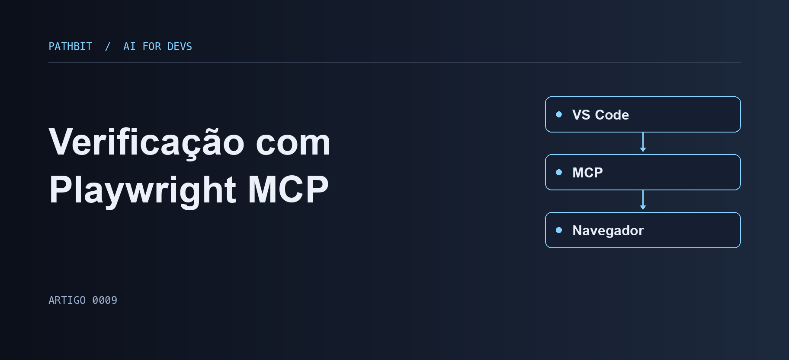

# Verify a local form with Playwright MCP in VS Code

[Português (Brasil)](ARTICLE.md) · [English](ARTICLE.en.md) · [Español](ARTICLE.es.md)

The shipping form can look correct in a diff and still display the wrong text in the browser. Use Playwright MCP to observe a validation failure and a successful retry on the same page.

## How it works

The workspace configuration in `.vscode/mcp.json` starts the Playwright server through `npx`. It uses `--isolated` for a fresh browser profile and `--headless` to run without a window. Check the package and command when VS Code asks whether you trust the server. The accessibility snapshot identifies controls by role and name.

## Run the exercise

Open `examples` and run `python3 -m http.server 19890 --bind 127.0.0.1 --directory site`. Start the MCP server from VS Code. Ask the assistant to go only to `http://127.0.0.1:19890/`, type `123` into `CEP`, click `Calcular frete`, and report the status. On the same page, replace it with `01001-000`, submit, and report the new value.

## Check the result

The first status is `Informe um CEP com 8 dígitos.`. The second is `Frete simulado: R$ 12,00`. The exercise validates format and uses a fixed shipping amount. If the result misses a step, request the observed status for both submissions. A recurring check can become a Playwright test with assertions for both messages.

[Quick start](../README.en.md) · [Official documentation](https://github.com/microsoft/playwright-mcp)

Developed with ❤️ by [Pathbit](https://pathbit.co/)
