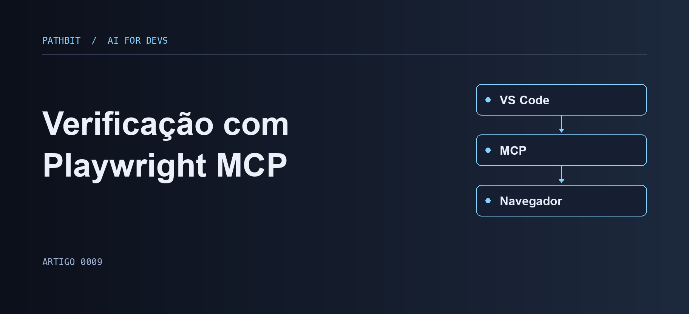

# Comprueba un formulario local con Playwright MCP en VS Code

[Português (Brasil)](ARTICLE.md) · [English](ARTICLE.en.md) · [Español](ARTICLE.es.md)

Un formulario de envío puede parecer correcto en el diff y mostrar un texto incorrecto en el navegador. Usa Playwright MCP para observar un error de validación y un reintento correcto en la misma página.

## Cómo funciona

La configuración de `.vscode/mcp.json` inicia el servidor Playwright mediante `npx`. Usa `--isolated` para un perfil nuevo y `--headless` para ejecutarlo sin ventana. Revisa el paquete y el comando cuando VS Code te pida que confíes en el servidor. La instantánea de accesibilidad identifica los controles por rol y nombre.

## Ejecuta el ejercicio

Abre `examples` y ejecuta `python3 -m http.server 19890 --bind 127.0.0.1 --directory site`. Inicia el servidor MCP en VS Code. Pide al asistente que visite solo `http://127.0.0.1:19890/`, escriba `123` en `CEP`, pulse `Calcular frete` y registre el estado. En la misma página, cambia el valor a `01001-000`, envía de nuevo y registra el nuevo texto.

## Comprueba el resultado

El primer estado es `Informe um CEP com 8 dígitos.`. El segundo es `Frete simulado: R$ 12,00`. El ejercicio valida el formato y usa un importe fijo. Si falta un paso, solicita el estado observado en los dos envíos. Una comprobación habitual puede convertirse en una prueba Playwright con aserciones para ambos mensajes.

[Inicio rápido](../README.es.md) · [Documentación oficial](https://github.com/microsoft/playwright-mcp)

Developed with ❤️ by [Pathbit](https://pathbit.co/)
