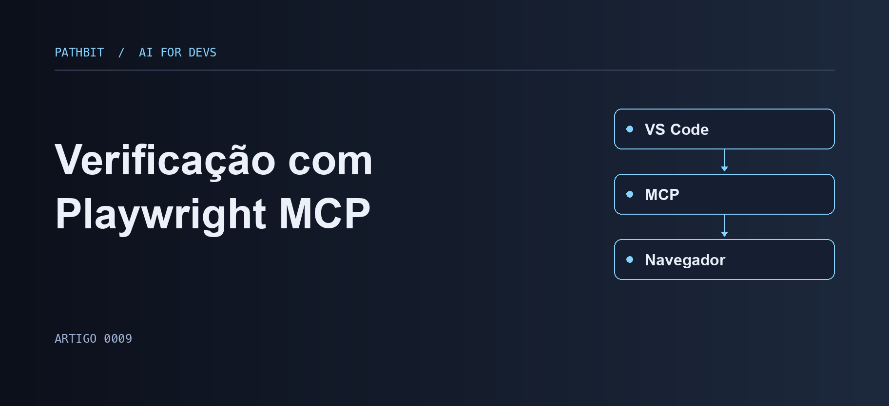

# Como verificar um formulário local com Playwright MCP no VS Code

O código de um formulário de frete pode parecer correto no diff. O navegador ainda pode exibir uma mensagem diferente, anexar um rótulo ao campo errado ou deixar um erro depois de uma tentativa bem-sucedida. Com Playwright MCP, o assistente pode percorrer uma página local e registrar o estado que viu após cada interação.

## O que o servidor leva ao assistente

O VS Code inicia um servidor MCP que oferece operações como abrir uma página, obter seu estado e interagir com controles. O snapshot de acessibilidade descreve elementos por papel e nome, como a caixa de texto `CEP` e o botão `Calcular frete`. Isso ajuda a escolher controles a partir do que o navegador expõe ao usuário. [Repositório oficial do Playwright MCP](https://github.com/microsoft/playwright-mcp).

Abra `examples` como raiz do workspace. A [configuração MCP](../examples/.vscode/mcp.json) executa o servidor por `npx` com `--isolated` e `--headless`. O perfil isolado começa sem o estado de uma sessão de navegador pessoal. O VS Code pode pedir que você confie no servidor antes de iniciá-lo. Confira o pacote e o comando exibidos na interface. [Configuração de servidores MCP no VS Code](https://code.visualstudio.com/docs/copilot/customization/mcp-servers).

## Modele a experiência antes de pedir o teste

O formulário aceita um CEP no formato de oito dígitos, com hífen opcional. A validação é local e verifica o formato. O valor apresentado é fixo para demonstrar a interação.

| Ação | Resultado na região de status |
| --- | --- |
| Digitar `123` e calcular | `Informe um CEP com 8 dígitos.` |
| Corrigir para `01001-000` e calcular | `Frete simulado: R$ 12,00` |

Faça as duas ações na mesma abertura da página. A segunda etapa verifica também se a mensagem de erro foi substituída. Peça o papel e o nome acessível dos controles, o texto realmente observado e a evidência usada para concluir a verificação.

## Show-Me-The-Code

1. Siga o [guia rápido](../README.md) para servir a pasta `site` em `127.0.0.1:19890` e iniciar o MCP no VS Code.
2. Rode o [prompt pronto](../examples/README.md) com a ferramenta Playwright disponível no chat. O roteiro usa somente a aplicação de exemplo e dados fictícios.
3. Compare o relato com a tabela e repita manualmente a sequência se a resposta omitir o estado após um clique.

Se a página não abrir, confira se o servidor HTTP continua no terminal e se a URL usa a mesma porta. Se o Playwright reportar um executável ausente, confira se o Google Chrome está instalado. Quando o fluxo se repetir com frequência, registre o caso como um teste Playwright com as duas asserções no texto de status. Assim o CI pode executar a mesma verificação sem depender do relato do assistente. [Asserções do Playwright Test](https://playwright.dev/docs/test-assertions).

---

Developed with ❤️ by [Pathbit](https://pathbit.co/)
