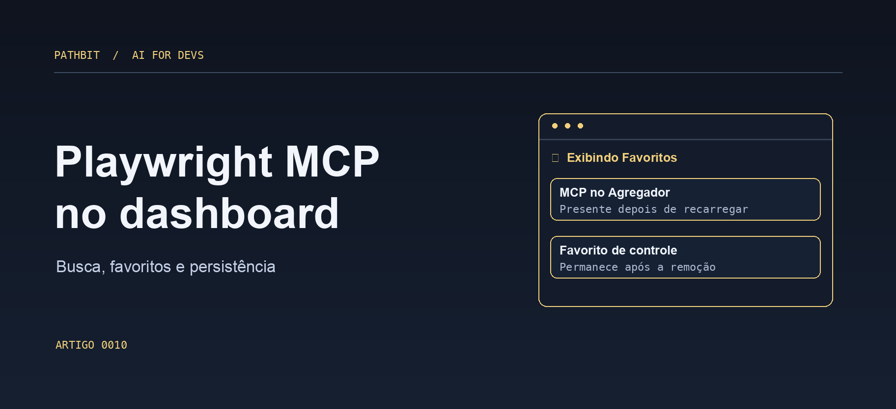
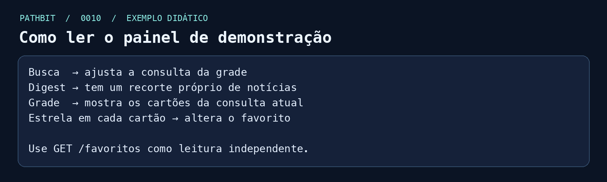
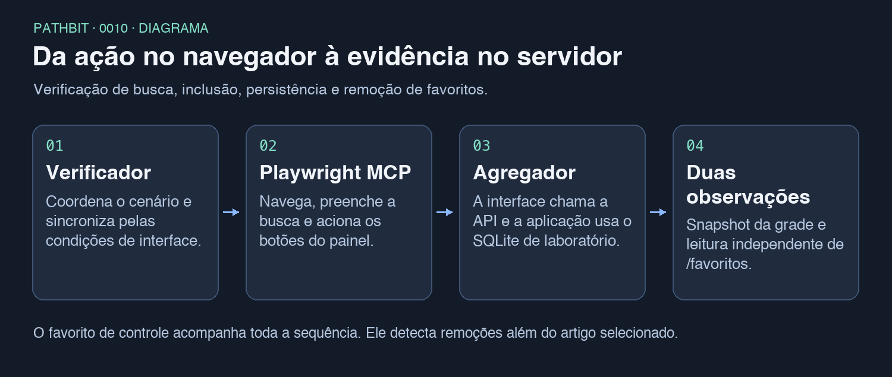
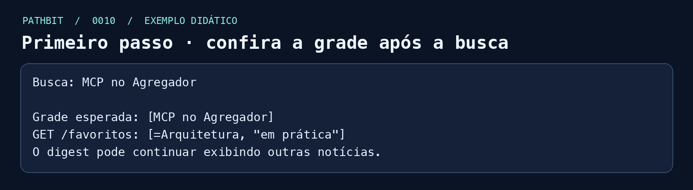
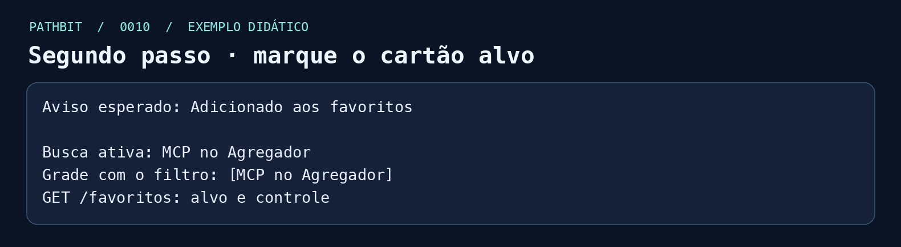
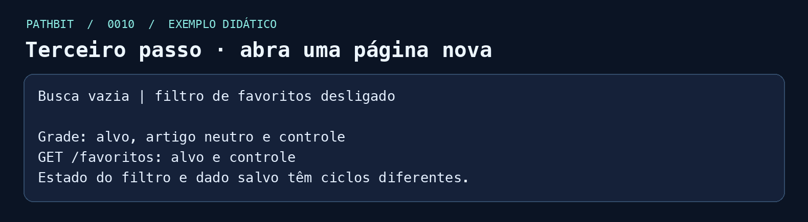
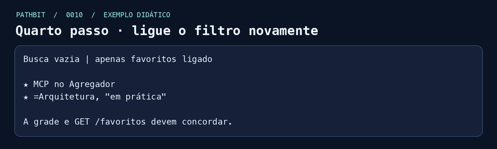
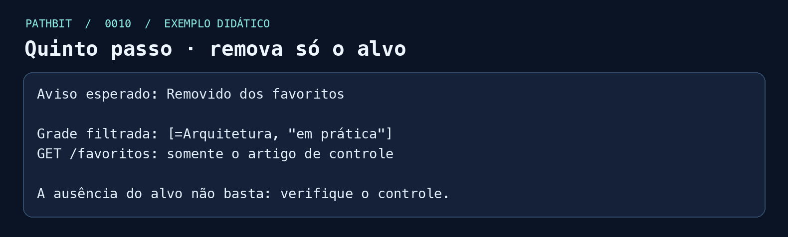

# Playwright MCP e o teste que o seu agente precisa ver para acreditar



No [artigo 0005](../../0005_sdd_do_vibe_coding_a_engenharia_deterministica/article/ARTICLE.md), colocamos o Agregador de Notícias de pé com seis especificações. Uma delas descreve uma operação simples de explicar para qualquer pessoa. Você salva uma notícia, abre a lista de favoritos amanhã e encontra a notícia lá. Do ponto de vista do código, isso passa por uma estrela no HTML, um evento no JavaScript, uma chamada HTTP, uma alteração no SQLite e outra leitura quando a tela é aberta de novo. Qual dessas coisas o seu agente verificou quando disse que Favoritos funciona?

Imagine um patch que muda a estrela imediatamente após o clique. A captura fica ótima. Na sessão seguinte a estrela volta ao estado anterior. Talvez o servidor tenha rejeitado a escrita. Talvez o botão tenha só mudado o estado da página. Talvez a escrita esteja certa e a próxima consulta use o filtro errado. Quem olha apenas uma imagem vê a mesma estrela para três problemas diferentes. Já quem olha só o retorno da API perde o caso em que o dado foi salvo e nunca chegou à tela.

Vamos montar a verificação que distingue esses casos. O Claude Code conversa com um servidor **Playwright MCP**. O navegador abre o **dashboard original do Agregador**, com Express e uma base SQLite descartável. O roteiro mexe em três notícias conhecidas, atravessa carregamento, busca, escrita, recarga e remoção, e compara o que a pessoa vê com a resposta da API correspondente. Ao fim, você tem o roteiro para o agente, um verificador executável e o raciocínio para adaptar os dois a um projeto seu.



> Este é o mapa do painel. Observe onde ficam o campo de busca, o digest e a grade. O teste distingue essas regiões antes de procurar o resultado do filtro.

## O teste começa por uma afirmação que alguém consegue contradizer

O pedido “abra a tela e veja se Favoritos funciona” não diz o que deveria continuar verdadeiro depois que a página for embora. Também permite que o agente confirme o caso mais fácil. Se a base já tem um favorito, ele pode abrir o filtro, ver um cartão e responder que conseguiu favoritar. Para evitar isso, comece com o estado inicial e escreva o que deve mudar a cada ato.

| Passo | Estado da interface que precisamos ver | Estado esperado no servidor |
| --- | --- | --- |
| Carregar a base de demonstração | A grade mostra os três artigos de exemplo | A lista de favoritos contém apenas o artigo de controle |
| Buscar `MCP no Agregador` | O alvo continua na grade e os outros dois saem | A busca lê os artigos e a lista de favoritos segue igual |
| Adicionar o favorito | A estrela do alvo muda e aparece “Adicionado aos favoritos” | A lista contém o alvo e o controle |
| Filtrar depois de recarregar | A busca e o filtro precisam ser configurados de novo. Depois de ligar Favoritos, alvo e controle aparecem | A mesma lista volta de uma nova leitura |
| Remover o alvo com o filtro ligado | O cartão do alvo sai e o controle fica | A lista volta a conter apenas o controle |

O artigo de controle faz mais do que decorar a base. Um bug poderia limpar todos os favoritos quando a pessoa remove só um. Se o teste começasse com lista vazia e usasse apenas um artigo, o bug passaria. Ter também um artigo que nunca foi favoritado impede que o teste aceite um filtro que apenas mostre todo mundo. A estrutura da base tem motivo em cada linha.

Agora compare os dois possíveis relatórios do agente. “Favoritos funciona” cabe em quase qualquer situação. “Depois de recarregar, liguei o filtro de novo, vi MCP no Agregador e o controle na grade e li os mesmos dois títulos em `GET /favoritos`” aponta para observações que você pode repetir.

## A arquitetura completa entre o pedido e o SQLite

O Model Context Protocol dá ao cliente um modo de descobrir ferramentas e pedir que o servidor as execute. No nosso arranjo, o Claude Code faz a requisição MCP e o pacote da Microsoft decide como executar a operação com Playwright. O navegador acessa o seu servidor HTTP como um navegador normal. São duas conversas diferentes, com falhas e evidências diferentes.



> **Figura 1.** O caminho do clique segue do verificador ao browser pelo MCP. A consulta separada à API ajuda a conferir a mudança persistida. A captura da grade e a leitura de `/favoritos` respondem a perguntas diferentes.

Por que separar o transporte? Porque “servidor conectado” quer dizer que o cliente conseguiu conversar com o processo do Playwright. O Express pode continuar desligado. E “página aberta” quer dizer que o navegador chegou ao endereço. Os cartões ainda podem estar carregando ou podem ter recebido uma resposta de erro. Separe as observações de infraestrutura das observações de comportamento.

| Fronteira | Quem controla | Primeiro sinal de diagnóstico |
| --- | --- | --- |
| Cliente e servidor MCP | Configuração do projeto, `npx` e aprovação no Claude Code | Estado exibido por `claude mcp get playwright` |
| Servidor MCP e navegador | Playwright, binário do Chrome e contexto isolado | Conseguiu abrir a página e obter um snapshot |
| Navegador e aplicação | Porta, origem, HTTP e JavaScript da página | Cabeçalho do dashboard, requisição ou erro de conexão |
| API e estado persistido | Rota de artigos, serviço e banco SQLite | `GET /favoritos` antes e depois de cada escrita |

Há dois caminhos para executar o artigo. Na sessão interativa, você entrega o roteiro ao Claude Code, revisa a ferramenta que ele pretende usar e pede o relatório por etapa. No caminho direto, o [verificador Python](../examples/verify_dashboard.py) usa o mesmo pacote MCP, lê os mesmos dados de exemplo e faz verificações definidas no código. O verificador começa com `initialize`, confirma a inicialização e chama `tools/call` para cada ação. Isso permite repetir a prova do dashboard mesmo quando você só quer isolar uma falha da integração de navegador. [Servidor oficial do Playwright MCP](https://github.com/microsoft/playwright-mcp) · [MCP no Claude Code](https://code.claude.com/docs/en/mcp).

### O que significa se uma chamada MCP deu certo

O verificador precisa distinguir três respostas. A primeira é um erro da solicitação JSON-RPC, como método inválido, que chega no campo `error`. A segunda é a falha da ferramenta, que pode chegar com `isError` no resultado mesmo quando a conversa do protocolo funcionou. A terceira é uma execução bem-sucedida do Playwright que devolveu uma página em estado diferente do esperado. Neste último caso, a asserção do cenário levanta o erro. Um cliente que só confere a presença de `result` perde as duas últimas situações.

Ao inicializar por `stdio`, o verificador envia `initialize` e a notificação `notifications/initialized`. Em seguida, cada pedido `tools/call` leva o nome da ação e seus argumentos, como `browser_snapshot` e o escopo `#articlesGrid`. A notificação não pede uma resposta. O cliente usa o identificador da requisição para aguardar o resultado do pedido certo. Isso dá à falha três endereços verificáveis: inicialização, execução de ferramenta e contrato da tela.

A montagem continua direcionada à versão do servidor usada no exercício. Se você atualizar o pacote, confira os nomes e os argumentos das ferramentas antes de interpretar uma falha como regressão do Agregador. Para descobrir o que a versão servidora anuncia, um cliente MCP pode consultar `tools/list`. Para descobrir o que o produto serviu, capture a grade ou consulte a rota do exercício. As duas observações vêm de lados diferentes do browser.

## Leia o código do produto antes de escolher a asserção

A interface tem uma grade em `#articlesGrid` e um digest acima dela. Ambos conseguem mostrar o mesmo título. A busca mexe na grade e mantém os destaques do digest. Se a asserção procura a notícia na página inteira, ela pode encontrar um link do digest e passar enquanto o cartão sumiu. O mesmo erro funciona ao contrário. Procurar se um título saiu da página inteira falha se o digest ainda o exibe, mesmo que a busca esteja correta.

No [HTML do Agregador](../../0005_sdd_do_vibe_coding_a_engenharia_deterministica/src/public/index.html), `carregarArtigos()` constrói uma URL com `limit=60` e acrescenta `categoria`, `busca` e `favoritos=true` conforme o estado da interface. O digest usa outra rota. A correção do teste vem desse contrato, não de um número gravado na tela.

| Elemento ou rota | O que representa | Como usar no roteiro |
| --- | --- | --- |
| `#searchInput` | Texto que a pessoa digita para filtrar | Use a entrada real do navegador e espere a grade |
| `#articlesGrid` | Resultado da consulta atual com filtros | Delimite presença e ausência dos títulos aqui |
| `#digestList` | Destaques calculados separadamente | Pode mostrar um título que saiu da grade |
| `#btnToggleFavoritos` | Preferência transitória da página | Ative de novo depois da recarga |
| `GET /favoritos` | Leitura dos itens marcados no banco | Compare o conjunto de títulos a cada escrita |

O detalhe do atraso importa. O campo de busca espera **300 ms** desde a última digitação para aplicar o novo filtro. Esse tempo aparece no código da aplicação, mas a prova não precisa dormir 300 ms exatos. Automações que esperam um intervalo fixo ganham um problema nos dois lados. Em uma máquina rápida deixam o teste mais lento. Em uma máquina lenta ainda podem observar o estado anterior. Espere a condição de interesse, como a saída do artigo de controle da grade.

A escrita também tem mais de um passo. `toggleFavorito` faz um `POST` ou `DELETE`, carrega de novo a grade, atualiza os dados do digest e mostra o aviso. A [rota de artigos](../../0005_sdd_do_vibe_coding_a_engenharia_deterministica/src/routes/artigos.js) chama `setFavorito`, e a [rota de favoritos](../../0005_sdd_do_vibe_coding_a_engenharia_deterministica/src/routes/favoritos.js) lê os itens marcados. Esse percurso é o que o teste atravessa. Ele não chama primeiro `POST` pelo Python para depois tentar “provar” no navegador que o clique escreveu.

## Escolha a ferramenta para o tipo de prova que você procura

Se a tarefa é descobrir por que um cartão aparece sem título, abrir a página com o MCP permite observar a estrutura e explorar o defeito sem escrever uma suíte inteira de saída. Se a equipe já conhece o contrato e roda a mesma prova em todo PR, um teste direto de Playwright tende a dar mensagens de erro mais controladas e um custo previsível. Um teste HTTP da rota é ainda mais simples quando a dúvida está apenas no SQLite ou no contrato JSON.

| Pergunta | Ferramenta que costuma responder mais rápido | O que ela pode deixar escapar |
| --- | --- | --- |
| O serviço alterou a linha certa? | Teste HTTP e consulta ao contrato | Renderização e interação da tela |
| O cartão certo saiu da grade? | Asserção de estado no navegador | Causa da falha sem consultar requisições ou a API |
| Como reproduzo um defeito que ainda não conheço? | Sessão com Playwright MCP e investigação orientada | Roteiros exploratórios podem seguir caminhos diferentes |
| A entrega pode ser verificada todo dia? | Código e dados de teste fixos, com relatório e asserções | Risco de checar apenas estados simplificados |

O verificador do artigo fica entre as duas últimas opções. Usa a integração real com Playwright MCP, mas a sequência e os critérios são fixos. Isso é conveniente para ensinar o protocolo e checar a demonstração. Em um repositório com dezenas de cenários, faz sentido considerar um runner de testes que configure processos, isolamento, traces e paralelismo em um lugar comum. [Asserções do Playwright](https://playwright.dev/docs/test-assertions).

## Prepare uma cópia que você consegue invalidar e recriar

O [script de preparo](../../tools/prepare_aggregator_lab.py) copia o código fonte, os testes e os manifests do Agregador para outro diretório. A demonstração usa Node.js 22 porque o aplicativo depende do módulo nativo de SQLite. Instale as dependências com o mesmo runtime que iniciará o processo. Use Python 3.10 ou posterior, npm e Google Chrome para o verificador. A sessão interativa também precisa de Claude Code disponível e autenticado.

Na raiz do repositório, use um shell compatível com Bash. Este é o terminal da aplicação.

```bash
repo="$(pwd -P)"
lab="$(mktemp -d)"
python3 tools/prepare_aggregator_lab.py "$lab/app"
cd "$lab/app"
npm ci

cp "$repo/0010_playwright_mcp_agregador/examples/.mcp.json" .mcp.json
export HOST=127.0.0.1 PORT=19810 DATABASE_PATH="$PWD/data/lab.sqlite"
node "$repo/tools/seed_aggregator_lab.mjs"
printf 'Pasta do laboratório: %s\n' "$PWD"
npm start
```

Anote a pasta impressa. Um segundo terminal pode começar na raiz da série para rodar o verificador ou na pasta da aplicação para abrir Claude Code. Se você usar outro porto, a URL do navegador, as consultas HTTP e o argumento `--url` do verificador precisam apontar para ele. Uma resposta válida de outro Agregador no mesmo computador pode levar o teste a validar o servidor errado.

A carga de dados só funciona numa cópia criada pelo script de preparo. Ela escreve no arquivo `data/lab.sqlite` daquela pasta. A base traz:

- **MCP no Agregador**, que começa sem a estrela marcada e é o alvo do roteiro.
- **Roteamento no OpenCode**, que começa fora de Favoritos e ajuda a distinguir a busca da lista completa.
- **=Arquitetura, "em prática"**, que começa marcada e precisa continuar assim depois da remoção do alvo.

Esses registros são gravados diretamente e têm links de exemplo. A automação verifica os cartões sem abrir esses links. A cópia traz a mesma lógica dos botões de importação e geração de resumo, mas o roteiro de Favoritos não usa nenhum deles. Indique o caminho exato ao agente para que a sessão fique nos dados de demonstração.

Antes de pedir o clique a qualquer cliente, faça uma leitura da lista original em outro terminal.

```bash
curl -fsS http://127.0.0.1:19810/favoritos |
  python3 -c 'import json, sys; print([item["titulo"] for item in json.load(sys.stdin)])'
```

O conjunto deve ter apenas o favorito de controle. Se o alvo já aparecer, a primeira transição não poderá ser comprovada. Isso acontece quando se interrompeu uma execução depois de uma escrita, antes da remoção. Para repetir de modo comparável, use uma cópia nova. O verificador detecta esse estado antes de tocar na interface.

## Registre o servidor MCP na pasta certa

Copie o arquivo [.mcp.json](../examples/.mcp.json) para a raiz da cópia. A configuração abaixo é a mesma usada pelo verificador, com a versão do pacote fixada para que os nomes de ferramentas e os argumentos coincidam com os mostrados neste artigo.

```json
{
  "mcpServers": {
    "playwright": {
      "type": "stdio",
      "command": "npx",
      "args": ["-y", "@playwright/mcp@0.0.86", "--browser", "chrome", "--isolated", "--headless"]
    }
  }
}
```

`stdio` indica que o cliente inicia o servidor e troca mensagens pelas entradas e saídas do processo. `--browser chrome` escolhe o Chrome instalado no computador. `--isolated` usa um perfil separado para o exercício. `--headless` roda sem janela, mas continua carregando páginas completas. É possível acompanhar pelos snapshots e por uma captura pedida na etapa observada. Uma configuração de projeto fica no projeto. O cliente do usuário pode pedir confiança no workspace e aprovação do servidor ao abrir a sessão. Revise os argumentos exibidos antes de aprovar. [Configuração de projeto no Claude Code](https://code.claude.com/docs/en/mcp).

Depois de iniciar o aplicativo acima, entre na pasta do laboratório com outro terminal e execute:

```bash
claude mcp get playwright
claude
```

Se a primeira chamada mostrar aprovação pendente, complete a aprovação na sessão interativa. O comando que lista a configuração e a ação que aprova o servidor são etapas diferentes. Confirme também que você abriu o Claude Code na cópia, não na raiz do catálogo. A cópia é onde o arquivo de projeto e o código do exercício estão juntos.

O isolamento de perfil evita pegar cookies e o estado do seu navegador pessoal. Ele tampouco restringe por si só todos os locais a que um browser consegue chegar. Mantenha o processo no ambiente de laboratório e as instruções na URL do Agregador. Ao adaptar para uma aplicação com autenticação, prepare dados e contas próprias de teste. Uma sessão que usa a sua conta real está em outro escopo, mesmo que o código do teste seja igual.

## Do snapshot ao clique no cartão certo

Um snapshot de acessibilidade é uma representação daquilo que o navegador expõe como controles, títulos, links e texto. Ele é mais econômico do que mandar todo o HTML para o modelo. Também é diferente de uma imagem. Uma página pode ter dois botões que parecem idênticos. O snapshot ajuda a verificar se eles têm nomes diferentes, mas nem todo nome visual se transforma no nome acessível que você esperava.

No Agregador, o título de atributo do botão é `Favoritar` ou `Remover dos favoritos`, conforme o estado. O conteúdo visível é uma estrela. Dependendo da representação do snapshot, o texto do botão pode vir como o próprio símbolo. Em uma grade com três cartões, “clique na primeira estrela” é uma receita frágil. Ordem muda, o filtro troca os cartões e a primeira estrela pode pertencer ao controle.

O verificador usa um localizador com identidade do cartão:

```text
#articlesGrid .article-card:has(a[href="https://example.org/mcp"]) .btn-fav
```

O começo recorta a grade. A parte do meio escolhe o cartão pelo link fixo da notícia de demonstração. O fim escolhe o controle dentro dele. O teste não navega até o link. Num produto seu, quando houver um nome acessível de ação com o título do artigo ou um identificador estável do componente, considere usar essa informação. Não ancore um teste recorrente em estilos ou posições de irmãos quando há um contrato melhor. [Localizadores do Playwright](https://playwright.dev/docs/locators).

O filtro causa uma nova renderização em `#articlesGrid`. O botão que você leu no snapshot anterior pode ter sido destruído e criado de novo. Se uma referência de elemento sair de validade, capture outro snapshot e procure novamente pelo cartão. Guardar uma referência antiga para todas as etapas funciona só enquanto a implementação da página não mudar. A identidade do artigo é parte do cenário. O número da referência é parte daquela observação.



> **Figura 2.** A busca encontra o alvo na grade. O digest no topo tem seu próprio recorte e pode continuar mostrando as outras notícias.

## O roteiro que o agente recebe

A primeira tarefa é verificar a aplicação correta. A segunda é registrar as evidências em ordem. O [roteiro de execução](../examples/scenario.md) separa esses pontos e pode ser colado no Claude Code após a aprovação da integração. Este é um pedido que dá ao agente a mesma fronteira de observação do verificador.

```text
Use o Playwright MCP para verificar o Agregador em http://127.0.0.1:19810/.
Trabalhe apenas na página local e nos artigos de demonstração.

1. Confirme o título e localize a grade de cartões, separada do digest.
2. Na busca, digite MCP no Agregador. Espere o estado da grade e registre
   o título encontrado e o título de controle que saiu da grade.
3. Favorite o cartão certo. Registre o aviso que o navegador mostrou.
4. Ligue Apenas Favoritos. Recarregue a página, ligue o filtro novamente
   e registre os dois favoritos presentes na grade.
5. Remova somente MCP no Agregador enquanto o filtro está ativo.
   Confirme que o cartão alvo saiu e o favorito de controle ficou.
6. Entregue uma tabela com passo, observação e evidência. Se houver falha,
   registre o estado e pare para diagnóstico.

Deixe o código e as fontes externas fora da execução.
```

Há uma diferença entre duas respostas superficiais que vale pegar logo na revisão. “Cliquei no botão e tomei um snapshot” descreve uma ação. “No novo snapshot, a grade tem o alvo e o controle, e o terceiro artigo não está dentro dela” descreve um resultado. Quando o modelo reportar só a ação, peça a observação e o recorte que a sustenta.



> **Figura 3.** Com a busca ainda preenchida, o filtro mostra apenas o alvo favoritado. A leitura da API encontra dois favoritos porque o controle continua salvo, fora do recorte da busca.

### O que sai de Favoritos quando você recarrega

Numa mesma sessão, o navegador guarda a preferência transitória no JavaScript da página. A variável `apenasFavoritos` começa em `false`. O filtro volta desligado quando a página é carregada de novo. A linha do SQLite segue marcada. Por isso a etapa de recarga tem dois movimentos. Primeiro observe a volta da grade completa. Depois ligue o filtro e confirme o conjunto de favoritos em uma consulta nova.

| Evento | Busca digitada | Filtro de favoritos | Linhas favoritas persistidas |
| --- | --- | --- | --- |
| Logo após favoritar | Alvo | Desligado até o clique do roteiro | Alvo e controle |
| Depois de ligar o filtro sem limpar busca | Alvo | Ligado | Alvo e controle, com só o alvo aparecendo na grade |
| Depois de recarregar | Vazia | Desligado | Alvo e controle |
| Depois de ligar o filtro novamente | Vazia | Ligado | Alvo e controle, ambos agora visíveis |
| Depois de remover o alvo | Vazia | Ligado | Controle |



> **Figura 4.** A recarga restaura a grade completa. Os ícones de favorito refletem a leitura de dados persistidos, enquanto a barra de busca e o filtro retornam ao estado inicial.



> **Figura 5.** Com “Apenas Favoritos” ligado novamente, os dois marcados aparecem. O destaque “Roteamento no OpenCode” pode permanecer no digest.



> **Figura 6.** Remover o alvo devolve a grade filtrada ao conjunto inicial. O controle com aspas e vírgula continua visível e a API também volta a listar somente esse item.

Essa diferença tem consequência prática também na especificação. Se o produto quiser preservar a preferência do filtro no endereço ou no armazenamento do navegador, escreva outro requisito. O roteiro acima descreve como funciona essa versão do Agregador. Aceitar a persistência de preferência como efeito colateral do teste confundiria dois comportamentos.

## Show-Me-The-Code

### Opção 1 com uma sessão interativa

1. Suba o Agregador descartável conforme o [guia de execução](../README.md) e confira a lista inicial com `curl`.
2. Na pasta da cópia, abra Claude Code e aprove o servidor Playwright MCP do projeto depois de revisar o comando.
3. Cole o roteiro. Peça ao modelo que registre o último snapshot da grade a cada alteração observada e confirme quais são os títulos de controle.
4. Faça uma leitura de `GET /favoritos` depois de favoritar e depois da remoção. O passo de diagnóstico termina quando a interface e a API concordam com a mesma etapa.

Se a missão é reproduzir um defeito, pare depois da primeira divergência entre o estado esperado e o observado. A tela naquele instante é informação útil. Repetir o clique muitas vezes pode corrigir temporariamente o comportamento e apagar a sequência que explicava o erro.

### Opção 2 com o mesmo servidor MCP e asserções fixas

Com o aplicativo rodando a partir da cópia, execute na raiz do repositório:

```bash
python3 0010_playwright_mcp_agregador/examples/verify_dashboard.py
```

A saída desta sequência é:

```text
Search narrowed the article grid.
Favoriting updated the UI and the server list.
Favorite persisted after a new page load.
Removal preserved the control favorite.
```

As frases estão em inglês porque são mensagens do verificador. O produto e o artigo continuam em português. São quatro pontos de controle independentes, emitidos depois das asserções que representam. A segunda linha, por exemplo, depende do aviso no browser e do conjunto devolvido por HTTP. A terceira envolve abrir a página novamente. O mesmo conjunto presente em memória na primeira aba não basta.

A seguir está o trecho que implementa a espera pela grade. É esta condição que distingue o teste da espera por um contador ou pelo sumiço de um título em toda a página.

```python
def wait_for_grid(mcp, *, present, absent=()):
    deadline = monotonic() + 10
    while monotonic() < deadline:
        snapshot = mcp.tool("browser_snapshot", target=GRID)
        if all(title in snapshot for title in present) and all(title not in snapshot for title in absent):
            return
        sleep(0.1)
    raise AssertionError(snapshot)
```

O intervalo de 100 ms é a cadência de leitura do estado, não uma estimativa do tempo que a feature precisa para funcionar. O prazo limita as tentativas de consulta ao snapshot. Se a chamada do servidor MCP travar por si só, o transporte precisa de seu próprio limite. Em código de CI, combine o prazo da asserção com um timeout do processo ou do job para que uma falha de infraestrutura também termine.

A primeira asserção HTTP espera exatamente um favorito de controle. A última asserção espera o mesmo resultado. Assim é possível executar o teste novamente depois de um resultado completo. Se a execução for interrompida entre a adição e a remoção, crie uma base nova. O script de semeadura não sobrescreve a preferência de um item já presente, então rodá-lo contra o mesmo arquivo não desfaz automaticamente a sequência interrompida.

### Confira a precondição quebrada de propósito

Uma verificação útil também falha quando a situação inicial deixou de ser aquela que o roteiro pressupõe. No navegador da cópia, marque primeiro “MCP no Agregador”. Agora rode o verificador completo. Ele deve parar na leitura inicial de `GET /favoritos` porque viu dois favoritos onde esperava um. Depois remova o alvo pela própria interface ou prepare uma cópia nova.

Esse exercício impede que o teste reutilize uma base de outra pessoa e publique um falso sucesso. Ele também explica por que há um artigo de controle e por que o padrão de loopback é explícito na CLI do verificador. O comando aceita `--url http://127.0.0.1:PORTA` para outra instância descartável na sua máquina. Use o endereço de um laboratório, pois o roteiro altera a lista de favoritos durante a prova.

## Localize a falha na camada que ainda responde

A parte mais útil de um cenário reproduzível é quando ele falha. Sem um estado inicial conhecido, toda falha parece um problema de rede. Com uma base e um roteiro estáveis, faça a próxima pergunta sobre a camada mais próxima da evidência.

| Sintoma | Conferência imediata | O que a conferência distingue |
| --- | --- | --- |
| O MCP não aparece na sessão | Revise a pasta atual, execute `claude mcp get playwright` e verifique a aprovação | Configuração da integração versus página indisponível |
| O navegador informa erro de conexão | Rode `curl -i http://127.0.0.1:19810/` fora da sessão | Servidor parado, porta trocada ou origem errada |
| A página abre, mas a grade nunca mostra os três títulos | Leia `/artigos` e compare o caminho SQLite usado na semeadura e no servidor | Base vazia, filtro ativo ou erro na leitura |
| A busca “falha” porque o título de controle ainda aparece no topo | Compare o digest com `#articlesGrid` | Escopo de asserção incorreto versus filtro incorreto |
| A estrela do alvo muda, mas ele some após recarregar | Compare `GET /favoritos` e a grade depois de reativar o filtro | Falha de gravação versus falha da interface |
| O item removido saiu e o controle também | Compare os IDs da chamada de remoção e a lista completa devolvida pelo servidor | Operação abrangente demais versus problema só no filtro |
| O verificador parou na primeira leitura de favoritos | Comece com uma base de demonstração recém-preparada | Estado inicial alterado por execução anterior |

Se o HTTP voltar com erro e o cartão mudar mesmo assim, investigue o tratamento da resposta antes de mexer no tempo de espera. Se o HTTP indicar sucesso e a leitura seguinte mostrar a linha certa, continue a investigação no JavaScript e no filtro. Use a mensagem que descreve o estado observado para formular o próximo experimento. “Teste falhou, tente de novo” só dá outra chance de não ver o defeito.

## Transforme o que você descobriu em uma verificação que o time pode repetir

Um roteiro de exploração tem liberdade para decidir qual botão procurar e qual estado merece uma captura. Essa liberdade é valiosa enquanto você está entendendo o defeito. Depois que o time concorda com os critérios, converta os pontos que comprovam o contrato em código. No Playwright Test, por exemplo, uma asserção `expect(locator).toBeVisible()` repete a leitura até o estado esperado ou até o prazo do teste. O mesmo mecanismo pode conferir ausência na grade. Trabalhe com os localizadores do produto e registre o contexto do estado anterior ao clique.

Ao promover esse teste para integração contínua, preserve a arquitetura do laboratório:

1. Inicie a versão exata do Agregador que será avaliada.
2. Crie uma base e uma porta para cada execução, com um nome que permita descobrir de qual processo veio a resposta.
3. Faça a consulta de prontidão antes de abrir o navegador. O servidor responder à raiz e a base conter os títulos são verificações distintas.
4. Ligue o trace ao cenário que falhou, se o runner adotado coletar esse recurso. Guarde os dados de teste e transfira somente os artefatos necessários ao diagnóstico.
5. Feche o navegador e o processo da aplicação após executar os casos. Dois testes em paralelo não podem gravar a mesma lista de favoritos e esperar estados independentes.

O contrato documentado neste artigo cobre busca, inclusão, recarga, remoção e a conservação de um favorito de controle. Adaptações para múltiplas contas, concorrência, outros navegadores e acessibilidade do controle têm casos próprios. Por exemplo, um teste com usuário A e usuário B precisa provar separação dos dados e usar autenticação de teste definida pela aplicação. Ele não se torna válido por executar a mesma captura duas vezes.

## Onde se encaixa na sequência da Pathbit

No [0006](../../0006_openspec_claude_code/article/ARTICLE.md), a change do OpenSpec dá um lugar à decisão e aos critérios. No [0007](../../0007_skills_claude_code/article/ARTICLE.md), uma Skill leva o agente aos arquivos e às perguntas certas. No [0008](../../0008_claude_code_worktrees/article/ARTICLE.md), o código de duas tarefas pode chegar a uma árvore integrada sem misturar as execuções. O [0009](../../0009_opencode_9router_ollama/article/ARTICLE.md) ajuda a saber qual modelo respondeu à sessão. Aqui a cadeia chega à pessoa que usa o produto. A fonte da evidência é o comportamento que a aplicação realmente serviu.

Quando alguém disser que Favoritos está concluído, peça a sequência que prova isso. Se há um cartão de controle, uma nova consulta e um estado final conhecido, o relatório pode ser revisto por quem nem abriu o terminal do primeiro agente. É nessa hora que a prova passa a servir à equipe.

## Referências

- [Playwright MCP e opções do servidor oficial](https://github.com/microsoft/playwright-mcp)
- [Configuração de servidores MCP no Claude Code](https://code.claude.com/docs/en/mcp)
- [Localizadores e escopo no Playwright](https://playwright.dev/docs/locators)
- [Asserções e repetição de condições no Playwright](https://playwright.dev/docs/test-assertions)
- [Roteiro, configuração e verificador deste laboratório](../examples/README.md)

---

Developed with ❤️ by [Pathbit](https://www.pathbit.com.br/)
