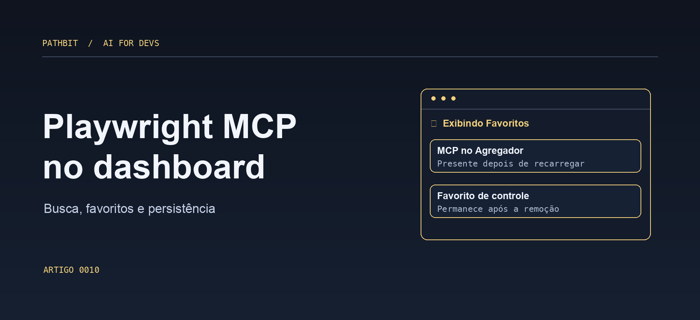
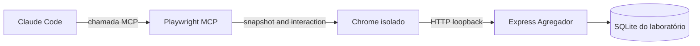

# Como usar Playwright MCP no Claude Code para verificar o dashboard do Agregador

Você pede ao agente que confirme se Favoritos funciona. Ele lê a rota, encontra o botão e diz que tudo parece correto. Ao abrir o navegador, você descobre que o primeiro clique atualiza a estrela, mas o item some depois de recarregar. Código, estado da página e estado persistido respondem perguntas diferentes. Para conferir essa funcionalidade, vamos observar o Agregador rodando em Chromium, atravessar o caminho que o leitor usa e comparar a interface com a lista que o servidor devolve.

Este artigo retoma o [dashboard do 0005](https://github.com/pathbit/pathbit-ai-for-devs/tree/master/0005_sdd_do_vibe_coding_a_engenharia_deterministica) e fecha a sequência iniciada no [0006](https://github.com/pathbit/pathbit-ai-for-devs/blob/master/0006_openspec_claude_code/article/ARTICLE.md). Usaremos o **Playwright MCP** no **Claude Code** com um processo do Agregador local e um banco SQLite de demonstração. Os dados têm títulos conhecidos, então o roteiro pode ser repetido sem depender de feed externo.

## O que conecta o Claude Code ao navegador

O servidor MCP executa ações de navegador e devolve observações. A API Express serve o dashboard e consulta o SQLite. O Claude Code pode usar o snapshot para descobrir o campo de busca, o cartão e o botão pelo papel e pelo nome expostos. A sessão do modelo e o navegador têm ciclos separados. Uma ação em MCP não muda os critérios que você pediu ao agente para verificar.

Em uma interação de favoritos, há pelo menos três evidências. A mensagem confirma que a tela recebeu a resposta da operação. A lista filtrada confirma que o cliente renderizou a atualização. Recarregar e refazer o filtro confirma que o estado veio de uma nova consulta. O laboratório também lê `GET /favoritos` para comparar a interface com o servidor. [Servidor oficial do Playwright MCP](https://github.com/microsoft/playwright-mcp) · [MCP no Claude Code](https://code.claude.com/docs/en/mcp).

## Prepare a aplicação original com dados que você controla

Prepare uma cópia com [o início rápido](https://github.com/pathbit/pathbit-ai-for-devs/blob/master/0010_playwright_mcp_agregador/README.md). O script copia `src`, testes e manifests do projeto do artigo 0005. Use Node.js 22, a mesma linha usada para instalar o SQLite nativo. A aplicação e o banco deste exercício ficam em um diretório diferente do clone original. O servidor escuta em `127.0.0.1:19810`.

| Artigo de demonstração | Estado inicial | Função no roteiro |
| --- | --- | --- |
| `MCP no Agregador` | Fora de Favoritos | Artigo que vamos buscar, favoritar e remover |
| `Roteamento no OpenCode` | Fora de Favoritos | Controle negativo da busca |
| `=Arquitetura, "em prática"` | Favoritado | Controle que continua presente depois da remoção |

O script de carga insere essas linhas sem consultar fontes externas. A tabela de fontes originais pode aparecer no dashboard, mas a verificação fica na lista de artigos já gravados. Evite clicar em Atualizar fontes durante o exercício. Ao repetir, recrie a cópia para começar com a mesma base, ou confirme os estados na API antes de seguir.

## Registre a integração no escopo do projeto

Copie [`.mcp.json`](https://github.com/pathbit/pathbit-ai-for-devs/blob/master/0010_playwright_mcp_agregador/examples/.mcp.json) para a raiz da cópia do laboratório. Essa é a configuração que o Claude Code usa para o escopo de projeto. O arquivo inicia `@playwright/mcp@0.0.86` com `npx`, canal `chrome`, perfil `--isolated` e execução `--headless`. O primeiro uso pode exigir download pelo npm e o Google Chrome precisa estar instalado. A tela de confiança do projeto e o pedido de aprovação do servidor permitem rever o comando executado.

O perfil separado evita misturar a sessão pessoal com a demonstração. O servidor ainda é capaz de navegar onde tiver acesso, então limite a instrução ao endereço local e acompanhe as ações. Use contas e dados descartáveis ao adaptar a técnica para um projeto com login. O [roteiro do módulo](https://github.com/pathbit/pathbit-ai-for-devs/blob/master/0010_playwright_mcp_agregador/examples/scenario.md) trabalha só com a URL de loopback.

## Leia o snapshot para localizar o controle de verdade

Peça primeiro que o agente abra a página, confira `Agregador de Notícias com Resumo por IA` e localize o campo com placeholder `Buscar por título, palavra-chave ou termo técnico...`. Digite `MCP no Agregador` e espere a lista refletir a busca. O campo usa atualização com atraso curto. Se o agente capturar a tela cedo, ainda pode ver o resultado da consulta anterior.

O botão de favoritos está no cartão de cada artigo e usa o título `Favoritar` ou `Remover dos favoritos`. O snapshot também expõe o texto visual de estrela. Use o cartão que contém o título do artigo para desambiguar botões iguais. Depois de clicar e receber a mensagem, procure `⭐ Apenas Favoritos`. O dashboard muda a legenda do filtro para `★ Exibindo Favoritos`. Essa mudança de texto é uma evidência de que o filtro foi ligado.

## Show-Me-The-Code

1. Siga o [roteiro](https://github.com/pathbit/pathbit-ai-for-devs/blob/master/0010_playwright_mcp_agregador/examples/scenario.md) em uma sessão com a integração aprovada.
2. Busque o artigo-alvo e confirme que o outro título de controle ficou fora dos cartões visíveis.
3. Favorite o artigo. Observe a mensagem `Adicionado aos favoritos` e confira a lista da API.
4. Ative o filtro, recarregue a página e ative-o novamente. O filtro é estado da interface e volta ao padrão no reload. A condição de favorito continua no banco.
5. Remova o favorito dentro da visão filtrada. O cartão alvo deve sair e o artigo de controle já favoritado deve permanecer.

| Passo | Evidência de navegador | Evidência HTTP |
| --- | --- | --- |
| Busca após digitar | Cartão do artigo alvo presente | A interface consultou `/artigos` com o filtro de busca |
| Favoritar | Mensagem e botão de estado atualizado | `GET /favoritos` inclui o alvo |
| Recarregar e filtrar | Cartão volta a aparecer em Favoritos | A leitura recupera o estado persistido |
| Remover | Cartão alvo sai e o controle permanece | `GET /favoritos` conserva apenas o controle |

O [verificador da demonstração](https://github.com/pathbit/pathbit-ai-for-devs/blob/master/0010_playwright_mcp_agregador/examples/verify_dashboard.py) usa o pacote MCP oficial, o mesmo dashboard e a API local para repetir a sequência. Para a sessão com o Claude Code, peça que ele devolva a etapa, a observação e a evidência. Se uma operação falhar, vale examinar o último snapshot e a resposta HTTP antes de propor qualquer alteração.

## O que repetir quando a interface muda

Se a aplicação demora, espere um texto ou o desaparecimento de um cartão. Pausas fixas tornam a execução sensível ao tempo do computador. Se um botão mudou de nome, leia o snapshot novo em vez de reutilizar uma referência antiga. Se o navegador confirma o clique e a lista volta diferente após recarregar, compare `GET /favoritos` com o teste da API do [artigo 0005](https://github.com/pathbit/pathbit-ai-for-devs/blob/master/0005_sdd_do_vibe_coding_a_engenharia_deterministica/tests/artigos.test.js).

Use o MCP para explorar, entender e documentar o que foi observado. Quando o fluxo estiver estabilizado, o mesmo cenário pode virar um teste Playwright com asserções de presença, ausência e persistência. Se mudar o contrato de favoritos, registre a mudança primeiro onde a equipe o acompanha. A interface, a API e a especificação ficam rastreáveis quando a evidência aponta para o mesmo comportamento.

[Repositório e arquivos do laboratório](https://github.com/pathbit/pathbit-ai-for-devs/tree/master/0010_playwright_mcp_agregador)

Developed with ❤️ by [Pathbit](https://pathbit.co/)
