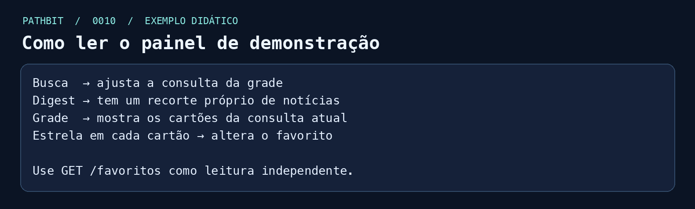
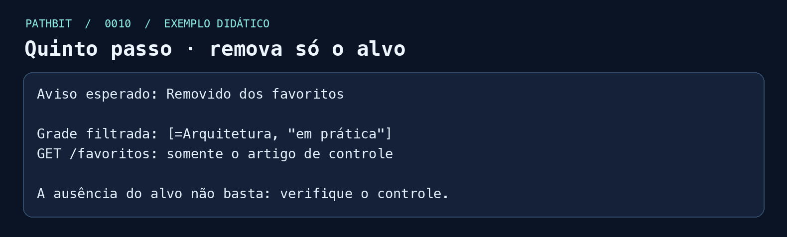

# A estrela mudou. Seu agente provou que o favorito ficou salvo?


Peça a um agente que verifique uma funcionalidade de favoritos e ele pode devolver um relatório impecável: abriu a tela, clicou na estrela, tirou uma captura. A imagem mostra a estrela marcada. Explica o que aparece na tela naquele momento. Agora feche a página, abra de novo e encontre exatamente o artigo que deveria estar guardado. Essa é a parte da história que o clique, por si só, deixa em aberto.

No artigo anterior sobre **Spec-Driven Development**, construímos um Agregador de Notícias com Express, SQLite e um dashboard web. O contrato de favoritos parece pequeno até você começar a atravessá-lo. Ele passa pelo botão do cartão, por uma escrita HTTP, pela coluna `favorito` no banco e por uma nova consulta. Um teste que examina só uma dessas etapas dá um diagnóstico parcial. Neste artigo, vamos repetir o caminho da pessoa que usa a tela com **Claude Code e Playwright MCP**, comparando o que aparece no navegador com o que o servidor realmente devolve.

## A especificação precisa de um antes e de um depois

Vamos propor um cenário que dá chance para a implementação falhar de formas úteis. Começamos com três artigos de demonstração.

| Registro | Estado inicial | Por que está no teste |
| --- | --- | --- |
| `MCP no Agregador` | Sem estrela | É o item que vamos buscar, marcar, reencontrar e remover |
| `Roteamento no OpenCode` | Sem estrela | Permite detectar se a busca ou o filtro mostra itens a mais |
| `=Arquitetura, "em prática"` | Favoritado | Tem de continuar marcado depois que removemos o alvo |

A terceira linha vale mais que uma tela bonita. Se a nossa base tivesse um único favorito, um bug que apagasse todos os favoritos passaria no passo da remoção. A interface ficaria vazia e o teste concluiria que removeu o item certo. Com um controle persistido, a prova precisa verificar duas afirmações juntas. O alvo sai e o controle fica.

Também precisamos da lista inicial. Se o artigo alvo já estiver favoritado por uma execução anterior, a demonstração começa depois da escrita que deveria comprovar. Abrir o filtro e encontrar dois artigos não diz se aquela sessão fez alguma alteração. O verificador começa lendo a API. Ele segue só quando a lista tem o controle e nenhum outro item.

## Quem fez o clique e quem salvou o dado?

O MCP conecta o cliente ao processo que oferece ferramentas. O cliente pede um snapshot ou um clique. O Playwright executa no navegador. O navegador fala com Express pela rede local. Express atualiza o SQLite quando recebe a operação. Cada parte tem uma resposta própria.

```text
Claude Code
   │ ferramenta MCP
Playwright MCP
   │ operação no navegador
Chrome isolado
   │ POST /artigos/<id>/favoritar
Express
   │ persiste alteração
SQLite
```

Há uma diferença importante entre a ferramenta devolver “cliquei” e a aplicação responder pela escrita. O clique pode executar mesmo quando a API devolve uma falha. A estrela pode mudar temporariamente, e a lista voltar vazia depois de carregar outra vez. Por isso, o roteiro passa pelo navegador para escrever e pela API para conferir. Se o teste marcasse primeiro pelo terminal, ele já teria alterado o estado antes da parte que quer provar.

A melhor forma de localizar um problema é perguntar qual fronteira respondeu. Se `claude mcp get playwright` aponta para uma configuração pendente, investigue o cliente e o servidor de ferramentas. Se a integração está conectada e o navegador não entra no endereço, confira a origem e a porta HTTP. Se a página abre e a API lê favoritos, investigue a grade e o estado de filtro. Esse encadeamento economiza tempo porque elimina tentativas aleatórias no lugar errado. [MCP no Claude Code](https://code.claude.com/docs/en/mcp) · [Servidor oficial Playwright MCP](https://github.com/microsoft/playwright-mcp).

## O bug pode estar no teste e não no seu produto

O dashboard do Agregador tem dois lugares onde a mesma notícia aparece. Em cima fica o digest. Abaixo vem a grade de cartões que responde aos filtros. A busca atualiza a grade, então o digest pode continuar exibindo “Roteamento no OpenCode” quando o cartão dessa notícia já saiu.

Uma asserção que procura o título na página inteira mistura duas responsabilidades. Às vezes falha com o produto correto. Às vezes passa com o produto quebrado. Para provar que a busca funcionou, recorte a observação a `#articlesGrid` e compare os títulos que pertencem àquele componente.

A escolha do botão tem uma armadilha parecida. Há uma estrela por cartão. “Clique na primeira estrela” depende da ordem que o HTML tiver hoje. No laboratório o verificador depende da identidade do cartão e só depois escolhe o botão dentro dele:

```text
#articlesGrid .article-card:has(a[href="https://example.org/mcp"]) .btn-fav
```

O endereço faz parte dos dados descartáveis e serve para localizar o cartão. O teste permanece na página do Agregador. Em um projeto com um nome acessível de ação inequívoco, procure o botão pelo papel e pelo nome dentro do componente. Se a aplicação renderizar a grade de novo, peça um snapshot atualizado antes de reaproveitar referências de elemento. [Localizadores do Playwright](https://playwright.dev/docs/locators).

### O que muda ao recarregar a página

No código desta versão, `apenasFavoritos` é uma variável JavaScript inicializada como `false`. A recarga apaga o filtro e o texto da busca da memória da página. O valor `favorito` que foi gravado permanece no SQLite. Para comprovar o requisito, carregamos de novo, observamos a grade normal, reativamos o filtro e comparamos os dois artigos com uma leitura nova do servidor.



> O diagrama aponta onde observar os cartões. Para conferir persistência no seu ambiente, recarregue e faça uma nova consulta à API.

Essa diferença muda a especificação. Se a equipe também quer que a **preferência do filtro** sobreviva à recarga, precisa dizer onde e por quanto tempo, e acrescentar outro cenário. O nosso caso prova a persistência do dado da notícia. A preferência da interface volta à configuração inicial.

## Prepare o laboratório com o código do artigo 0005

A série fornece um script que copia o Agregador original, os testes e os manifests para uma pasta temporária. A cópia usa Node.js 22 e instala o módulo nativo SQLite para esse runtime. O script de semeadura cria as três notícias no banco do exercício. Ele não precisa consultar feeds externos. Você precisa de Python 3.10+, npm e Google Chrome para rodar este percurso. Para usar o chat, também precisa de uma sessão autenticada no Claude Code.

A partir da raiz do repositório, inicie em um terminal:

```bash
repo="$(pwd -P)"
lab="$(mktemp -d)"
python3 tools/prepare_aggregator_lab.py "$lab/app"
cd "$lab/app"
npm ci
cp "$repo/0010_playwright_mcp_agregador/examples/.mcp.json" .mcp.json
export HOST=127.0.0.1 PORT=19810 DATABASE_PATH="$PWD/data/lab.sqlite"
node "$repo/tools/seed_aggregator_lab.mjs"
npm start
```

O arquivo de integração usa o pacote `@playwright/mcp@0.0.86`, transporte `stdio` e Chrome com perfil isolado. Abra o Claude Code na pasta da cópia e confira a aprovação do servidor. Usar o perfil separado evita misturar as contas do seu browser pessoal com os dados do exercício. O endereço autorizado no roteiro é o do laboratório local. Ao adaptar para outro sistema, registre quais contas, operações e dados estão em escopo antes de dar o primeiro clique.

## A prova em quatro pontos

**Busca.** Digite o título alvo e confira a grade depois da atualização. O Agregador usa um debounce de 300 ms. Espere o resultado aparecer em vez de decidir que um atraso fixo sempre basta. O digest e referências antigas de elementos ficam fora da asserção.

**Escrita.** Marque a estrela no cartão certo. Observe “Adicionado aos favoritos” e consulte `GET /favoritos`. A lista precisa conter o alvo e o controle. Isso dá ao diagnóstico um ponto antes da recarga.

**Persistência.** Abra novamente o dashboard, ative “Apenas Favoritos” e procure os dois cartões. Comparar o que a grade mostra com uma leitura do servidor ajuda a separar falha de escrita de falha de filtro.

**Remoção.** Na visão já filtrada, remova apenas o alvo. A grade volta a mostrar só o controle. A API também volta a devolver aquele conjunto. O teste terminou no mesmo estado em que começou, o que torna a repetição comparável.

Peça ao Claude Code um relatório com passo, observação e evidência de cada transição. Se a primeira diferença ocorrer na busca, pare nessa etapa e preserve o snapshot. Tratar uma falha no começo como se fosse um sucesso até a remoção só dificulta descobrir onde a execução divergiu.



> O quadro ilustra o estado esperado após remover o alvo. O filtro segue ativo e a grade tem só o controle. Faça também uma leitura independente de `GET /favoritos`.

## O mesmo experimento sem depender da conversa com o modelo

Na raiz da série, com a aplicação ainda rodando, execute:

```bash
python3 0010_playwright_mcp_agregador/examples/verify_dashboard.py
```

O script inicia o mesmo servidor MCP, envia as operações de navegador em ordem e verifica os dados lidos do Express. Ele emite uma linha depois de cada conjunto de asserções concluído:

```text
Search narrowed the article grid.
Favoriting updated the UI and the server list.
Favorite persisted after a new page load.
Removal preserved the control favorite.
```

Você pode comparar o resultado do roteiro no chat com o verificador. Se o agente disser que o fluxo passou e o script divergir, leia quais condições cada um realmente observou. O verificador precisa da base inicial do laboratório. Se você parar depois de favoritar, prepare outra cópia para repetir o caso completo.

## Leia os sinais quando o cenário falhar

Se o MCP abrir a URL e a grade continuar vazia, confira o terminal da aplicação e consulte `/artigos`. O servidor pode estar atendendo com outro banco. O filtro também pode carregar uma lista vazia por uma requisição que falhou, embora o HTML do dashboard apareça. Comece pelo contrato que consegue testar diretamente.

Se a estrela mudar e `GET /favoritos` continuar devolvendo apenas o controle, espere a conclusão da gravação e confira a resposta HTTP da ação. Uma animação local pode acontecer antes da confirmação do backend. Se a API mostrar ambos depois da recarga, mas o filtro da grade esconder um deles, confira a busca, a URL consultada e o escopo do snapshot. Já dá para restringir o diagnóstico à leitura ou renderização da tela.

Quando o controle sumir junto com o alvo, a identidade usada para clicar e o conteúdo do novo conjunto são evidências melhores do que uma contagem. Duas listas com um item podem conter artigos diferentes. Essa é a razão de o verificador comparar quais são os títulos, além de olhar a estrela.

### Onde isso entra num projeto de verdade

Use o MCP para explorar comportamento novo, reproduzir relatos e descobrir quais elementos representam as transições. Depois que a equipe concordar com a prova, os pontos críticos podem ir para uma suíte com asserções, dados fixos e ambiente independente por execução. Se dois testes modificarem a mesma lista de favoritos em paralelo, nenhuma boa asserção vai compensar a inconsistência da base.

Comece pequeno. Pegue uma ação que envolve estado persistido em seu produto e escreva o que deve aparecer antes, logo depois e depois de carregar de novo. Acrescente um item de controle que não pode mudar. Entre uma estrela e o estado que sobrevive ao dia seguinte está a diferença entre executar um clique e comprovar um contrato.

[Abrir o artigo completo e o laboratório da Pathbit no GitHub](https://github.com/pathbit/pathbit-ai-for-devs/tree/master/0010_playwright_mcp_agregador)

#Playwright #MCP #ClaudeCode #SpecDrivenDevelopment #EngenhariaDeSoftware #Pathbit
