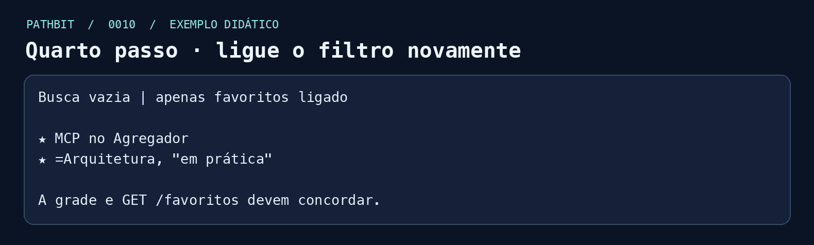

# Seu agente clicou na estrela. O artigo ainda está lá amanhã?

Um clique no botão de favoritos pode atualizar a estrela antes de você saber se a gravação deu certo. Por isso, na continuação da série Pathbit AI for Devs, voltamos ao Agregador de Notícias construído com SDD e fizemos a mesma verificação que uma pessoa faria.

1. Buscar uma notícia e conferir que a grade trouxe o cartão certo.
2. Favoritar e comparar o aviso da tela com a lista que a API devolve.
3. Recarregar a página, ligar o filtro novamente e reencontrar o artigo.
4. Remover só a notícia escolhida e confirmar que o favorito de controle permaneceu.

O laboratório conecta Claude Code ao Playwright MCP, usa o dashboard original e começa com três notícias em uma base SQLite descartável. A figura mostra o resultado esperado depois da recarga. O artigo explica como obter esse resultado e conferir a lista de favoritos na API.

Se você tivesse de escolher uma ação do seu produto para verificar desse jeito, qual precisaria sobreviver a uma recarga?

[Artigo e comandos do laboratório no GitHub](https://github.com/pathbit/pathbit-ai-for-devs/tree/master/0010_playwright_mcp_agregador)

#Playwright #MCP #ClaudeCode #EngenhariaDeSoftware #Pathbit
